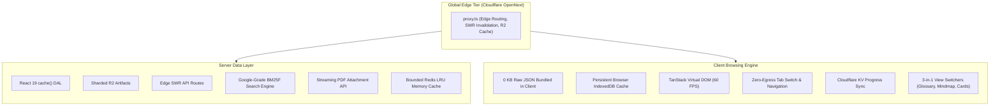

# Modern Data Engineer & Lakehouse Architect (`moderndataengineer.uk`)

<p align="center">
  
</p>

<p align="center">
  <a href="https://nextjs.org/"></a>
  <a href="https://react.dev/"></a>
  <a href="https://www.typescriptlang.org/"></a>
  <a href="https://vitest.dev/"></a>
  <a href="https://developers.cloudflare.com/workers/"></a>
  <a href="LICENSE"></a>
  <a href="SECURITY.md"></a>
</p>

> **The Definitive Open-Access Enterprise Data Engineering & Lakehouse Systems Encyclopedia**  
> 11,500+ verified scenarios, system design drills, and high-resolution architecture blueprints covering **Microsoft Fabric (DP-600), Databricks, Apache Spark 4.0, Delta Lake, Apache Iceberg, Unity Catalog, dbt, Apache Airflow, and Medallion Lakehouse Architecture**.  
> 
> 🌐 **Live Web Application**: **[https://moderndataengineer.uk](https://moderndataengineer.uk)**  
> 📦 **Sister Repository**: **[The PySpark Handbook (105 Production Recipes)](https://github.com/santoshjammi29/pyspark-handbook)** • **[Azure Enterprise Cheat Sheet](https://github.com/santoshjammi29/azure-cheat-sheet)**

---

## 🏛️ System Architecture

Built on a **Zero-Bundle, Zero-Egress, Edge-Native Architecture**: massive data catalogs stay strictly server-side within React 19 `cache()` Data Access Layers (DAL), serving zero-bundle lightweight JSON payloads to 60 FPS virtualized client surfaces (`@tanstack/react-virtual` + HTML5 `<canvas>`). Large dataset shards are persistently cached in the browser's IndexedDB (`idb`), guaranteeing **0 bytes of repeat network egress** across tab switches and page reloads:



---

## 📊 Curated Data Inventory (11,500+ Assets)

The platform hosts the industry's most rigorous, verified repository of data engineering scenarios, system design benchmarks, and architecture blueprints:

| Category | Module / Dataset | Count | Focus & Architectural Scope |
| :--- | :--- | :---: | :--- |
| **System Design** | Architecture Scenarios | **3,206** | End-to-end cloud designs, trade-off matrices, failure modes & 36-keyword multi-domain filter deck. |
| **Technical Q&A** | Data Engineering Practice | **3,615** | Distributed compute, streaming CDC, pipeline reliability & lakehouse design. |
| **Technical Q&A** | Core Platform Questions | **3,232** | Deep internals across Fabric, Power BI, Synapse, ADF, Spark & SQL Server. |
| **Staff+ Mastery** | Extreme Architect Scenarios | **125** | High-pressure Staff/Principal interview design problems across 5 domain blocks. |
| **Core Concepts** | Architectural Concepts | **679** | 14 pillars: Fabric, Databricks, Lakehouse, Spark, Power BI, ADF, Airflow, dbt, FinOps, etc. |
| **Curriculum** | Databricks 100 Mastery | **100** | 100-day structured roadmap with certification mappings (DE Associate & Pro). |
| **Visual Design** | Whiteboard Blueprints | **42** | High-resolution digital hand-drawn blueprints with 5 role perspectives (Architect, Senior DE, DE, Steward, BA), failure triage & engine mechanics across 7 domains. |
| **Modern Stack** | Modern Architecture Blueprints | **18** | End-to-end modern lakehouse, vector pipeline, and CDC stream blueprints. |
| **Enterprise Guide** | GCC Enterprise Directory | **156** | Tier-1 Global Capability Centers (Bangalore/Hyderabad) with hiring rubrics & tech stacks. |
| **Coding Practice** | Engine Benchmark Exercises | **178** | Hands-on PySpark (51), Spark SQL (50), Python/DataOps (42), and MSSQL (35). |
| **Databricks Hub** | Unified Databricks Operations | **148+** | 48 suite cards + 100 architectural operations + 6 production memory triage playbooks. |
| **PDF Downloads** | Compiled Master Vector PDFs | **7** | Production vector PDFs (Architecture, PySpark, Python, Spark Core, Spark SQL, Incident Runbooks, Master Ref). |
| **Reference** | Cheatsheet Card Suites | **124** | 48 Databricks suite cards + 76 quick reference cards (Web, PDF, Poster). |
| **Polyglot Matrix** | Multi-Engine Code Matrix | **15** | Comparative code execution matrix across Databricks, Snowflake, BigQuery, Fabric, and DuckDB. |
| **Lakehouse FinOps** | Modern Cost Playbooks | **15** | Cloud Lakehouse FinOps & compute cost reduction playbooks with risk assessments. |
| **Roadmaps** | Learning Paths | **12** | Structured certification paths for DP-600, DP-203, PL-300, and Databricks. |

---

## 🎨 Enterprise Whiteboard Blueprints (42 Architect-Grade Blueprints)

All 42 blueprints are rendered as high-fidelity hand-drawn digital schematics (available in `src/data/diagrams.ts` and `/public/diagrams/` in WebP & AVIF formats) grouped into 7 core architectural domains. Every single blueprint has been elevated with **exhaustive technical granularity and multi-persona engineering depth**:

- **5 Distinct Role Perspectives per Blueprint**:
  - 🏛️ **Lead Data Architect**: Macro system design, multi-cloud federation, SLA/SLO definition, FinOps unit economics, disaster recovery.
  - ⚙️ **Senior / Staff Data Engineer**: Low-level engine internals, CPU cache line alignment, AST query plans, off-heap Tungsten memory, shuffle spill triage, ACID log serialization.
  - 🔧 **Data Engineer**: Daily ELT pipeline engineering, partition/clustering choices, idempotency, streaming checkpoints, schema evolution, and CDC ingestion.
  - 🛡️ **Data Steward & Governance**: Unity Catalog 3-level namespace (`catalog.schema.table`), Purview lineage graphs, dynamic row/column masks, PII classification, and GDPR deletion workflows.
  - 📊 **Business Analyst & BI**: Power BI Direct Lake sub-second DAX response, VertiPaq memory limits, metric consistency across dimensional bus matrices, and self-service exploration.
- **Executive Architect Manifesto (`architectNotes`)**: Explicit trade-offs, scaling limits, anti-patterns, and cost burndown models.
- **Under-the-Hood Technical Mechanisms**: 4–6 concrete engine mechanisms per blueprint (e.g. V-Order Parquet sorting, Netty socket buffers, HNSW vector indexing, RocksDB LSM memtables, OCC commit protocols).
- **Production Triage & Incident Runbooks**: Detailed incident cards featuring alert symptoms, root causes, and step-by-step engineering mitigations.
- **Interactive 4-Tab Lightbox Inspector**: Modal viewer across `/architecture` and `/whiteboards` enabling seamless switching between **Architecture & Pillars**, **5 Role Perspectives**, **Production Triage**, and **Governance & Compliance**.

| Architectural Domain | Count | Highlighted Production Blueprints |
| :--- | :---: | :--- |
| **Compute & Optimization** | **11** | Catalyst Optimizer & Photon Engine<br>• Shuffle & Memory Architecture<br>• Data Skew & AQE<br>• SaveMode Handling<br>• Join Strategy Decision Matrix<br>• Tungsten Spill Mechanics<br>• Structured Streaming State Store (RocksDB)<br>• Photon vs. JVM<br>• Broadcast & Accumulators<br>• SQL Server Engine Internals |
| **Storage Engines & Formats** | **8** | Delta Lake ACID Under the Hood<br>• Apache Iceberg Snapshot Tree<br>• Open Table Formats (Delta vs. Iceberg vs. Hudi)<br>• Open File Formats (Parquet vs. ORC vs. Avro)<br>• 6 Delta Optimization Levers<br>• Lakehouse ACID Concurrency Matrix<br>• SCD Types 0–6 in Medallion<br>• Master Enterprise Lakehouse Reference |
| **Pipelines & Ingestion** | **8** | Apache Airflow Distributed Architecture<br>• dbt Modern Analytics Engineering DAG<br>• Azure Data Factory Hybrid IR<br>• Kafka Event Streaming<br>• CDC with Debezium<br>• Databricks Medallion Architecture<br>• Delta Live Tables (DLT)<br>• Databricks Asset Bundles (DABs) & Serverless CI/CD |
| **Platform Landscape** | **5** | Databricks Unified Platform Master<br>• Enterprise RAG & Vector Data Pipelines<br>• Modern Python Data (Arrow, Polars, DuckDB)<br>• FinOps & Cloud Cost Optimization<br>• Enterprise Edge & IoT Architecture |
| **Microsoft Fabric & Power BI** | **4** | Microsoft Fabric Unified Architecture & OneLake<br>• Power BI Direct Lake & VertiPaq<br>• Power BI DAX Engine Mechanics & Context Transition<br>• Fabric OneLake Shortcuts & Direct Lake Mode |
| **Data Modeling & Architecture** | **4** | Kimball Dimensional Modeling & Star Schema<br>• Data Vault 2.0 Enterprise Modeling<br>• Distributed Systems Resilience & Consensus<br>• Enterprise Data Mesh & Data Products |
| **Governance & Security** | **2** | Unity Catalog Unified Governance & 3-Level Namespace<br>• Microsoft Purview Unified Metadata & Catalog |

---

## ⚡ Core Platform Capabilities & Recent Additions

- **42 Architect-Grade Whiteboard Blueprints & 5-Role Interactive Inspector (`/architecture` & `/whiteboards`)**:
  - Full architectural elevation across all 42 blueprints featuring 5 dedicated role perspectives (Lead Architect, Senior DE, Data Engineer, Data Steward, Business Analyst), under-the-hood engine mechanisms, and production incident runbooks.
  - Interactive 4-tab Lightbox inspection modal with real-time zooming, dark/light canvas mode, and official technical documentation deep links.
- **Google-Grade BM25F Search Engine (`⌘K` / `Ctrl+K`)**:
  - Sub-millisecond client-side discovery engine indexing all 11,500+ assets with instant keyboard navigation.
  - Field-weighted scoring (Title: 3×, Subtitle: 2×, Content: 1×) with typo tolerance and zero-OOM memory optimization on Cloudflare Workers edge.
- **Single-Roof Concepts & Mind Map Hub (`/concepts`)**:
  - Unified view switcher seamlessly toggles between **Glossary & Cards (679 terms)**, **4-Level Interactive Mind Map (14 pillars)**, and **Active Recall Flashcards** without page reload.
- **Dedicated Databricks Coding Hub (`/code-practice/databricks`)**:
  - Consolidates 148+ operations with code templates, certification mappings, and native Unity Catalog Volumes and DBFS operations.
  - Dedicated production memory bottleneck triage playbooks: Driver OOM, Executor OOM, Shuffle Spill to Disk, Skew Joins, Small Files, and GC pauses.
- **PDF Downloads Hub & Streaming API (`/cheat-sheet` & `/api/download/pdf/[filename]`)**:
  - 7 compiled vector PDFs including the Lakehouse Enterprise Master Reference, Incident Runbooks, and 5 Databricks engineering sheets.
  - Direct browser attachment download headers with in-modal interactive preview.
- **36-Keyword Multi-Domain Scenario Filter (`/architecture`)**:
  - Interactive filter bar across 6 domain groups (Compute, Storage, Ingestion, FinOps, Governance, Modeling) with real-time matched counts and URL parameter synchronization.
- **2026 Cloud × Polyglot Matrix (`/modern-stack`)**:
  - Comparative execution matrices and cost playbooks across Databricks, Snowflake, BigQuery, Microsoft Fabric, and DuckDB.
- **Enterprise Security & Reliability**:
  - Strict Content Security Policy (CSP), bounded memory Redis LRU cache, Cloudflare KV/D1 authentication and progress synchronization, and security disclosure policy (`SECURITY.md` and `/.well-known/security.txt`).

---

## 🛠️ Quick Start & Developer Guide

### Prerequisites
- Node.js 18.17+ or 20+
- Python 3.10+ (for content sharding & validation scripts)

```bash
# 1. Install project dependencies
npm install

# 2. Run local Next.js development server
npm run dev
# Open http://localhost:3000

# 3. Execute automated test suite (51 test files, 410 passed tests)
npm test

# 4. Production build check (Cloudflare OpenNext build)
npm run build:cf

# 5. Full production deployment to Cloudflare with idempotent R2 sync
npm run deploy:cf

# 6. Fast-track code-only deployment (~35 seconds, skips R2 uploads)
npm run deploy:quick
```

---

## 🧪 Testing & Verification

Automated quality gates validate data schemas, bundle hygiene, accessibility, and search indexing:

- **51 Test Files**: 100% passing across unit, integration, and UI component tests.
- **410 Tests**: Comprehensive coverage spanning BM25F ranking, virtual scroll limits, SIMD worker offloads, responsive layout constraints, 42 blueprint persona structures, and PDF download streaming headers.
- **Zero-Bundle Enforcement**: Automated tests verify that no raw JSON data leaks into client JavaScript bundles.

---

## 📜 Documentation Directory

Detailed platform architecture guides and engineering runbooks are maintained in [`docs/`](docs/README.md):

| Documentation Pillar | Scope & Focus Areas | Direct Links |
| :--- | :--- | :--- |
| **[Architecture & Blueprints](docs/architecture/README.md)** | Lakehouse systems, storage internals, and engine blueprints | [`01_azure_synapse.md`](docs/architecture/01_azure_synapse.md)<br>• [`02_microsoft_fabric.md`](docs/architecture/02_microsoft_fabric.md)<br>• [`05_lakehouse_finops.md`](docs/architecture/05_lakehouse_finops.md)<br>• [`06_enterprise_blueprints.md`](docs/architecture/06_enterprise_blueprints.md)<br>• [`07_open_storage_formats.md`](docs/architecture/07_open_storage_formats.md)<br>• [`08_delta_optimization.md`](docs/architecture/08_delta_optimization.md) |
| **[Databricks Operations & Triage](docs/databricks_master_operations_and_triage_guide.md)** | Operational reference: DBFS, Volumes, PySpark, SQL & OOM Triage | [`Master Operations & Triage Guide`](docs/databricks_master_operations_and_triage_guide.md) |
| **[Production Audits](docs/audits/README.md)** | Edge benchmarks, theme contrast, design system & accessibility | [`production_audit.md`](docs/audits/production_audit.md)<br>• [`theme_audit.md`](docs/audits/theme_audit.md)<br>• [`design_system_audit.md`](docs/audits/design_system_audit.md) |
| **[Design System](docs/design-system/README.md)** | Fluid tokens, typography scale & motion specifications | [`tokens_and_primitives.md`](docs/design-system/tokens_and_primitives.md) |
| **[Engineering & Operations](docs/engineering/README.md)** | App Router DAL, deployment guide & platform roadmap | [`development_guide.md`](docs/engineering/development_guide.md)<br>• [`workers-for-platforms.md`](docs/engineering/workers-for-platforms.md)<br>• [`roadmap.md`](docs/engineering/roadmap.md) |

👉 **[Browse Full Documentation Hub (`docs/README.md`)](docs/README.md)**
