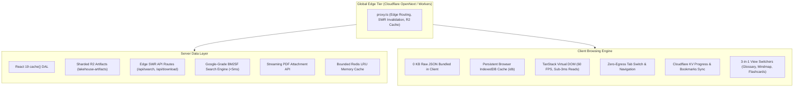
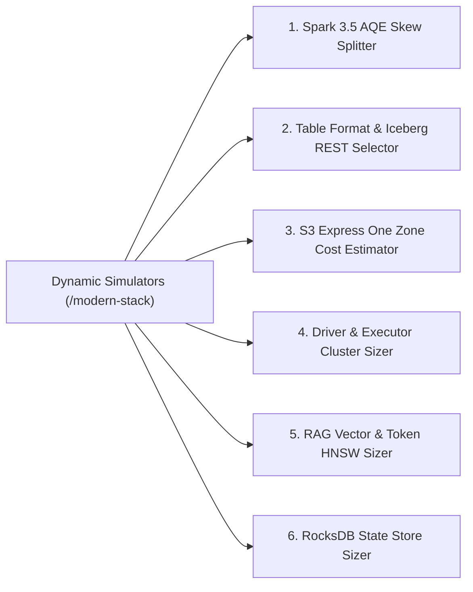

# Modern Data Engineer & Lakehouse Architect (`moderndataengineer.uk`)

<p align="center">
  
</p>

<p align="center">
  <a href="https://nextjs.org/"></a>
  <a href="https://react.dev/"></a>
  <a href="https://www.typescriptlang.org/"></a>
  <a href="https://vitest.dev/"></a>
  <a href="https://developers.cloudflare.com/workers/"></a>
  <a href="src/data/content-counts.json"></a>
  <a href="docs/content-expansion-plan.md"></a>
  <a href="LICENSE"></a>
  <a href="SECURITY.md"></a>
</p>

> **The Definitive Open-Access Enterprise Data Engineering & Lakehouse Systems Encyclopedia**  
> **11,956+ verified assets**, architectural scenarios, interactive execution simulators, and high-resolution blueprints covering **Microsoft Fabric (DP-600/DP-700), Databricks, Apache Spark 3.5+/4.0, Delta Lake 3.2, Apache Iceberg v2/v3, Unity Catalog, dbt, Apache Airflow, and Governed Agentic Data Systems**.
>
> 🌐 **Live Production Web Application**: **[https://moderndataengineer.uk](https://moderndataengineer.uk)**  
> 📦 **Sister Repositories**: **[The PySpark Handbook (105 Production Recipes)](https://github.com/santoshjammi29/pyspark-handbook)** • **[Azure Enterprise Cheat Sheet](https://github.com/santoshjammi29/azure-cheat-sheet)**

> [!NOTE]
> **2026 Lakehouse Architecture Standard & Sourced Evidence**: Every core architectural recommendation across this platform is anchored in official documentation and 21 primary authoritative research reports—including [DORA 2025](https://dora.dev/research/2025/dora-report/), [Thoughtworks Technology Radar Vol. 35](https://www.thoughtworks.com/en-gb/about-us/news/2026/thoughtworks-technology-radar-highlights-stronger-controls), [dbt Labs State of Analytics Engineering 2026](https://www.getdbt.com/blog/new-dbt-labs-report-finds-ai-driven-acceleration-is-outpacing-trust-and-governance), [Martin Fowler's Data Product Navigator](https://martinfowler.com/articles/data-product-platform-nav.html), NIST SP 800-207 Zero Trust, and OWASP Top 10 for LLMs.

---

## 🏛️ System Architecture

Built on a **Zero-Bundle, Zero-Egress, Edge-Native Architecture**: massive datasets stay strictly server-side within React 19 `cache()` Data Access Layers (DAL), serving zero-bundle lightweight JSON payloads to 60 FPS virtualized client surfaces (`@tanstack/react-virtual` + HTML5 `<canvas>`). Large dataset shards are persistently cached in the browser's IndexedDB (`idb`), guaranteeing **0 bytes of repeat network egress** across tab switches and page reloads:



---

## 📊 Curated Data Inventory (11,956+ Assets)

The platform hosts the industry's most rigorous, verified catalog of data engineering scenarios, system design benchmarks, interactive simulators, and architecture blueprints:

| Category | Module / Dataset | Exact Count | Focus & Architectural Scope |
| :--- | :--- | :---: | :--- |
| **Searchable Assets** | Total MiniSearch Catalog | **11,956** | Fully indexed client-side catalog with sub-5ms BM25F search (`⌘K`). |
| **Technical Q&A** | Practice Question Bank | **7,098** | **3,670** Data Engineering (`data_de.json`) + **3,428** Core Platform (`questions.json`). |
| **System Design** | Architecture Scenarios | **3,294** | Production cloud designs, trade-off matrices, failure modes, and 36-keyword filter deck (`/architecture`). |
| **Core Concepts** | Architectural Concepts | **869** | 14 core pillars: Fabric, Databricks, Lakehouse, Spark, Power BI, ADF, Airflow, dbt, FinOps (`/concepts`). |
| **Coding Drills** | Multi-Engine Drills | **283** | Hands-on PySpark 3.5+/4.0 (**156**), Spark SQL (**50**), Python/Polars (**42**), and MSSQL (**35**). |
| **Coding Hub** | Unified Code Operations | **431+ Ops** | 283 Interactive Drills, 148+ Databricks Operations & Memory Triage, 15 Polyglot Matrix, and 62 Python Runbooks (`/code-practice`). |
| **Guided Tracks** | Learning Tracks | **15 Tracks** | 15 progressive tracks including the new **Governed Agentic Data Platforms** track (`/guided-learning`). |
| **Career Paths** | Complete Certification Paths | **13 Paths** | 16-Week Production Lakehouse Track, DP-700, DP-600, Databricks Associate/Pro, and legacy DP-203 reference (`/learning-paths`). |
| **Enterprise Guide** | GCC Enterprise Directory | **156** | Tier-1 Global Capability Centers (Bangalore & Hyderabad) with hiring bars, tech stacks, and interview loops (`/company-research`). |
| **Visual Blueprints** | Hand-Drawn Whiteboards | **42** | High-resolution blueprints with 5 role perspectives, under-the-hood engine mechanics, and triage runbooks (`/whiteboards`). |
| **Modern Blueprints**| Modern Architecture Blueprints | **18** | End-to-end modern lakehouse, vector pipeline, and CDC stream blueprints (`/modern-stack`). |
| **Modern Concepts** | Cutting-Edge Primitives | **32** | UniForm, Iceberg v2/v3, LanceDB, Arrow C Data, Liquid Clustering, Data Contracts, ODCS standard (`/modern-stack`). |
| **Lakehouse FinOps**| Cloud Cost Playbooks | **15** | Cloud Lakehouse FinOps & compute cost reduction playbooks with risk assessments (`/modern-stack`). |
| **Interactive Labs** | Dynamic Execution Simulators | **6 Simulators** | Spark 3.5 AQE Skew Join Sizer, Table Format Selector, S3 Express Cost Estimator, Cluster Sizer, RAG Sizer, Streaming State Sizer (`/modern-stack`). |
| **Execution Flows** | Interactive Flow Diagrams | **8 Flows** | Mastery Roadmap, Medallion Flow, Enterprise Stack, SDLC, Pipeline Execution, System Design, Interview Defense, Optimization (`/stages`). |
| **PDF Downloads** | Compiled Master Vector PDFs | **7 PDFs** | Architecture Master Reference, PySpark, Python, Spark Core, Spark SQL, Incident Runbooks, Master Cheatsheet (`/cheat-sheet`). |

---

## ⚡ Dynamic Simulators & Interactive Execution Engines

The platform includes production-grade dynamic calculators and execution simulators enabling hands-on modeling of distributed data systems:



<details>
<summary><b>🔍 Click to expand full technical specification for the 6 Dynamic Simulators</b></summary>

1. **Spark 3.5 AQE Shuffle & Skew Sizer (`/modern-stack`)**:
   - Automatically models dynamic partition splitting when partitions exceed $5\times$ median size or 256 MB.
   - Calculates target post-shuffle partition sizes, recommended executor core allocation, and spill risk alerts.
2. **Table Format & REST Catalog Selector (`/modern-stack`)**:
   - Evaluates Delta Lake 3.2 (Liquid Clustering + Deletion Vectors) vs. Apache Iceberg v2/v3 (REST Catalog + Positional Deletes) vs. Apache Hudi.
   - Provides concrete recommendations for catalog federation (Unity Catalog, Apache Polaris, Project Nessie, AWS Glue).
3. **Query Scan Cost & S3 Express One Zone Tiering Estimator (`/modern-stack`)**:
   - Compares AWS S3 Standard (\$0.023/GB) vs. **AWS S3 Express One Zone** directory buckets (\$0.16/GB, sub-10ms latency, 50% cheaper request costs).
   - Factors in BigQuery on-demand (\$6.25/TB) and Databricks Serverless SQL (\$0.55/DBU).
4. **Spark 3.5/4.0 Cluster Sizer with Driver OOM Headroom (`/modern-stack`)**:
   - Computes executor memory, container overhead, and dedicated **Driver Memory** (`spark.driver.memory` and `spark.driver.memoryOverhead = max(384MB, 10%)`) to prevent Driver OOM during broadcast joins and wide-table Catalyst plans.
5. **RAG Vector & Token Sizer (`/modern-stack`)**:
   - Models vector dimensions (1536d / 3072d), token context windows, and a **1.25x HNSW graph indexing memory overhead multiplier**.
   - Embeds OWASP Top 10 for LLMs (LLM01 Prompt Injection, LLM06 Sensitive Information Disclosure) sandboxing requirements.
6. **Streaming Watermark & RocksDB State Sizer (`/modern-stack`)**:
   - Simulates state retention windows, event watermarks, and **RocksDB state stores on local NVMe SSDs** with asynchronous changelog checkpointing to cloud object storage.

</details>

<details>
<summary><b>🔬 Click to expand Spark Catalyst & Engine Execution Simulators</b></summary>

- **Spark Engine Flow Simulator (`/spark-engine`)**:
  - 5 interactive execution flows including **Spark 3.5 AQE Skew Join Dynamic Splitting** (`aqe_skew`), modeling how runtime partition skew is detected and split into parallel sub-tasks to eliminate executor skew stragglers.
- **Spark Catalyst Plan Inspector (`/spark-catalyst`)**:
  - 7 cutting-edge plan scenarios:
    1. `delta-liquid-clustering-scan`: Multi-dimensional Hilbert-curve data skipping with Roaring Bitmap Deletion Vectors.
    2. `iceberg-v2-positional-delete-merge`: Iceberg v2 row-level delete scan combining Parquet statistics with positional delete bitmaps.
    3. `aqe-runtime-skew-split`: Adaptive Query Execution dynamically detecting and splitting skewed partitions (>5x median).
    4. `broadcast-hash-join`: Elimination of shuffle exchange via broadcast threshold.
    5. `predicate-pushdown`: Storage layer partition and metadata pruning.
    6. `column-pruning`: Elimination of unused struct fields from Parquet footers.
    7. `window-spec-pushdown`: Analytical window function partition optimization.

</details>

---

## 🎨 Enterprise Whiteboard Blueprints (42 Architect-Grade Blueprints)

All 42 blueprints are rendered as high-fidelity hand-drawn digital schematics (available in `src/data/diagrams.ts` and `/public/diagrams/` in WebP & AVIF formats) grouped into 7 core architectural domains. Every single blueprint includes **multi-persona engineering depth**:

- **5 Distinct Role Perspectives per Blueprint**:
  - 🏛️ **Lead Data Architect**: Macro system design, multi-cloud federation, SLA/SLO definition, FinOps unit economics, disaster recovery.
  - ⚙️ **Senior / Staff Data Engineer**: Low-level engine internals, CPU cache line alignment, AST query plans, off-heap Tungsten memory, shuffle spill triage, ACID log serialization.
  - 🔧 **Data Engineer**: Daily ELT pipeline engineering, partition/clustering choices, idempotency, streaming checkpoints, schema evolution, and CDC ingestion.
  - 🛡️ **Data Steward & Governance**: Unity Catalog 3-level namespace (`catalog.schema.table`), Purview lineage graphs, dynamic row/column masks, PII classification, and GDPR deletion workflows.
  - 📊 **Business Analyst & BI**: Power BI Direct Lake sub-second DAX response, VertiPaq memory limits, metric consistency across dimensional bus matrices, and self-service exploration.
- **Executive Architect Notes**: Explicit trade-offs, scaling limits, anti-patterns, and cost burndown models.
- **Under-the-Hood Technical Mechanisms**: 4–6 concrete engine mechanisms per blueprint (e.g. V-Order Parquet sorting, Netty socket buffers, HNSW vector indexing, RocksDB LSM memtables, OCC commit protocols).
- **Production Triage & Incident Runbooks**: Detailed incident cards featuring alert symptoms, root causes, and step-by-step engineering mitigations.
- **Interactive 4-Tab Lightbox Inspector**: Modal viewer across `/architecture` and `/whiteboards` enabling seamless switching between **Architecture & Pillars**, **5 Role Perspectives**, **Production Triage**, and **Governance & Compliance**.

| Architectural Domain | Count | Highlighted Production Blueprints |
| :--- | :---: | :--- |
| **Compute & Optimization** | **11** | Catalyst Optimizer & Photon Engine<br>• Shuffle & Memory Architecture<br>• Data Skew & AQE<br>• SaveMode Handling<br>• Join Strategy Decision Matrix<br>• Tungsten Spill Mechanics<br>• Structured Streaming State Store (RocksDB)<br>• Photon vs. JVM<br>• Broadcast & Accumulators<br>• SQL Server Engine Internals |
| **Storage Engines & Formats** | **8** | Delta Lake ACID Under the Hood<br>• Apache Iceberg Snapshot Tree<br>• Open Table Formats (Delta vs. Iceberg vs. Hudi)<br>• Open File Formats (Parquet vs. ORC vs. Avro)<br>• 6 Delta Optimization Levers<br>• Lakehouse ACID Concurrency Matrix<br>• SCD Types 0–6 in Medallion<br>• Master Enterprise Lakehouse Reference |
| **Pipelines & Ingestion** | **8** | Apache Airflow Distributed Architecture<br>• dbt Modern Analytics Engineering DAG<br>• Azure Data Factory Hybrid IR<br>• Kafka Event Streaming<br>• CDC with Debezium<br>• Databricks Medallion Architecture<br>• Delta Live Tables (DLT)<br>• Databricks Asset Bundles (DABs) & Serverless CI/CD |
| **Platform Landscape** | **5** | Databricks Unified Platform Master<br>• Enterprise RAG & Vector Data Pipelines<br>• Modern Python Data (Arrow, Polars, DuckDB)<br>• FinOps & Cloud Cost Optimization<br>• Enterprise Edge & IoT Architecture |
| **Microsoft Fabric & Power BI** | **4** | Microsoft Fabric Unified Architecture & OneLake<br>• Power BI Direct Lake & VertiPaq<br>• Power BI DAX Engine Mechanics & Context Transition<br>• Fabric OneLake Shortcuts & Direct Lake Mode |
| **Data Modeling & Architecture** | **4** | Kimball Dimensional Modeling & Star Schema<br>• Data Vault 2.0 Enterprise Modeling<br>• Distributed Systems Resilience & Consensus<br>• Enterprise Data Mesh & Data Products |
| **Governance & Security** | **2** | Unity Catalog Unified Governance & 3-Level Namespace<br>• Microsoft Purview Unified Metadata & Catalog |

---

## 📚 16-Week Production Lakehouse Curriculum & Triage Runbooks

- **Applied 16-Week Curriculum (Path 13 under `/learning-paths`)**:
  - *Weeks 1–4*: ADF Production Ingestion & Control Flow (Tumbling Windows, REST API Pagination, High-Watermark Delta Ingestion, Bounded ForEach concurrency).
  - *Weeks 5–8*: Spark Notebook Engineering & Delta Lake Under the Hood (Thin orchestrators, Liquid Clustering, UniForm, Schema Evolution, Checkpoint internals).
  - *Weeks 9–12*: Enterprise CI/CD with Declarative Automation Bundles (DABs) & OIDC Keyless Deployments (Topological DAG verification, PR checks, environment promotion).
  - *Weeks 13–16*: SRE Observability, Incident Triage & Disaster Recovery (ADF $\times$ Databricks Retry Multipliers, Watermark Desync Reconciliation, Point-in-time Restore).
- **Certification Lifecycle Notice**: Marked DP-203 with a **Legacy Reference** badge (retired March 31, 2025) and directed candidates to **DP-700** (Fabric Data Engineer) and **DP-600** (Fabric Analytics Engineer).
- **7 Master Production Incident Runbooks (`docs/databricks_master_operations_and_triage_guide.md`)**:
  1. Driver OutOfMemoryError (heap space and broadcast hash join thresholds).
  2. Executor OutOfMemoryError (container killed by YARN/Kubernetes, Exit code 137).
  3. Shuffle Disk Spill (Tungsten memory vs. disk spill triage).
  4. Optimistic Concurrency Control (OCC) write conflict resolution.
  5. Cross-System Multi-Layer Retry Storms ($(1+R_{\text{ADF}}) \times (1+R_{\text{DB}}) = 16$).
  6. Structured Streaming Checkpoint Invalidation & Offset Recovery.
  7. Two-Phase Watermark Transaction Boundaries & Lag Reconciliation.

---

## 🛠️ Quick Start & Developer Guide

### Prerequisites
- Node.js 18.17+ or 20+
- Python 3.10+ (for content sharding & validation scripts)

```bash
# 1. Clone repository and install dependencies
git clone https://github.com/santoshjammi29/moderndataengineer.git
cd moderndataengineer
npm install

# 2. Run local Next.js development server
npm run dev
# Open http://localhost:3000

# 3. Execute automated test suite (58 test files, 472 passed tests)
npm test

# 4. Validate content schemas and shard search index
npm run content:validate
npm run content:shard

# 5. Production build check (Cloudflare OpenNext build)
npm run build:cf

# 6. Deploy to Cloudflare Workers with automated R2 asset sync
npm run deploy:cf
```

---

## 🧪 Testing & Verification

Automated quality gates validate data schemas, bundle hygiene, accessibility, and search indexing:

- **58 Test Files**: 100% passing across unit, integration, and UI component tests.
- **472 Tests**: Comprehensive coverage spanning BM25F ranking, virtual scroll limits, SIMD worker offloads, responsive layout constraints, 42 blueprint persona structures, whiteboard asset integrity verification, dynamic font scaling, and PDF download streaming headers.
- **Zero-Bundle Enforcement**: Automated tests verify that no raw JSON data leaks into client JavaScript bundles.
- **Strict TypeScript & ESLint**: `tsc --noEmit` and `eslint` pass with 0 errors.

---

## 📜 Central Documentation Hub

Detailed platform architecture guides and engineering runbooks are maintained in [`docs/`](docs/README.md):

| Documentation Pillar | Scope & Focus Areas | Direct Links |
| :--- | :--- | :--- |
| **[Architecture & Blueprints](docs/architecture/README.md)** | Lakehouse systems, storage internals, and engine blueprints | [`01_azure_synapse.md`](docs/architecture/01_azure_synapse.md)<br>• [`02_microsoft_fabric.md`](docs/architecture/02_microsoft_fabric.md)<br>• [`05_lakehouse_finops.md`](docs/architecture/05_lakehouse_finops.md)<br>• [`06_enterprise_blueprints.md`](docs/architecture/06_enterprise_blueprints.md)<br>• [`07_open_storage_formats.md`](docs/architecture/07_open_storage_formats.md)<br>• [`08_delta_optimization.md`](docs/architecture/08_delta_optimization.md) |
| **[Databricks Operations & Triage](docs/databricks_master_operations_and_triage_guide.md)** | Operational reference: DBFS, Volumes, PySpark, SQL & OOM Triage | [`Master Operations & Triage Guide`](docs/databricks_master_operations_and_triage_guide.md) |
| **[Research Expansion Plan](docs/content-expansion-plan.md)** | Sourced evidence ledger, 21 research reports, inventory manifest | [`content-expansion-plan.md`](docs/content-expansion-plan.md) |
| **[Standardized Architecture](docs/STANDARDIZED_ARCHITECTURE.md)** | Server/Client boundaries, DAL, SEO, and architectural invariants | [`STANDARDIZED_ARCHITECTURE.md`](docs/STANDARDIZED_ARCHITECTURE.md) |
| **[Production Audits](docs/audits/README.md)** | Edge benchmarks, theme contrast, design system & accessibility | [`production_audit.md`](docs/audits/production_audit.md)<br>• [`theme_audit.md`](docs/audits/theme_audit.md)<br>• [`design_system_audit.md`](docs/audits/design_system_audit.md) |
| **[Design System](docs/design-system/README.md)** | Fluid tokens, typography scale & motion specifications | [`tokens_and_primitives.md`](docs/design-system/tokens_and_primitives.md) |
| **[Engineering & Operations](docs/engineering/README.md)** | App Router DAL, deployment guide & platform roadmap | [`development_guide.md`](docs/engineering/development_guide.md)<br>• [`workers-for-platforms.md`](docs/engineering/workers-for-platforms.md)<br>• [`roadmap.md`](docs/engineering/roadmap.md) |

---

<p align="center">
  <b>Modern Data Engineer & Lakehouse Architect</b><br>
  Built with ❤️ for enterprise data engineers, platform architects, and systems thinkers.<br>
  <a href="https://moderndataengineer.uk">moderndataengineer.uk</a>
</p>
