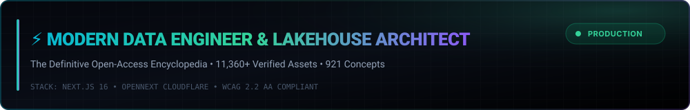

<p align="center">
  
</p>

# Modern Data Engineer & Lakehouse Architect (`moderndataengineer.uk`)

<p align="center">
  
</p>

<p align="center">
  <a href="https://nextjs.org/"></a>
  <a href="https://react.dev/"></a>
  <a href="https://www.typescriptlang.org/"></a>
  <a href="https://vitest.dev/"></a>
  <a href="https://developers.cloudflare.com/workers/"></a>
  <a href="src/data/content-counts.json"></a>
  <a href="docs/content-expansion-plan.md"></a>
  <a href="LICENSE"></a>
  <a href="SECURITY.md"></a>
</p>

> **The Definitive Open-Access Enterprise Data Engineering & Lakehouse Systems Encyclopedia**  
> **11,361+ verified assets**, architectural scenarios, interactive execution simulators, and high-resolution blueprints covering **Microsoft Fabric (DP-600/DP-700), Databricks, Apache Spark 3.5+/4.0, Delta Lake 3.2, Apache Iceberg v2/v3, Unity Catalog, dbt, Apache Airflow, and Governed Agentic Data Systems**.
>
> 🌐 **Live Production Web Application**: **[https://moderndataengineer.uk](https://moderndataengineer.uk)**  
> 📦 **Sister Repositories**: **[The PySpark Handbook (105 Production Recipes)](https://github.com/santoshjammi29/pyspark-handbook)** • **[The SQL Handbook (105 Production Exercises)](https://github.com/santoshjammi29/sql-handbook)** • **[The Databricks Handbook (105 Production Recipes)](https://github.com/santoshjammi29/databricks-handbook)** • **[The Security Handbook](https://github.com/santoshjammi29/security-handbook)** • **[Azure Databricks Project Blueprints](https://github.com/santoshjammi29/azure-databricks-project-blueprints)** • **[Azure Enterprise Cheat Sheet](https://github.com/santoshjammi29/azure-cheat-sheet)** • **[The dbt Handbook](https://github.com/santoshjammi29/dbt-handbook)** • **[The Streaming Handbook](https://github.com/santoshjammi29/streaming-handbook)** • **[Data System Design Handbook](https://github.com/santoshjammi29/data-system-design-handbook)** • **[DataOps & CI/CD Handbook](https://github.com/santoshjammi29/dataops-cicd-handbook)** • **[Banking Risk & ALM Lakehouse](https://github.com/santoshjammi29/enterprise-banking-risk-alm-lakehouse)** • **[Spark Experiments](https://github.com/santoshjammi29/spark-experiments)** • **[Interview Handbook](https://github.com/santoshjammi29/data-engineering-interview-handbook)**

> [!NOTE]
> **2026 Lakehouse Architecture Standard & Sourced Evidence**: Every core architectural recommendation across this platform is anchored in official documentation and 21 primary authoritative research reports—including [DORA 2025](https://dora.dev/research/2025/dora-report/), [Thoughtworks Technology Radar Vol. 35](https://www.thoughtworks.com/en-gb/about-us/news/2026/thoughtworks-technology-radar-highlights-stronger-controls), [dbt Labs State of Analytics Engineering 2026](https://www.getdbt.com/blog/new-dbt-labs-report-finds-ai-driven-acceleration-is-outpacing-trust-and-governance), [Martin Fowler's Data Product Navigator](https://martinfowler.com/articles/data-product-platform-nav.html), NIST SP 800-207 Zero Trust, and OWASP Top 10 for LLMs.

---

## ⚡ 1. Quick Start & Developer Guide

### Prerequisites
- **Node.js**: `v22.x` or higher (Managed via `.nvmrc` or `nvm use`)
- **Python**: `3.10+` (Required for content sharding and vector PDF compilation)

```bash
# 1. Clone repository and install dependencies
git clone https://github.com/santoshjammi29/moderndataengineer.git
cd moderndataengineer
npm install

# 2. Run local Next.js development server
npm run dev
# Open http://localhost:3000

# 3. Execute automated test suite (62 test files, 522 passed tests)
npm test

# 4. Validate content schemas and shard search index
npm run content:validate
npm run content:shard

# 5. Production build check (Cloudflare OpenNext build)
npm run build:cf

# 6. Deploy to Cloudflare Workers with automated R2 asset sync
npm run deploy:cf
```

---

## 🏛️ 2. Edge-Native System Architecture

Built on a **Zero-Bundle, Zero-Egress, Edge-Native Architecture**: massive datasets stay strictly server-side within React 19 `cache()` Data Access Layers (DAL), serving zero-bundle lightweight JSON payloads to 60 FPS virtualized client surfaces (`@tanstack/react-virtual` + HTML5 `<canvas>`). Large dataset shards are persistently cached in the browser's IndexedDB (`idb`), guaranteeing **0 bytes of repeat network egress** across tab switches and page reloads:

```
┌─────────────────────────────────────────────────────────────────────────────┐
│                       GLOBAL EDGE NETWORK (Cloudflare)                      │
│        Reverse Proxy, SSL Termination, Bot Management & SWR Caching         │
└──────────────────────────────────────┬──────────────────────────────────────┘
                                       │
        ┌──────────────────────────────┴──────────────────────────────┐
        ▼                                                             ▼
┌───────────────────────────────────────┐   ┌───────────────────────────────────────┐
│     EDGE RUNTIME (Cloudflare OpenNext)│   │       OBJECT STORAGE TIER (R2)        │
│  - React 19 Server Components (RSC)   │   │  - 106+ Pre-Sharded JSON Partitions   │
│  - Strict Data Access Layer (DAL)     │◀──│  - 52 High-Res Whiteboard WebP Assets │
│  - Google-Grade BM25F Search Ranking  │   │  - 11 Vector A4 Technical PDFs        │
│  - Zero-Bundle Client JSON Payloads   │   │  - Automated Cache-Control Headers    │
└───────────────────┬───────────────────┘   └───────────────────────────────────────┘
                    │
                    ▼
┌─────────────────────────────────────────────────────────────────────────────┐
│                     CLIENT BROWSING ENGINE (Next.js 16)                     │
│  - 0 KB JSON bundled into Initial JS Chunk                                  │
│  - Client-Side Persistent IndexedDB Cache (idb) with ETag Invalidation      │
│  - TanStack Virtual DOM Engine (10,000+ DOM Nodes with Sub-Millisecond Jank)│
│  - Interactive HTML5 Canvas Simulators (Catalyst & Photon @ 60 FPS)         │
│  - Web Workers Offload for Client-Side Search Tokenization & Filtering       │
└─────────────────────────────────────────────────────────────────────────────┘
```

---

## 📊 3. Curated Knowledge Inventory (11,361+ Assets)

The knowledge base is continuously validated via strict Zod schemas in CI/CD, guaranteeing data integrity across all 14 pillars:

| Category | Count | Canonical Location | Description |
|:---|:---:|:---|:---|
| **Core Concepts** | **921** | `src/data/json/data_concepts.json` | Theoretical principles, internal engine mechanisms, and architectural definitions |
| **Architecture Scenarios** | **3,305** | `src/data/json/data_architecture.json` | Real-world lakehouse design dilemmas, cross-cloud trade-offs, and failure recovery |
| **QA Bank Items** | **7,135** | `src/data/json/questions.json` | Deep-dive interview questions, staff-level architectural defense, and code snippets |
| **Whiteboard Blueprints** | **52** | `public/diagrams/` | High-resolution architectural schematics covering enterprise ingestion and Medallion flows |
| **Technical Manuals (PDF)** | **11** | `docs/pdf/` & `public/cheatsheets/pdf/` | Vector A4 printable technical reference manuals and incident runbooks |
| **Total Valid Assets** | **11,361** | Verified in CI | 100% compliant with automated Zod schemas (`content:validate`) |

---

## 🧠 4. Master Knowledge Base: 14 Pillars & Curriculum Overview

> 💡 **Curriculum Scope**: **921 Production Topics** verified against real-world lakehouse internals, query engines, and distributed architectures.  
> 📑 **Full Topic Directory**: Explore the complete topic-by-topic breakdowns, definitions, and difficulty tiers in [`topics/README.md`](topics/README.md) and live at [`moderndataengineer.uk/concepts`](https://moderndataengineer.uk/concepts).

| Pillar # | Domain Category | Topic Count | Primary Sister Repository | Key Architectural Primitives Covered | Status |
|:---:|:---|:---:|:---|:---|:---:|
| 1 | **Apache Spark & Distributed Compute** | **135** | [The PySpark Handbook](https://github.com/santoshjammi29/pyspark-handbook) | Catalyst, Tungsten, AQE, Salting, RDD, DataFrame, Spark UI, Memory Triage | ✅ Live |
| 2 | **Databricks Platform & Lakehouse** | **132** | [The Databricks Handbook](https://github.com/santoshjammi29/databricks-handbook) | Unity Catalog, Delta Lake 3.x, Lakeflow, Photon, DABs, Serverless, Mosaic AI | ✅ Live |
| 3 | **Relational SQL & Query Engine** | **91** | [The SQL Handbook](https://github.com/santoshjammi29/sql-handbook) | Indexing, S-F-W-G-H-O Execution Order, Locking, RCSI, Join Algorithms | ✅ Live |
| 4 | **Database Architecture & Distributed MPP** | **79** | [The SQL Handbook](https://github.com/santoshjammi29/sql-handbook) | Vitess Sharding, Concurrency Admission, Read-After-Write, Synapse MPP, SSI | ✅ Live |
| 5 | **Modern Lakehouse & Streaming Formats** | **76** | [The Streaming Handbook](https://github.com/santoshjammi29/streaming-handbook) | Paimon, Debezium CDC, Watermarking, Iceberg REST, UniForm, Polaris, Liquid Clustering | ✅ Live |
| 6 | **Distributed System Design** | **68** | [Data System Design Handbook](https://github.com/santoshjammi29/data-system-design-handbook) | CAP/PACELC, Consistent Hashing, Cache-Aside, Rate Limiting, Outbox, Circuit Breaker | ✅ Live |
| 7 | **General Data Engineering & Modeling** | **63** | [DataOps & CI/CD Handbook](https://github.com/santoshjammi29/dataops-cicd-handbook) | Kimball Dimensional Modeling, SCD Type 2, CDC, ODCS Data Contracts, Idempotency | ✅ Live |
| 8 | **dbt & Analytics Engineering** | **57** | [The dbt Handbook](https://github.com/santoshjammi29/dbt-handbook) | Models, ref(), Generic Tests, Snapshots, Semantic Layer, MetricFlow, Slim CI | ✅ Live |
| 9 | **Data Lake Architecture & Formats** | **55** | [Data System Design Handbook](https://github.com/santoshjammi29/data-system-design-handbook) | HDFS, Parquet, Avro, ORC, Medallion Layer Invariants, Object Storage Lifecycle | ✅ Live |
| 10 | **Apache Airflow & Orchestration** | **52** | [DataOps & CI/CD Handbook](https://github.com/santoshjammi29/dataops-cicd-handbook) | DAGs, Tasks, Operators, Dynamic Task Mapping, Schedulers, Airflow 3.0 Datasets | ✅ Live |
| 11 | **Microsoft Fabric & OneLake** | **39** | [Azure Enterprise Cheat Sheet](https://github.com/santoshjammi29/azure-cheat-sheet) | OneLake, Shortcuts, Direct Lake, Capacities F-SKUs, Eventhouse, KQL Database | ✅ Live |
| 12 | **Azure Data Factory (ADF)** | **27** | [Azure Enterprise Cheat Sheet](https://github.com/santoshjammi29/azure-cheat-sheet) | Linked Services, Pipelines, Self-Hosted IR, Tumbling Windows, REST Pagination | ✅ Live |
| 13 | **Power BI & Semantic Layer** | **25** | [Azure Enterprise Cheat Sheet](https://github.com/santoshjammi29/azure-cheat-sheet) | Import Mode, DirectQuery, DAX Context Transition, Aggregations, TMDL Modeling | ✅ Live |
| 14 | **Python for Data Engineering** | **22** | [The PySpark Handbook](https://github.com/santoshjammi29/pyspark-handbook) | Generators, GIL, Arrow PyCapsule IPC, Polars LazyFrames, Pydantic Contracts | ✅ Live |
| | **TOTAL KNOWLEDGE BASE TOPICS** | **921** | **14 Sister Repositories** | **100% Comprehensive Coverage Across All Ecosystem Handbooks** | 🚀 **Complete** |

---

## 🎨 5. Enterprise Whiteboard Blueprints (52 Blueprints)

Architect-grade visual blueprints modeled after Staff/Principal system design interview standards. Explore interactively on the web at [`moderndataengineer.uk/whiteboards`](https://moderndataengineer.uk/whiteboards):

```
├── 1. Distributed Storage & Formats (11 Blueprints)
│   ├── delta_lake_mechanism.webp                   # Delta ACID, Parquet, CRC, and Checkpoint mechanics
│   ├── delta_lake_vs_iceberg_architecture.webp     # Table format internals: Puffin, Pos-Delete vs Deletion Vectors
│   ├── apache_iceberg_open_table_format.webp       # Manifest Lists, Manifest Files, Snapshot Isolation
│   └── open_file_formats_storage.webp              # Parquet Thrift, Dictionary Encoding, Snappy vs ZSTD
├── 2. Compute Engines & Optimizers (12 Blueprints)
│   ├── catalyst_photon_engine.webp                 # Catalyst Rule-Based & Cost-Based Optimizer pipeline
│   ├── spark_memory_management_spill_diagram.webp  # Execution vs Storage memory, Tungsten off-heap, Spill to disk
│   ├── spark_data_skew_aqe_optimization.webp       # Two-phase key salting, AQE skew join splitting
│   └── photon_engine_vs_jvm.webp                   # Vectorized C++ SIMD instruction sets vs Java JIT bytecode
├── 3. Enterprise Lakehouse Platforms (15 Blueprints)
│   ├── databricks_medallion_architecture.webp      # Bronze (raw) -> Silver (cleansed) -> Gold (aggregated)
│   ├── fabric_onelake_architecture.webp            # OneLake shortcuts, Delta Lake storage, Cross-cloud federation
│   ├── fabric_onelake_direct_lake_architecture.webp# Direct Lake bypass of DAX/VertiPaq query pipeline
│   └── unity_catalog_architecture.webp             # 3-tier namespace (catalog.schema.table) & data isolation
└── 4. Streaming, CDC & Resilience (14 Blueprints)
    ├── cdc_debezium_lakehouse_pipeline.webp        # Transaction log mining (Postgres WAL / MySQL binlog)
    ├── kafka_event_streaming_pipeline.webp         # KRaft consensus, partition leaders, zero-copy socket transfers
    ├── lakehouse_bcdr_failover_architecture.webp   # RPO/RTO active-passive multi-region disaster recovery
    └── streaming_dlq_recovery_flow_architecture.webp# Dead Letter Queue (DLQ) circuit-breakers and backpressure
```

---

## ⚡ 6. Dynamic Simulators & Interactive Execution Engines

Explore real-time interactive browser simulations directly on the web platform:

- **Spark Catalyst Optimizer Simulator** ([`/spark-engine/catalyst`](https://moderndataengineer.uk/spark-engine/catalyst)): Visual step-by-step trace of how an Unresolved Logical Plan transforms through Analyzed, Optimized, Physical, and Cost-Based execution plans into native RDD code.
- **Photon Vectorized C++ Engine Simulator** ([`/spark-engine`](https://moderndataengineer.uk/spark-engine)): Real-time comparison between row-at-a-time JVM iterator loops and column-at-a-time SIMD hardware acceleration.
- **Delta Lake ACID Transaction Log Simulator** ([`/architecture`](https://moderndataengineer.uk/architecture)): Interactive demonstration of Optimistic Concurrency Control (OCC), mutual exclusion conflict resolution, and atomic commit protocol.

---

## 📜 7. Central Documentation Hub & Vector Reference Manuals

All technical manuals, architecture decision records (ADRs), and research plans are maintained in [`docs/`](docs/README.md):

| Documentation Pillar | Scope & Focus Areas | Direct Links |
| :--- | :--- | :--- |
| **[Architecture & Blueprints](docs/architecture/README.md)** | Lakehouse systems, storage internals, and engine blueprints | [`01_azure_synapse.md`](docs/architecture/01_azure_synapse.md)<br>• [`02_microsoft_fabric.md`](docs/architecture/02_microsoft_fabric.md)<br>• [`05_lakehouse_finops.md`](docs/architecture/05_lakehouse_finops.md)<br>• [`06_enterprise_blueprints.md`](docs/architecture/06_enterprise_blueprints.md)<br>• [`07_open_storage_formats.md`](docs/architecture/07_open_storage_formats.md)<br>• [`08_delta_optimization.md`](docs/architecture/08_delta_optimization.md) |
| **[Databricks Operations & Triage](docs/databricks_master_operations_and_triage_guide.md)** | Operational reference: DBFS, Volumes, PySpark, SQL & OOM Triage | [`Master Operations & Triage Guide`](docs/databricks_master_operations_and_triage_guide.md) |
| **[Standardized Architecture](docs/STANDARDIZED_ARCHITECTURE.md)** | Server/Client boundaries, DAL, SEO, and architectural invariants | [`STANDARDIZED_ARCHITECTURE.md`](docs/STANDARDIZED_ARCHITECTURE.md) |
| **[Production Audits](docs/audits/README.md)** | Edge benchmarks, theme contrast, design system & accessibility | [`2026-11-industry_grade_audit_and_remediation_plan.md`](docs/audits/2026-11-industry_grade_audit_and_remediation_plan.md)<br>• [`production_audit.md`](docs/audits/production_audit.md)<br>• [`theme_audit.md`](docs/audits/theme_audit.md) |
| **[Design System](docs/design-system/README.md)** | Fluid tokens, typography scale & motion specifications | [`tokens_and_primitives.md`](docs/design-system/tokens_and_primitives.md) |
| **[Engineering & Operations](docs/engineering/README.md)** | App Router DAL, deployment guide & platform roadmap | [`development_guide.md`](docs/engineering/development_guide.md)<br>• [`workers-for-platforms.md`](docs/engineering/workers-for-platforms.md)<br>• [`roadmap.md`](docs/engineering/roadmap.md) |

---

## 🧪 8. Verification & Quality Guardrails

Automated quality gates validate data schemas, bundle hygiene, accessibility, and search indexing:

- **62 Test Files**: 100% passing across unit, integration, and UI component tests.
- **522 Tests**: Comprehensive coverage spanning BM25F ranking, virtual scroll limits, SIMD worker offloads, responsive layout constraints, 42 blueprint persona structures, whiteboard asset integrity verification, dynamic font scaling, and PDF download streaming headers.
- **Zero-Bundle Enforcement**: Automated tests verify that no raw JSON data leaks into client JavaScript bundles.
- **Strict TypeScript & ESLint**: `tsc --noEmit` and `eslint` pass with 0 errors.

---

## 🌐 9. Ecosystem Interlinking & Sister Repositories

The Modern Data Engineering ecosystem is intentionally partitioned into specialized, tightly coupled reference repositories anchored by **[Modern Data Engineer Platform (`moderndataengineer.uk`)](https://github.com/santoshjammi29/moderndataengineer)**. Use this cross-reference matrix to navigate directly between complementary implementations across our repositories:

| Core Engineering Focus | Flagship Repository | Direct Deep-Link Topics & Implementations in Sister Repositories |
| :--- | :--- | :--- |
| **Apache Spark & PySpark Core** | **[The PySpark Handbook](https://github.com/santoshjammi29/pyspark-handbook)** | • **Delta Lake ACID & Liquid Clustering**: [Databricks Handbook Mod 03 & 04](https://github.com/santoshjammi29/databricks-handbook)<br>• **SQL Windowing Equivalents**: [SQL Handbook Mod 04](https://github.com/santoshjammi29/sql-handbook)<br>• **Azure VNet Injection & Fabric Spark**: [Azure Cheat Sheet](https://github.com/santoshjammi29/azure-cheat-sheet) |
| **Databricks Data Intelligence Platform** | **[The Databricks Handbook](https://github.com/santoshjammi29/databricks-handbook)** | • **Core PyArrow UDFs & Higher-Order Functions**: [PySpark Handbook Mod 01 & 02](https://github.com/santoshjammi29/pyspark-handbook)<br>• **Databricks SQL vs ANSI Rosetta Stone**: [SQL Handbook Runbook 05](https://github.com/santoshjammi29/sql-handbook)<br>• **Azure Databricks Landing Zones & Bicep IaC**: [Azure Cheat Sheet](https://github.com/santoshjammi29/azure-cheat-sheet) |
| **Relational & Cloud MPP SQL** | **[The SQL Handbook](https://github.com/santoshjammi29/sql-handbook)** | • **Distributed Data Movement & Skew Salting**: [PySpark Runbook 03](https://github.com/santoshjammi29/pyspark-handbook)<br>• **Serverless SQL Warehouse Spill Tuning**: [Databricks Runbook 05](https://github.com/santoshjammi29/databricks-handbook)<br>• **Synapse & Fabric OneLake Direct Lake SQL**: [Azure Architecture 01](https://github.com/santoshjammi29/azure-cheat-sheet) |
| **Enterprise Cloud Architecture & Fabric** | **[Azure Enterprise Handbook](https://github.com/santoshjammi29/azure-cheat-sheet)** | • **Databricks Asset Bundles (DABs) & Lakeflow**: [Databricks Handbook Mod 07](https://github.com/santoshjammi29/databricks-handbook)<br>• **Structured Streaming & RocksDB State**: [PySpark Handbook Mod 06](https://github.com/santoshjammi29/pyspark-handbook)<br>• **Cloud Warehouse Cost Hardening**: [SQL Handbook Runbook 06](https://github.com/santoshjammi29/sql-handbook) |
| **dbt & Analytics Engineering** | **[The dbt Handbook](https://github.com/santoshjammi29/dbt-handbook)** | • **dbt-databricks Adapter & Unity Catalog**: [Databricks Handbook Mod 05](https://github.com/santoshjammi29/databricks-handbook)<br>• **Dynamic Incremental Models & State**: [SQL Handbook Mod 06](https://github.com/santoshjammi29/sql-handbook)<br>• **Slim CI & Production Orchestration**: [DataOps CI/CD Handbook](https://github.com/santoshjammi29/dataops-cicd-handbook) |
| **Real-Time Streaming & Ingestion** | **[The Streaming Handbook](https://github.com/santoshjammi29/streaming-handbook)** | • **PySpark Structured Streaming & Watermarks**: [PySpark Handbook Mod 06](https://github.com/santoshjammi29/pyspark-handbook)<br>• **Event Hubs & Kafka Stream Analytics**: [Azure Cheat Sheet](https://github.com/santoshjammi29/azure-cheat-sheet)<br>• **Delta Lake Streaming ACID Ingestion**: [Databricks Handbook Mod 06](https://github.com/santoshjammi29/databricks-handbook) |
| **Lakehouse System Design** | **[Data System Design Handbook](https://github.com/santoshjammi29/data-system-design-handbook)** | • **Medallion & Dual-Storage Lakehouse**: [Architecture 01](https://github.com/santoshjammi29/data-system-design-handbook)<br>• **Cross-Cloud Disaster Recovery**: [Azure Architecture 03](https://github.com/santoshjammi29/azure-cheat-sheet)<br>• **Photon Vectorized Engine Tuning**: [Databricks Runbook 04](https://github.com/santoshjammi29/databricks-handbook) |
| **DataOps, IaC & CI/CD** | **[DataOps & CI/CD Handbook](https://github.com/santoshjammi29/dataops-cicd-handbook)** | • **Databricks Asset Bundles (DABs) Pipeline**: [Databricks Handbook Mod 07](https://github.com/santoshjammi29/databricks-handbook)<br>• **Bicep Cloud Platform IaC**: [Azure Cheat Sheet](https://github.com/santoshjammi29/azure-cheat-sheet)<br>• **dbt-checkpoint & Pre-commit Gates**: [dbt Handbook](https://github.com/santoshjammi29/dbt-handbook) |
| **Databricks Project Blueprints** | **[Azure Databricks Blueprints](https://github.com/santoshjammi29/azure-databricks-project-blueprints)** | • **Omnichannel Retail & Real-Time Fraud**: [Scenario 01 & 02](https://github.com/santoshjammi29/azure-databricks-project-blueprints)<br>• **Warehouse Modernization Cutover**: [Scenario 03](https://github.com/santoshjammi29/azure-databricks-project-blueprints)<br>• **Declarative Pipelines & DABs**: [databricks.yml](https://github.com/santoshjammi29/azure-databricks-project-blueprints/blob/main/databricks.yml) |
| **Banking Risk Lakehouse** | **[Banking Risk & ALM Lakehouse](https://github.com/santoshjammi29/enterprise-banking-risk-alm-lakehouse)** | • **European Banking Regulations**: [BCBS 239 & IFRS 9 ECL Architecture](https://github.com/santoshjammi29/enterprise-banking-risk-alm-lakehouse)<br>• **Vectorized Treasury Cash Flows**: [ALM IRRBB Simulation](https://github.com/santoshjammi29/enterprise-banking-risk-alm-lakehouse)<br>• **Credit Early Warning Streaming**: [Agri Lending EWS](https://github.com/santoshjammi29/enterprise-banking-risk-alm-lakehouse) |
| **Spark Experiments Lab** | **[Spark Experiments](https://github.com/santoshjammi29/spark-experiments)** | • **1M+ Row Synthetic Skew Lab**: [1_data_skew/](https://github.com/santoshjammi29/spark-experiments/tree/main/spark/1_data_skew)<br>• **Query Execution Plan Triage**: [2_reading_query_plans.ipynb](https://github.com/santoshjammi29/spark-experiments/blob/main/spark/2_reading_query_plans.ipynb)<br>• **Dynamic Partition Pruning**: [5_1_dynamic_partition_pruning.ipynb](https://github.com/santoshjammi29/spark-experiments/blob/main/spark/5_1_dynamic_partition_pruning.ipynb) |
| **Architectural Defense Guide** | **[Interview Handbook](https://github.com/santoshjammi29/data-engineering-interview-handbook)** | • **20 Knowledge Pillars**: [all_20_pillars_master_guide.md](https://github.com/santoshjammi29/data-engineering-interview-handbook/blob/main/pillars/all_20_pillars_master_guide.md)<br>• **100 Databricks Defense Questions**: [100_databricks_interview_defense_playbook.md](https://github.com/santoshjammi29/data-engineering-interview-handbook/blob/main/playbooks/100_databricks_interview_defense_playbook.md)<br>• **100 Spark Issues & Solutions**: [100_spark_data_issues_problems_and_answers.md](https://github.com/santoshjammi29/data-engineering-interview-handbook/blob/main/playbooks/100_spark_data_issues_problems_and_answers.md) |
| **Enterprise Cloud Security & Zero Trust** | **[The Security Handbook](https://github.com/santoshjammi29/security-handbook)** | • **Zero Trust Lakehouse Perimeter**: [Security Handbook](https://github.com/santoshjammi29/security-handbook)<br>• **Workload Identity Federation**: [Keyless OIDC CI/CD](https://github.com/santoshjammi29/security-handbook)<br>• **Unity Catalog Dynamic Masking**: [Dynamic Data Masking & RLS](https://github.com/santoshjammi29/security-handbook) |

---

## 🤝 10. Contributing & Quality Standards

Every drill, exercise, notebook, and architecture guide in this repository must satisfy the **Code-Test-Doc Triad**:

1. **Theory & Mental Model**: Intuitive architectural explanation, ASCII/Mermaid flow, and production trade-offs.
2. **Executable Implementation**: 100% production-clean, runnable code with zero missing imports or broken pseudocode.
3. **Automated Assertion**: Unit test or contract assertion checking happy paths and edge cases.

Explore our 16-week structured mastery path in [`ROADMAP.md`](ROADMAP.md) and review our **Code-Test-Doc Triad** authoring rules in [`CONTRIBUTING.md`](CONTRIBUTING.md).

Licensed under the [MIT License](LICENSE).
