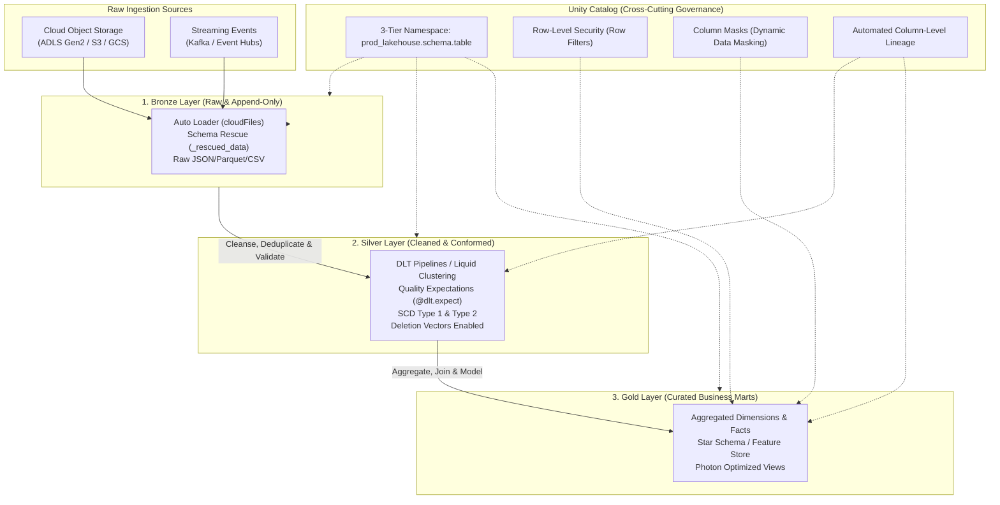
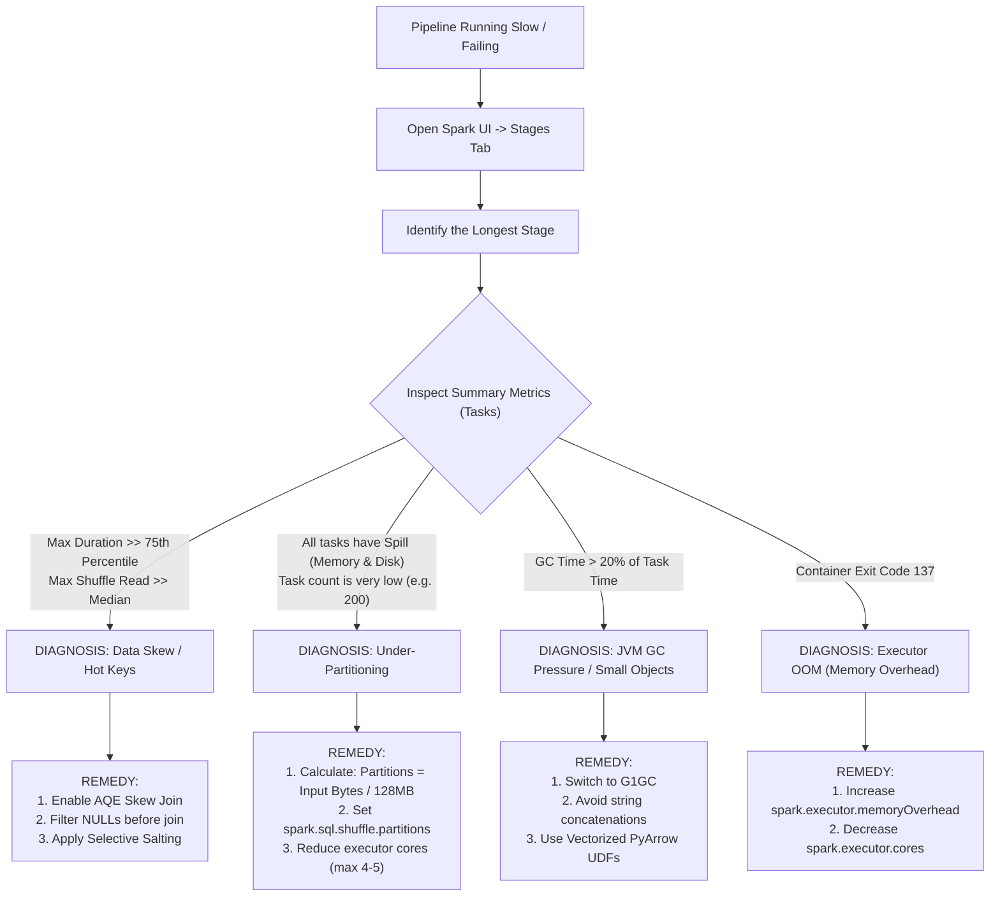

# Production Databricks Manual: Architecture, Code Patterns & Triage Runbook

This manual covers the complete lifecycle across the three core disciplines:
1. **Architectural Design**: Enterprise Medallion Lakehouse with Unity Catalog Governance.
2. **Production Code Patterns**: Auto Loader, Delta Live Tables (DLT) with Liquid Clustering, and Two-Phase Key Salting.
3. **Hands-On Triage Runbook**: Step-by-step diagnostic workflow for Skew, Spill, and OOM in Spark UI.

---

## Part 1: Architectural Design — Medallion Lakehouse with Unity Catalog



### 1.1 Unity Catalog 3-Tier Hierarchy
In production, organize assets strictly into the 3-tier namespace:

```text
prod_catalog/
├── bronze_raw/          <-- Append-only raw ingested tables (Managed Tables)
├── silver_curated/      <-- Deduplicated, standardized, validated data
└── gold_analytics/      <-- Kimball-style star schema & aggregated BI marts
```

### 1.2 Unity Catalog Security Setup (DDL)

```sql
-- 1. Create Catalog and Schemas
CREATE CATALOG IF NOT EXISTS prod_lakehouse;
USE CATALOG prod_lakehouse;

CREATE SCHEMA IF NOT EXISTS bronze_raw;
CREATE SCHEMA IF NOT EXISTS silver_curated;
CREATE SCHEMA IF NOT EXISTS gold_analytics;

-- 2. Define Dynamic Data Masking Function for PII (Credit Cards / SSN)
CREATE OR REPLACE FUNCTION silver_curated.mask_pii(val STRING)
RETURN CASE 
    WHEN IS_ACCOUNT_GROUP_MEMBER('compliance_officers') THEN val
    ELSE CONCAT('XXXX-XXXX-XXXX-', RIGHT(val, 4))
END;

-- 3. Define Row-Level Security Function for Regional Isolation
CREATE OR REPLACE FUNCTION gold_analytics.region_filter(region STRING)
RETURN 
    IS_ACCOUNT_GROUP_MEMBER('executive_leadership') 
    OR (IS_ACCOUNT_GROUP_MEMBER('eu_analysts') AND region = 'EU')
    OR (IS_ACCOUNT_GROUP_MEMBER('us_analysts') AND region = 'US');
```

---

## Part 2: Production Code Patterns

### Pattern A: Auto Loader (`cloudFiles`) Ingestion into Bronze
Auto Loader reliably ingests millions of incoming files with zero directory listing overhead, dynamic schema evolution, and a rescue column for corrupted data.

```python
from pyspark.sql import SparkSession
from pyspark.sql.functions import current_timestamp, input_file_name

spark = SparkSession.builder.getOrCreate()

# Source and Checkpoint paths in ADLS/S3
source_path = "abfss://raw-zone@datalakeprod.dfs.core.windows.net/incoming_orders/"
checkpoint_path = "abfss://checkpoints@datalakeprod.dfs.core.windows.net/bronze_orders/"

# Ingest with Auto Loader
bronze_stream = (
    spark.readStream
    .format("cloudFiles")
    .option("cloudFiles.format", "parquet")
    .option("cloudFiles.schemaLocation", f"{checkpoint_path}/schema")
    .option("cloudFiles.schemaEvolutionMode", "addNewColumns")
    .option("cloudFiles.inferColumnTypes", "true")
    .load(source_path)
    .withColumn("ingested_at", current_timestamp())
    .withColumn("source_file", input_file_name())
    .writeStream
    .format("delta")
    .outputMode("append")
    .option("checkpointLocation", f"{checkpoint_path}/data")
    .trigger(availableNow=True) # Cost-efficient incremental batch processing
    .toTable("prod_lakehouse.bronze_raw.orders")
)
```

---

### Pattern B: Delta Live Tables (DLT) with Expectations & Liquid Clustering
This Silver table uses declarative data quality constraints (`expect_or_drop`), Delta 3.x **Liquid Clustering** (`cluster_by`), and enables **Deletion Vectors**.

```python
import dlt
from pyspark.sql.functions import col, to_date

# Enable Deletion Vectors for sub-second updates and merges
@dlt.table(
    name="orders_silver",
    comment="Cleansed orders with Liquid Clustering on order_date and customer_id",
    table_properties={
        "delta.enableDeletionVectors": "true",
        "delta.autoOptimize.optimizeWrite": "true"
    },
    cluster_by=["order_date", "customer_id"] # Modern Liquid Clustering
)
# Data Quality Constraints (Expectations)
@dlt.expect_or_fail("valid_order_id", "order_id IS NOT NULL")
@dlt.expect_or_drop("valid_amount", "amount >= 0")
@dlt.expect("recent_records", "order_date >= '2020-01-01'") # Logs metrics without dropping
def orders_silver():
    return (
        dlt.read("prod_lakehouse.bronze_raw.orders")
        .select(
            col("order_id").cast("string"),
            col("customer_id").cast("string"),
            col("order_date").cast("date"),
            col("amount").cast("decimal(18, 2)"),
            col("currency").cast("string"),
            col("status").cast("string")
        )
        .dropDuplicates(["order_id"])
    )
```

---

### Pattern C: Production Selective Two-Phase Key Salting
When Adaptive Query Execution (AQE) cannot resolve extreme skew (e.g. millions of `NULL`s or one enterprise customer representing 70% of rows), use **selective salting**.

```python
from pyspark.sql import functions as F

# K is the salt factor (number of sub-partitions)
SALT_FACTOR = 8
HOT_CUSTOMERS = ["CUST_MEGA_CORP", "CUST_ENTERPRISE_99", "UNKNOWN"]

# 1. Selectively salt the Left Table (Fact: Orders)
# Normal keys get salt = 0; Hot keys get a random salt between 0 and K-1
orders_salted = orders_df.withColumn(
    "salt",
    F.when(F.col("customer_id").isin(HOT_CUSTOMERS), F.floor(F.rand() * SALT_FACTOR))
     .otherwise(F.lit(0))
)

# 2. Selectively replicate the Right Table (Dimension: Customers)
# Normal keys get array [0]; Hot keys get array [0, 1, ..., K-1] via explode
customers_exploded = customers_df.withColumn(
    "salt_array",
    F.when(
        F.col("customer_id").isin(HOT_CUSTOMERS), 
        F.array([F.lit(i) for i in range(SALT_FACTOR)])
    ).otherwise(F.array(F.lit(0)))
).withColumn("salt", F.explode("salt_array")).drop("salt_array")

# 3. Perform the Join on BOTH key and salt
joined_df = orders_salted.join(
    customers_exploded,
    on=["customer_id", "salt"],
    how="inner"
).drop("salt")
```

---

## Part 3: Hands-On Triage Runbook — Skew, Spill & OOM in Spark UI



### 3.1 How to Read the Spark UI Stages Tab

Open the slowest stage and expand the **Task Metrics Table**:

| Metric | Normal Healthy Profile | Skew / Spill Profile |
| :--- | :--- | :--- |
| **Duration (Min / Median / 75th / Max)** | $2.1\text{s} \;/\; 2.5\text{s} \;/\; 2.8\text{s} \;/\; 3.5\text{s}$ | $1.2\text{s} \;/\; 1.8\text{s} \;/\; 2.1\text{s} \;/\; \mathbf{28.4\text{m}}$ |
| **Shuffle Read Size (Max vs. Median)** | Within $1.5\times - 2\times$ of median | Max is $\mathbf{50\times - 100\times}$ median |
| **Spill (Memory)** | $0\text{ MB}$ | $> 5\text{ GB}$ on straggler tasks |
| **Spill (Disk)** | $0\text{ MB}$ | $> 1.5\text{ GB}$ on straggler tasks |
| **GC Time** | $< 5\%$ of total duration | $> 25\%$ of total duration |

---

### 3.2 Triage Matrix & Resolution Runbook

#### Symptom 1: 1 Task Takes 30 Minutes While 199 Tasks Finish in 5 Seconds
* **Root Cause**: Single Hot Key (Data Skew).
* **Step-by-Step Fix**:
  1. Confirm AQE Skew Join is active:
     ```sql
     SET spark.sql.adaptive.enabled = true;
     SET spark.sql.adaptive.skewJoin.enabled = true;
     SET spark.sql.adaptive.skewJoin.skewedPartitionFactor = 3;
     SET spark.sql.adaptive.skewJoin.skewedPartitionThresholdInBytes = 134217728; -- 128MB
     ```
  2. If joining on a key with high null counts, isolate nulls before the join:
     ```python
     non_nulls = df.filter("customer_id IS NOT NULL")
     nulls = df.filter("customer_id IS NULL")
     joined = non_nulls.join(dim, "customer_id").unionByName(nulls.selectExpr("...", "NULL as dim_col"))
     ```
  3. If AQE cannot resolve it, implement **Pattern C (Selective Two-Phase Salting)**.

---

#### Symptom 2: Spill (Memory) and Spill (Disk) Across ALL Tasks
* **Root Cause**: Under-partitioning or oversaturated executor cores.
* **Step-by-Step Fix**:
  1. **Calculate the correct partition count**:
     $$\text{Target Partitions} = \frac{\text{Stage Input Data Volume in Bytes}}{134,217,728 \text{ Bytes } (128\text{ MB})}$$
     *Example:* For $250\text{ GB}$ post-shuffle data: $\frac{250 \times 1024}{128} \approx 2,000 \text{ partitions}$.
  2. Set the shuffle partitions:
     ```python
     spark.conf.set("spark.sql.shuffle.partitions", 2000)
     ```
  3. **Check Executor Cores**: Do not configure executors with 8 or 16 cores. Set:
     ```text
     spark.executor.cores = 4
     spark.executor.memory = 16g
     ```
     This guarantees each task gets $\approx 4\text{ GB}$ of physical memory rather than sharing scraps.

---

#### Symptom 3: Executor Lost / Exit Code 137
* **Root Cause**: Container memory overhead exceeded by non-JVM processes (Python workers, PyArrow, off-heap buffers).
* **Step-by-Step Fix**:
  Increase `spark.executor.memoryOverhead` from the default 10% to 25%:
  ```text
  spark.executor.memory = 16g
  spark.executor.memoryOverhead = 4096m
  ```
