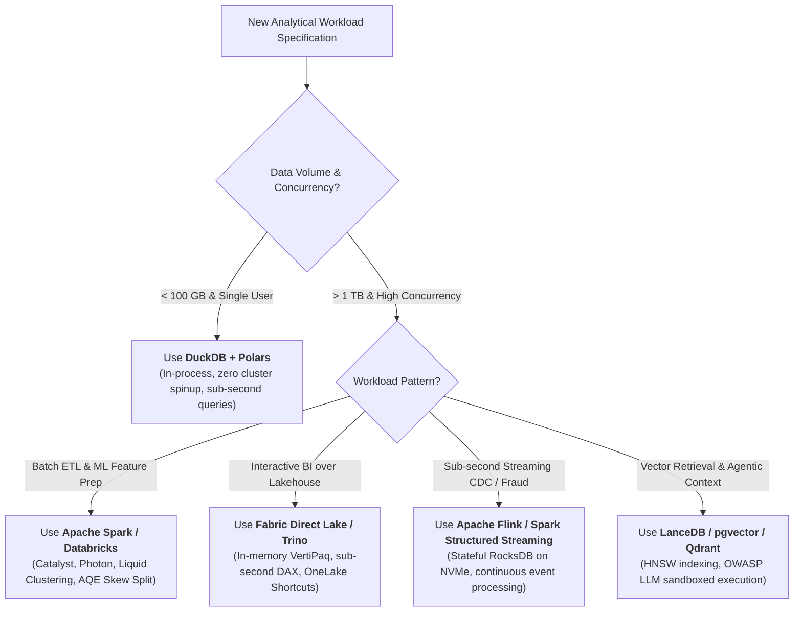

# Architecture Blueprints & Technical Deep-Dive Library

  
  
  

> **Authoritative Technical Guides & Enterprise Blueprints for Modern Lakehouse Systems**  
> Covering Azure Synapse, Microsoft Fabric, Modern NoSQL/Vector Databases, Streaming ETL, Lakehouse FinOps, Open Storage Formats, 42 Whiteboard Blueprints, and Delta Lake Performance Optimization.

> [!NOTE]
> **2026 Production Standards**: Architectural recommendations in this library align with current enterprise lakehouse specifications: Apache Spark 3.5+ AQE runtime skew splitting, Delta Lake 3.2 Liquid Clustering & Roaring Bitmap Deletion Vectors, Apache Iceberg v2/v3 REST Catalogs, AWS S3 Express One Zone sub-10ms directory buckets, NIST SP 800-207 Zero Trust, and OWASP Top 10 for LLMs.

---

## 📚 Architectural Modules Directory

| Module | Title | Core Technologies | Focus & Key Takeaways | Direct Link |
| :---: | :--- | :--- | :--- | :--- |
| **01** | **Azure Synapse Architecture Deep-Dive** | Dedicated SQL Pools, Serverless SQL, Managed VNet | MPP architecture, 60 hash distributions, Workload Management (WLM), HTAP Synapse Link. | [`01_azure_synapse.md`](./01_azure_synapse.md) |
| **02** | **Microsoft Fabric Architecture Mastery** | OneLake, Direct Lake, Shortcuts, F-SKU Capacity | SaaS lakehouse convergence, VertiPaq memory mapping, capacity smoothing, and bursting curves. | [`02_microsoft_fabric.md`](./02_microsoft_fabric.md) |
| **03** | **Modern NoSQL & Vector Databases** | Cosmos DB, ScyllaDB, pgvector, Qdrant, Milvus | RU/s optimization, multi-region writes, vector embeddings, semantic search, and RAG architectures. | [`03_nosql_vector_db.md`](./03_nosql_vector_db.md) |
| **04** | **Modern ETL/ELT & Stream Processing** | Spark, Flink, DuckDB, Polars, Delta UniForm | In-process analytical de-clustering, Apache Arrow zero-copy memory, real-time CEP vs micro-batching. | [`04_etl_stream_proc.md`](./04_etl_stream_proc.md) |
| **05** | **Lakehouse FinOps & Cloud Cost Optimization** | Databricks System Tables, Storage Lifecycle, Spot VMs | TCO models, Serverless SQL auto-scaling, Spot instance arbitrage, and cold data lifecycle policies. | [`05_lakehouse_finops.md`](./05_lakehouse_finops.md) |
| **06** | **Enterprise Blueprints & Failure Playbooks** | End-to-End Enterprise Lakehouse Blueprints | 6 production walkthroughs + 42 Whiteboard Blueprints across 7 domains with Mermaid flows. | [`06_enterprise_blueprints.md`](./06_enterprise_blueprints.md) |
| **07** | **Open Format Storage Types Reference** | Delta Lake, Apache Iceberg, Apache Hudi, Paimon | Lakehouse metadata snapshot trees, ACID OCC, hidden partitioning, Parquet/ORC/Avro physical layouts. | [`07_open_storage_formats.md`](./07_open_storage_formats.md) |
| **08** | **6 Delta Lake Optimization Levers** | Liquid Clustering, Z-Order, OPTIMIZE, VACUUM | Benchmarking 6 Delta Lake performance and storage hygiene levers across a 50M-row dataset. | [`08_delta_optimization.md`](./08_delta_optimization.md) |
| **Data** | **Unified Machine-Readable JSON Export** | Full Dataset JSON (`knowledge_base_export.json`) | Machine-readable export with metadata, schema tags, questions, and code snippets for SSGs and RAG. | [`knowledge_base_export.json`](./knowledge_base_export.json) |

---

## 🎨 Enterprise Whiteboards (42 Architect Blueprints across 7 Domains)

The platform provides 42 architect-grade digital whiteboard schematics across 7 domains with 5 persona perspectives (Lead Architect, Senior DE, DE, Steward, BI Analyst):

1. **Compute & Optimization (11 blueprints)**: Catalyst Optimizer & Photon Engine, Shuffle & Memory Architecture, Data Skew & AQE, SaveMode Handling, Join Strategy Decision Matrix, Tungsten Spill Mechanics, Structured Streaming State Store (RocksDB), Photon vs. JVM, Broadcast & Accumulators, SQL Server Engine Internals.
2. **Storage Engines & Formats (8 blueprints)**: Delta Lake ACID Under the Hood, Apache Iceberg Snapshot Tree, Open Table Formats, Open File Formats, 6 Delta Optimization Levers, Lakehouse ACID Concurrency Matrix, SCD Types 0–6 in Medallion, Master Enterprise Lakehouse Reference.
3. **Pipelines & Ingestion (8 blueprints)**: Apache Airflow Distributed Architecture, dbt Analytics Engineering DAG, Azure Data Factory Hybrid IR, Kafka Event Streaming, CDC with Debezium, Databricks Medallion Architecture, Delta Live Tables (DLT), Databricks Asset Bundles (DABs) & Serverless CI/CD.
4. **Platform Landscape (5 blueprints)**: Databricks Unified Platform Master, Enterprise RAG & Vector Data Pipelines, Modern Python Data (Arrow, Polars, DuckDB), FinOps & Cloud Cost Optimization, Enterprise Edge & IoT Architecture.
5. **Microsoft Fabric & Power BI (4 blueprints)**: Fabric Unified Architecture & OneLake, Power BI Direct Lake & VertiPaq, Power BI DAX Engine Mechanics, Fabric OneLake Shortcuts & Direct Lake Mode.
6. **Data Modeling & Architecture (4 blueprints)**: Kimball Dimensional Modeling & Star Schema, Data Vault 2.0 Enterprise Modeling, Distributed Systems Resilience & Consensus, Enterprise Data Mesh & Data Products.
7. **Governance & Security (2 blueprints)**: Unity Catalog Unified Governance & 3-Level Namespace, Microsoft Purview Unified Metadata & Catalog.

---

## 🧭 Architectural Decision Tree: Format & Engine Selection

---

[← Back to Central Documentation Hub](../README.md)
