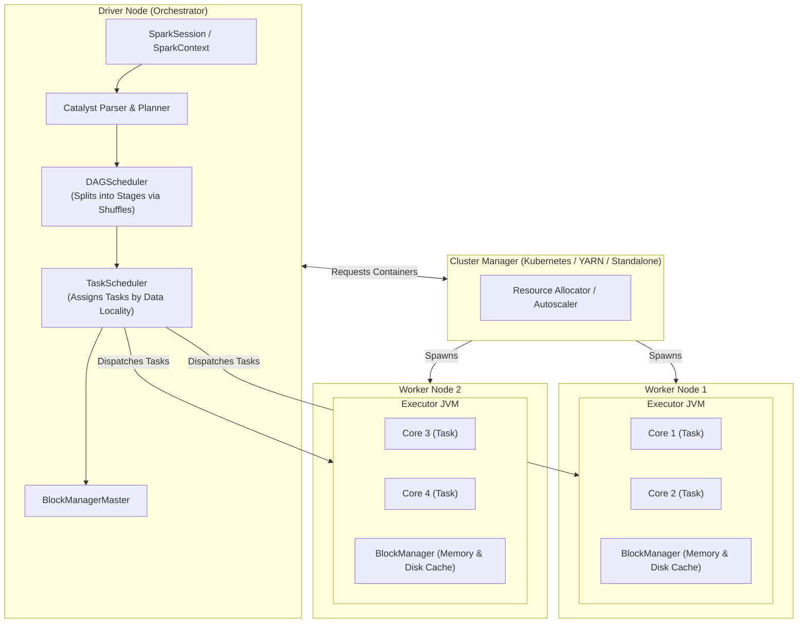
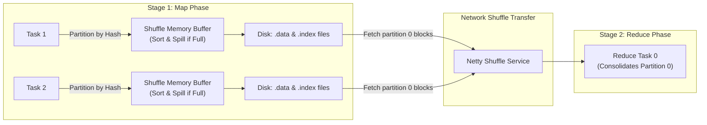
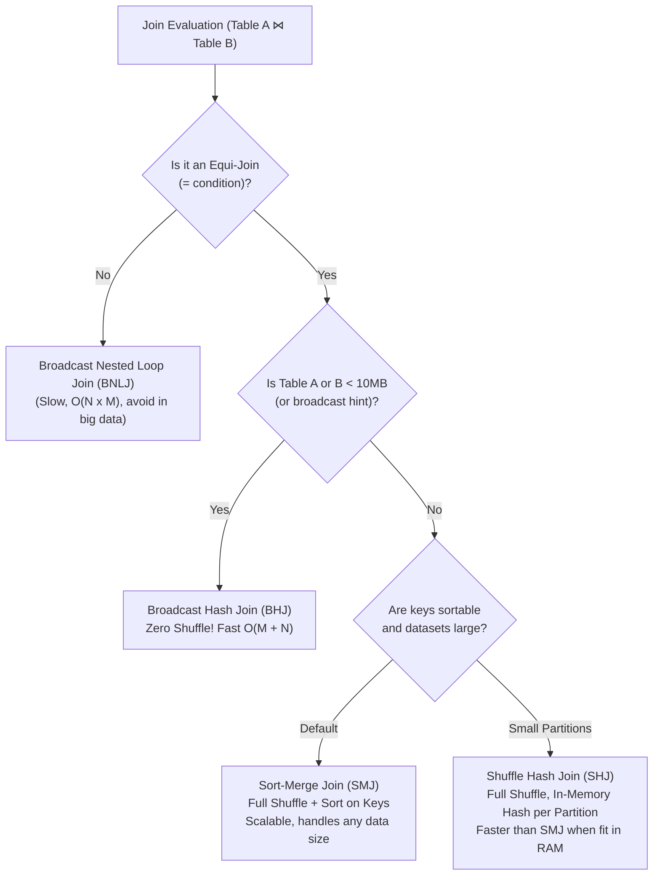
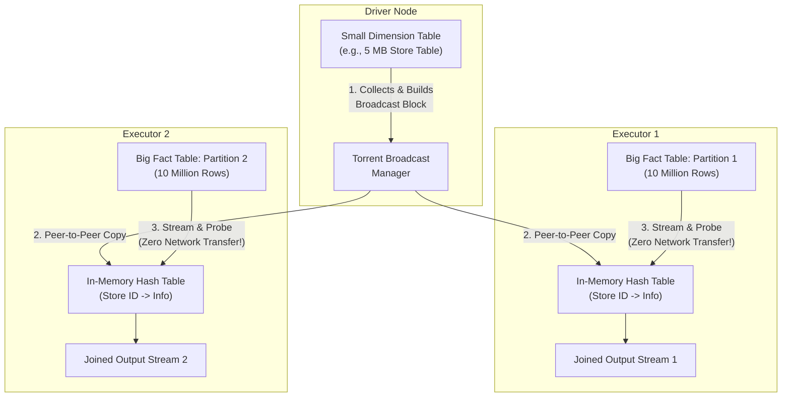
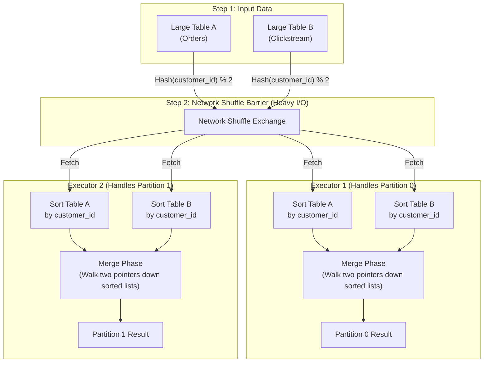
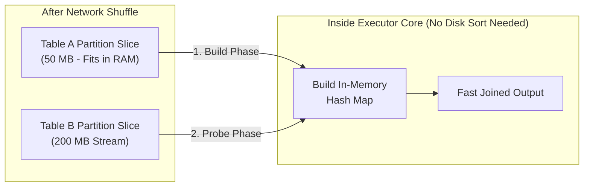
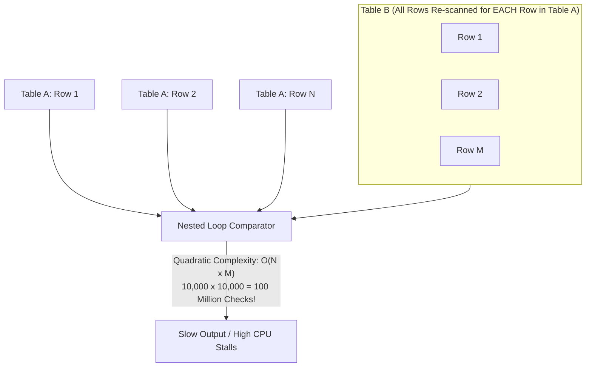
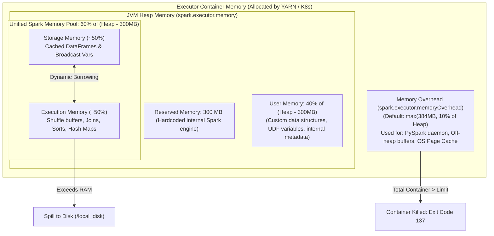
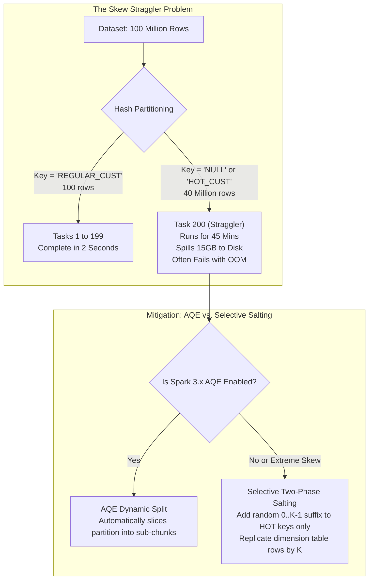

# Deep Dive: Distributed Core, Memory, Shuffling, Joins & Skew Mechanics

This guide provides an end-to-end technical breakdown of the 5 foundational performance pillars:
* **Pillar 1**: Distributed Core & Cluster Architecture
* **Pillar 2**: Partitioning, Shuffling & Data Distribution
* **Pillar 4**: Join Strategies & Relational Mechanics
* **Pillar 5**: Memory Management, OOM & Performance Triage
* **Pillar 6**: Data Skew, Key Distribution & Salting Mechanics

---

## Pillar 1: Distributed Core & Cluster Architecture



### 1.1 The Master-Worker Lifecycle
1. **Driver**: Instantiates the `SparkSession`, parses user code into an optimized execution plan, builds the DAG, and coordinates execution. The driver does **not** process data rows unless you call `.collect()`, `.take()`, or broadcast a table.
2. **Cluster Manager**: Allocates compute instances and launches executor containers on worker nodes based on configuration (`spark.executor.instances`, autoscaling).
3. **Executors**: Standalone JVM processes that run tasks on dedicated threads (cores), store cached partitions in memory/disk, and maintain local shuffle outputs.

### 1.2 The Execution Hierarchy: Job $\rightarrow$ Stage $\rightarrow$ Task
* **Job**: Triggered whenever user code calls an **action** (e.g., `.count()`, `.collect()`, `.save()`). A single notebook can trigger dozens of jobs.
* **Stage**: A physical boundary within a job. A new stage is created whenever a **wide transformation (shuffle)** occurs (e.g., `groupBy`, `join`, `distinct`). Within a stage, operations run in-memory via pipelining without network transfers.
* **Task**: The smallest executable unit. One task runs on one executor core and processes exactly **one partition** of data. A stage with 200 partitions runs 200 tasks.

### 1.3 Narrow Transformations vs. Wide Transformations & Pipelining
* **Narrow Transformations (`select`, `filter`, `withColumn`, `map`)**:
  * Each output partition depends on exactly one input partition.
  * **Pipelining / Whole-Stage CodeGen**: The engine compiles all sequential narrow transformations into a single Java bytecode `while` loop. Data stays in CPU registers and L1/L2 cache, never touching memory or disk between steps.
* **Wide Transformations (`groupBy`, `join`, `repartition`, `distinct`)**:
  * Output partitions depend on records scattered across multiple input partitions.
  * **Shuffle Barrier**: Execution must pause; all upstream tasks must write their partitioned data to local disk before downstream tasks can fetch it across the network.

---

## Pillar 2: Partitioning, Shuffling & Data Distribution



### 2.1 The Golden Sizing Rule: $100\text{ MB} - 200\text{ MB}$ per Partition
* **If partitions are too small ($< 20\text{ MB}$)**:
  * Scheduling overhead dominates. Launching a JVM task takes $5\text{ms} - 15\text{ms}$. If tasks finish in $2\text{ms}$, the cluster spends $80\%$ of its CPU cycles coordinating tasks rather than computing data.
* **If partitions are too large ($> 500\text{ MB} - 1\text{ GB}$)**:
  * Partitions cannot fit into executor execution memory during joins and aggregations, triggering severe **disk spilling** and JVM Garbage Collection thrashing.
* **Target Partition Calculation Formula**:
  $$\text{Target Shuffle Partitions} = \frac{\text{Stage Input Data Volume in Bytes}}{134,217,728 \text{ Bytes } (128\text{ MB})}$$

### 2.2 Hash vs. Range Partitioning
* **Hash Partitioning**: Evaluates `murmur3_hash(key) % num_partitions`. Fast and uniform for high-cardinality, evenly distributed keys.
* **Range Partitioning**: Samples the dataset to calculate quantile cutoffs so that Partition 0 contains keys $[A-E]$, Partition 1 $[F-K]$, etc. Used by `orderBy` and `sort` to produce globally ordered data.

### 2.3 Sort Shuffle Mechanics
Spark uses an **External Sorter**:
1. Incoming rows are held in an in-memory buffer (`PartitionedAppendOnlyMap` or `PartitionedPairBuffer`).
2. When the buffer fills, Spark sorts records by partition index and key, writing a temporary spilled file to disk.
3. At the end of the map task, all spilled runs are merged into **exactly one `.data` file** accompanied by an **`.index` file** containing byte offsets per target partition.
4. Downstream reduce tasks use the index file to perform random reads over HTTP/Netty.

### 2.4 Coalesce vs. Repartition
| Feature | `coalesce(n)` | `repartition(n)` |
| :--- | :--- | :--- |
| **Network Shuffle** | **No** (merges local partitions on same node) | **Yes** (full cluster-wide hash shuffle) |
| **Partition Count** | Can only **decrease** partition count | Can **increase or decrease** partition count |
| **Data Distribution** | Can result in uneven, skewed partition sizes | Uniform, balanced data distribution |
| **Primary Use Case** | Writing clean files to disk right before `.write` | Rebalancing data after heavy filters |

### 2.5 Dynamic Partition Pruning (DPP)
When joining a partitioned fact table (e.g., partitioned by `date`) with a small dimension table:
1. The dimension table is scanned and filtered (e.g., `where year = 2026`).
2. The matching distinct dates are packed into a **broadcast variable**.
3. The engine injects this list directly into the fact table scan, skipping entire partition directories at the file-system level before the join runs.

---

## Pillar 4: Join Strategies & Relational Mechanics



### 4.1 Join Strategy Deep Dive

| Join Strategy | Shuffle Required? | Memory Requirement | Best For | Vulnerability / Pitfall |
| :--- | :--- | :--- | :--- | :--- |
| **Broadcast Hash Join (BHJ)** | **None** | Dimension table must fit in Driver & Executor RAM | Small table ($< 10\text{ MB} - 100\text{ MB}$) joined with any large table | Driver OOM if broadcasted table is larger than expected |
| **Sort-Merge Join (SMJ)** | **Yes** (Both sides) | Low (streams through sorted partitions) | Large-scale joins ($> 100\text{ GB}$) | Disk spill during sort phase if keys are skewed |
| **Shuffle Hash Join (SHJ)** | **Yes** (Both sides) | High (smaller side partition must fit in execution RAM) | Large tables where sorting is expensive and partitions fit in RAM | Executor OOM if single partition hash table exceeds RAM |
| **Broadcast Nested Loop (BNLJ)** | **None** (One side broadcast) | Broadcast side in RAM | Non-equi joins (`<, >, !=`) | Extremely slow: quadratic CPU complexity $O(N \times M)$ |
| **Cartesian (Cross Join)** | **Yes** | High memory pressure | Explicit matrix multiplication | Explosive row count output |

### 4.2 Physical Visualizations of Join Execution

#### A. Broadcast Hash Join (BHJ) — Zero Fact Shuffle


#### B. Sort-Merge Join (SMJ) — Heavy Two-Sided Network Shuffle & Sort


#### C. Shuffle Hash Join (SHJ) — Shuffle without Disk Sorting


#### D. Broadcast Nested Loop Join (BNLJ) — The Quadratic Cluster Killer


### 4.3 How Broadcast Hash Join (BHJ) Works Internally
1. **Driver Collection**: The driver executes the sub-plan for the small table, runs `.collect()`, and builds an in-memory serialized buffer.
2. **Torrent Broadcast**: The driver distributes the buffer across all executors using a BitTorrent-style peer-to-peer protocol.
3. **Local Hash Table**: Each executor deserializes the small table into an in-memory hash table (Tungsten `BytesToBytesMap`).
4. **Zero-Shuffle Stream**: The large table is streamed from local storage directly through the hash table to find matching keys. **No network shuffle takes place.**

### 4.4 Bloom Filter Joins
For large-scale equi-joins where neither table fits in a broadcast join:
* Spark builds a compact **Bloom filter** (a space-efficient probabilistic bit array) on the join keys of the smaller table.
* The bit array is broadcast to the large table's scan tasks.
* Rows from the large table are tested against the Bloom filter; rows that definitely do not match are discarded **before** the shuffle exchange occurs, cutting network traffic by up to $80\%$.

---

## Pillar 5: Memory Management, OOM & Performance Triage



### 5.1 The Unified Memory Manager Explained
Spark dynamically manages the boundary between **Storage Memory** and **Execution Memory**:
* **Borrowing Rule**:
  * If Execution memory is idle, Storage can borrow space to cache DataFrames.
  * If Execution memory needs space for a join or sort, **it can forcefully evict Storage partitions to disk**.
  * **Storage CANNOT evict Execution memory**. Execution memory has absolute priority.

### 5.2 Deciphering Exit Code 137 (OOM Killer)
Exit Code 137 indicates that the host operating system or container manager (Kubernetes / YARN) sent a `SIGKILL` ($128 + 9 = 137$) to the executor container.
* **Why it happens**:
  The JVM heap (`spark.executor.memory`) did not necessarily crash. Rather, the **entire container's memory consumption** (JVM Heap + Off-Heap + Python worker processes + PyArrow allocations + OS page cache) exceeded the container ceiling.
* **The Remedy**:
  Increase `spark.executor.memoryOverhead` from the default $10\%$ to $25\% - 30\%$:
  ```text
  spark.executor.memory = 16g
  spark.executor.memoryOverhead = 4096m
  ```

### 5.3 Memory Spill Triage: Memory vs. Disk Spill
When Spark displays spill metrics in the Spark UI:
* **Spill (Memory)**: The size of the data in **uncompressed deserialized Java object form** while held in RAM.
* **Spill (Disk)**: The size of that exact same data after it was serialized, compressed (via Snappy/LZ4), and written to local disk.
* *Rule of Thumb*: Spill (Memory) is typically $3\times - 5\times$ larger than Spill (Disk). If you see $10\text{ GB}$ Spill (Disk), the executor had to serialize and shuffle $40\text{ GB}$ of uncompressed memory structures, creating severe I/O penalties.

### 5.4 G1GC Tuning Checklist
When Garbage Collection accounts for $> 15\%$ of total stage time:
1. Avoid creating millions of tiny Java String objects in UDFs; use native Spark SQL expressions.
2. Ensure you are using G1GC with modern settings:
   ```text
   -XX:+UseG1GC
   -XX:InitiatingHeapOccupancyPercent=45
   -XX:G1ReservePercent=15
   ```
3. Avoid "fat executors" with $> 5$ cores. Cores share the same heap; having 16 cores on a single JVM leads to massive parallel object allocation and prolonged GC stop-the-world pauses.

---

## Pillar 6: Data Skew, Key Distribution & Salting Mechanics



### 6.1 Anatomy of Data Skew
Data skew occurs when value distribution follows a power law (Zipf's law). Common skew culprits:
1. **Unchecked `NULL` Values**: Outer joins or uncleaned ingestion files where millions of rows have `NULL` or empty strings as their join key.
2. **Default / Sentinel Values**: Legacy records mapped to `-1`, `UNKNOWN`, or `9999-12-31`.
3. **Platform Mega-Entities**: A single platform customer (e.g., Walmart or Amazon) representing $40\%$ of all transactional volume.

### 6.2 The Three Levels of Skew Mitigation

#### Level 1: Automatic AQE Skew Join (Zero Code Changes)
In Spark 3.x+ / Databricks, Adaptive Query Execution detects skew dynamically after the map shuffle stage:
```sql
SET spark.sql.adaptive.enabled = true;
SET spark.sql.adaptive.skewJoin.enabled = true;
SET spark.sql.adaptive.skewJoin.skewedPartitionFactor = 3;
SET spark.sql.adaptive.skewJoin.skewedPartitionThresholdInBytes = 134217728; -- 128 MB
```
*How AQE fixes it*: Spark detects that Partition 50 is $3\times$ larger than the median and exceeds $128\text{ MB}$. It automatically breaks Partition 50 into three smaller sub-partitions ($50_1, 50_2, 50_3$) and reads the matching join partition from the other table three times, balancing task runtimes.

---

#### Level 2: Null / Default Value Isolation
If the skew is caused by nulls or default sentinels, **never salt nulls**. Filter them out before the join:
```python
# 1. Split valid keys from null keys
valid_orders = orders.filter("customer_id IS NOT NULL")
null_orders = orders.filter("customer_id IS NULL")

# 2. Join only valid keys (no skew)
joined_valid = valid_orders.join(customers, "customer_id", "inner")

# 3. Union nulls back with null dimension columns
from pyspark.sql.functions import lit
null_orders_aligned = null_orders.selectExpr(
    "*",
    "NULL as customer_name",
    "NULL as customer_tier"
)

final_result = joined_valid.unionByName(null_orders_aligned)
```

---

#### Level 3: Selective Two-Phase Salting
When dealing with valid, highly skewed enterprise keys where AQE is insufficient:

```python
from pyspark.sql import functions as F

# Step 1: Define salt factor and target hot keys
SALT_FACTOR = 8
SKEWED_KEYS = ["ENTERPRISE_CORP_1", "ENTERPRISE_CORP_2"]

# Step 2: Salt the skewed fact table (Add random 0..K-1 suffix ONLY to skewed keys)
salted_fact = fact_df.withColumn(
    "salt",
    F.when(F.col("account_id").isin(SKEWED_KEYS), F.floor(F.rand() * SALT_FACTOR))
     .otherwise(F.lit(0))
)

# Step 3: Replicate the dimension table (Explode 0..K-1 ONLY for skewed keys)
replicated_dim = dim_df.withColumn(
    "salt_array",
    F.when(
        F.col("account_id").isin(SKEWED_KEYS),
        F.array([F.lit(i) for i in range(SALT_FACTOR)])
    ).otherwise(F.array(F.lit(0)))
).withColumn("salt", F.explode("salt_array")).drop("salt_array")

# Step 4: Perform Join on both the key and the salt
balanced_joined_df = salted_fact.join(
    replicated_dim,
    on=["account_id", "salt"],
    how="inner"
).drop("salt")
```

### 6.3 The Pitfalls of "Blind" Salting vs. "Selective" Salting
* **The Blind Salting Trap**: If you append salt to *every row* in both tables, and your dimension table has 10 million rows, setting $K = 50$ explodes the dimension table to **500 million rows** across the network. This causes immediate network saturation, massive shuffle spill, and container crashes.
* **The Selective Rule**: **Only replicate what is actually skewed.** Normal keys should always carry `salt = 0` and remain un-exploded ($1\times$).
