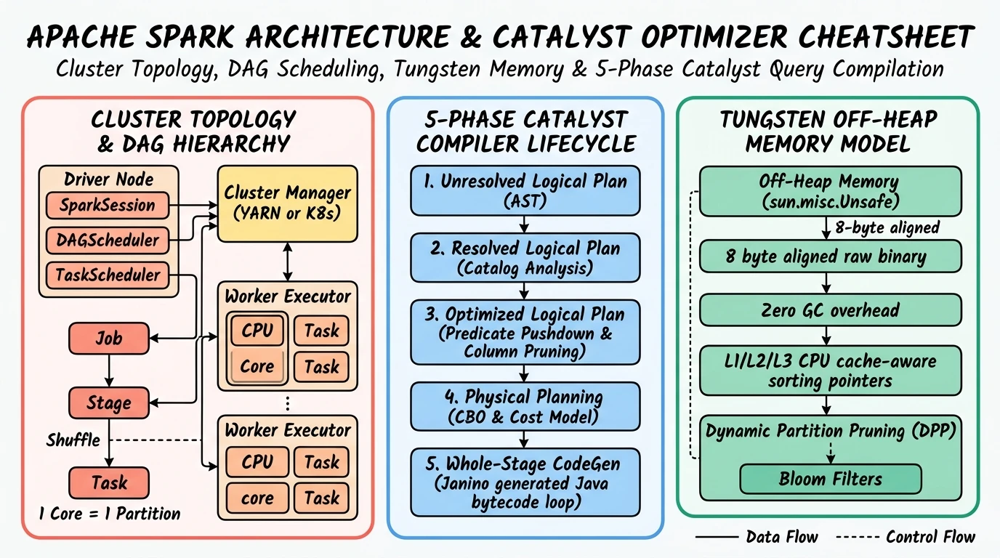
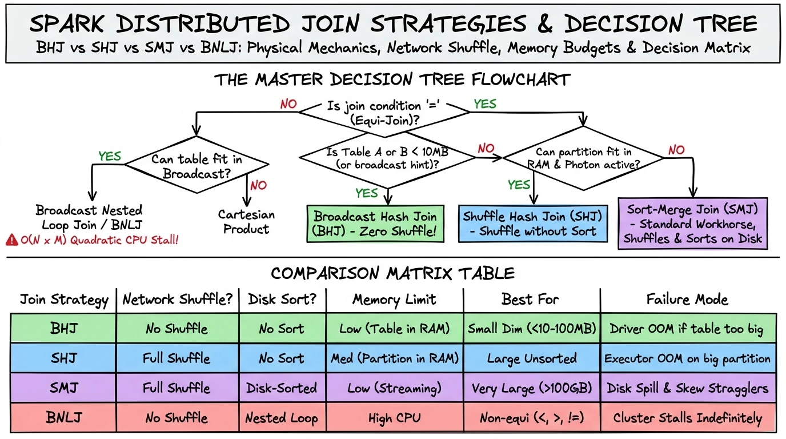
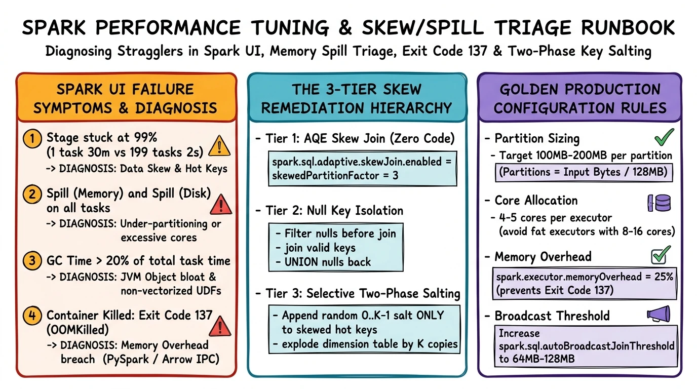

# Apache Spark Architecture, Optimizations & Production Triage Cheatsheet

> **Visual Quick Reference**: High-resolution digital whiteboard cheatsheets covering Spark distributed core topology, the 5-phase Catalyst optimizer compiler, physical join decision mechanics, Spark UI straggler diagnostics, and skew/spill triage playbooks.

---

## Cheatsheet 1: Cluster Architecture & Catalyst Optimizer



### Panel 1: Cluster Topology & DAG Hierarchy
- **Driver Node**: The JVM coordinator hosting `SparkSession`, `DAGScheduler` (converts logical plan to physical stages), `TaskScheduler` (dispatches task sets), and `BlockManagerMaster`.
- **Cluster Manager**: Coordinates worker node allocation across Kubernetes, YARN, or Databricks Serverless control plane.
- **Worker Executors**: Independent JVM processes running allocated CPU cores (task slots) and local `BlockManager` (replicates/serves blocks).
- **Execution Hierarchy**:
  - **Job**: Triggered by an Action (`.count()`, `.collect()`, `.write()`).
  - **Stage**: Separated strictly by **Wide Shuffle Boundaries** (ShuffleExchange). Pipelined operations (Narrow transformations: `.map()`, `.filter()`) run within a single stage.
  - **Task**: The atomic execution unit. **$1\text{ Core} = 1\text{ Task} = 1\text{ Partition}$**.

### Panel 2: The 5-Phase Catalyst Compiler Lifecycle
1. **Unresolved Logical Plan (AST)**: Syntactically parsed SQL or DataFrame operators containing unresolved relation and column names.
2. **Resolved Logical Plan (Analysis)**: Catalog lookup binds table and column names to types and schemas via Unity Catalog / Hive Metastore.
3. **Optimized Logical Plan**: Rule-based optimizations including:
   - **Predicate Pushdown**: Pushes filters to the storage layer before reading data.
   - **Column Pruning**: Eliminates unreferenced columns early.
   - **Constant Folding & Boolean Simplification**.
4. **Physical Planning**: Cost-Based Optimizer (CBO) evaluates physical operators (e.g. BroadcastHashJoin vs SortMergeJoin) using statistics and histograms.
5. **Whole-Stage CodeGen**: Compiles complex operator pipelines into a single flattened Java bytecode loop via the Janino compiler, eliminating virtual function calls and keeping variables in CPU registers.

### Panel 3: Tungsten Memory & Off-Heap Storage
- **Off-Heap Memory Model**: Uses `sun.misc.Unsafe` to allocate memory outside the JVM garbage collector, eliminating GC pauses for multi-gigabyte shuffle buffers.
- **Raw Binary Encodings**: Data stored in compact 8-byte aligned binary format rather than heavy Java objects (avoiding 16-byte object headers and pointer bloat).
- **Cache-Aware Computation**: Sort pointers and 8-byte key prefixes fit directly into L1/L2/L3 CPU cache lines for high-throughput in-memory sorting.
- **Dynamic Partition Pruning (DPP)**: Broadcasts dimension keys as Bloom filters to prune unneeded fact table partitions at runtime before scanning storage.

---

## Cheatsheet 2: Distributed Join Strategies & Master Decision Tree



### Master Join Decision Tree
```
Is the join condition an Equi-Join ('=')?
├── NO (Non-equi: <, >, !=, LIKE)
│    ├── Can the smaller table fit in memory? (spark.sql.autoBroadcastJoinThreshold)
│    │    └── YES ──► Broadcast Nested Loop Join (BNLJ) [Warning: O(N*M) CPU stall]
│    └── NO ────────► Cartesian Product Join (CPJ) [Fatal: N*M output explosion]
│
└── YES (Equi-Join)
     ├── Is one side small enough to broadcast? (Default < 10MB or explicit broadcast hint)
     │    └── YES ──► Broadcast Hash Join (BHJ) [Zero Network Shuffle, Zero Disk Sort]
     │
     └── NO (Both sides are large)
          ├── Can build-side partitions fit in RAM & is Photon / ShuffleHash enabled?
          │    └── YES ──► Shuffle Hash Join (SHJ) [Shuffles keys, builds hash table in RAM]
          │
          └── NO ────────► Sort-Merge Join (SMJ) [Standard Workhorse: Shuffles & sorts on disk]
```

### Physical Join Comparison Matrix

| Join Strategy | Network Shuffle? | Disk Sort? | Memory Footprint | Sweet Spot | Catastrophic Failure Mode |
| :--- | :---: | :---: | :--- | :--- | :--- |
| **Broadcast Hash Join (BHJ)** | ❌ No | ❌ No | High on Driver & Executors | Small dimension lookup ($< 10\text{MB}-100\text{MB}$) | Driver JVM OutOfMemoryError if table is too large |
| **Shuffle Hash Join (SHJ)** | ⚠️ Full Shuffle | ❌ No | Medium (each partition fits in RAM) | Large dataset with no pre-sorting; Photon engine | Executor OOM if single partition exceeds RAM |
| **Sort-Merge Join (SMJ)** | ⚠️ Full Shuffle | ⚠️ Disk Sort | Minimal (Streaming iterator) | Very large datasets ($> 100\text{GB}$) | Disk spill & long-tail stragglers on skewed keys |
| **Broadcast Nested Loop (BNLJ)** | ❌ No | ❌ No | Driver memory + CPU bound | Non-equi conditions on tiny reference tables | Quadratic $O(N \times M)$ CPU lockup & pipeline hang |

---

## Cheatsheet 3: Performance Tuning & Skew/Spill Triage Runbook



### Panel 1: Spark UI Failure Symptoms & Rapid Diagnosis
1. **Symptom: Stage stuck at 99% (1 task takes 35 mins while 199 finish in 2 seconds)**
   - *Root Cause*: **Data Skew / Hot Key Concentration**.
   - *Spark UI Verification*: Go to **Stages tab** -> **Task Summary Metrics** -> Check the **Max vs Median** duration and shuffle read sizes. If Max is 100x Median, data is skewed.
2. **Symptom: All tasks show heavy `Spill (Memory)` and `Spill (Disk)`**
   - *Root Cause*: **Under-partitioning** or executor core contention (e.g. 16 cores per executor sharing 16GB RAM).
   - *Remediation*: Increase partition count (`spark.sql.shuffle.partitions` or `repartition`) to target **$100\text{MB}-200\text{MB}$ per partition**.
3. **Symptom: Executor GC Time $> 20\%$ of total Task Time**
   - *Root Cause*: JVM Object bloat, heavy non-vectorized Python UDFs, or caching large string-heavy DataFrames without deserialization.
   - *Remediation*: Switch to Native PySpark / Higher-Order SQL functions or Pandas Vectorized UDFs (Arrow-backed).
4. **Symptom: Container Killed: Exit Code 137 (OOMKilled)**
   - *Root Cause*: Off-heap memory overhead breached by PySpark worker processes, Arrow IPC buffers, or RocksDB streaming state stores.
   - *Remediation*: Increase `spark.executor.memoryOverhead` from default $10\%$ to $20\%-25\%$.

### Panel 2: The 3-Tier Skew Remediation Hierarchy
- **Tier 1: Adaptive Query Execution (AQE) Skew Join (Zero-Code)**
  ```python
  spark.conf.set("spark.sql.adaptive.enabled", "true")
  spark.conf.set("spark.sql.adaptive.skewJoin.enabled", "true")
  spark.conf.set("spark.sql.adaptive.skewJoin.skewedPartitionFactor", "3")
  spark.conf.set("spark.sql.adaptive.skewJoin.skewedPartitionThresholdInBytes", "67108864") # 64MB
  ```
- **Tier 2: Null Key Isolation**
  - Nulls hash to partition 0, causing massive skew stragglers.
  ```sql
  -- Separate valid keys from nulls before joining
  SELECT o.*, c.*
  FROM orders o
  JOIN customers c ON o.customer_id = c.customer_id
  WHERE o.customer_id IS NOT NULL
  UNION ALL
  SELECT o.*, NULL AS customer_name, NULL AS customer_tier
  FROM orders o
  WHERE o.customer_id IS NULL;
  ```
- **Tier 3: Selective Two-Phase Key Salting (PySpark)**
  - Replicate dimension keys by $K$ and append a random uniform suffix ($0 \dots K-1$) to the skewed hot keys on the fact table:
  ```python
  from pyspark.sql import functions as F

  SALT_FACTOR = 8
  SKEWED_KEYS = ["GUEST_CHECKOUT", "DEFAULT_STORE"]

  # 1. Salt only skewed keys on large fact table
  orders_salted = orders.withColumn(
      "salt",
      F.when(F.col("customer_id").isin(SKEWED_KEYS), F.floor(F.rand() * SALT_FACTOR))
       .otherwise(F.lit(0))
  ).withColumn("join_key", F.concat_ws("_", F.col("customer_id"), F.col("salt")))

  # 2. Explode lookup dimension table by SALT_FACTOR
  customers_replicated = customers.withColumn(
      "salt",
      F.when(F.col("customer_id").isin(SKEWED_KEYS), F.explode(F.array([F.lit(i) for i in range(SALT_FACTOR)])))
       .otherwise(F.lit(0))
  ).withColumn("join_key", F.concat_ws("_", F.col("customer_id"), F.col("salt")))

  # 3. Perform even, un-skewed join
  result = orders_salted.join(customers_replicated, on="join_key", how="inner").drop("salt", "join_key")
  ```

### Panel 3: Golden Production Configuration Rules

```ini
# 1. Optimal Partition Sizing (Target 100MB - 200MB per task partition)
# Partitions = Total Input Uncompressed Data (Bytes) / 134217728 (128MB)
spark.sql.files.maxPartitionBytes=134217728

# 2. Adaptive Query Execution (Spark 3.x+ Standard)
spark.sql.adaptive.enabled=true
spark.sql.adaptive.coalescePartitions.enabled=true
spark.sql.adaptive.advisoryPartitionSizeInBytes=134217728

# 3. Dynamic Partition Pruning & Bloom Filters
spark.sql.optimizer.dynamicPartitionPruning.enabled=true
spark.sql.optimizer.dynamicPartitionPruning.useStats=true

# 4. Executor Sizing (The "Golden 5-Core" Rule)
# Avoid fat executors (e.g. 16 cores) to prevent GC stall and IO saturation
spark.executor.cores=4
spark.executor.memory=28g
spark.executor.memoryOverhead=6g  # 20-25% buffer prevents Exit Code 137

# 5. Broadcast Join Threshold Tuning
# If Driver has >= 32GB RAM, safely increase threshold to reduce network shuffles
spark.sql.autoBroadcastJoinThreshold=67108864 # 64MB (Default 10MB)
```

---

## Related Documentation & Reproducibility Labs
- **Distributed Core & Join Mechanics Deep Dive**: [`distributed_core_joins_and_skew_deep_dive.md`](./distributed_core_joins_and_skew_deep_dive.md)
- **Synthetic Skew & Spill Reproduction Lab**: [`synthetic_skew_and_spill_lab.md`](./synthetic_skew_and_spill_lab.md)
- **100 Databricks Interview Defense Playbook**: [`../interview_prep/100_databricks_interview_defense_playbook.md`](../interview_prep/100_databricks_interview_defense_playbook.md)
- **200 Concepts Encyclopedia**: [`../interview_prep/200_databricks_spark_and_lakehouse_concepts_encyclopedia.md`](../interview_prep/200_databricks_spark_and_lakehouse_concepts_encyclopedia.md)
- **Complete Whiteboard Blueprints Hub (20 Pillars & 8 Playbooks)**: [`../whiteboard_diagrams/handbook_whiteboard_blueprints.md`](../whiteboard_diagrams/handbook_whiteboard_blueprints.md)
