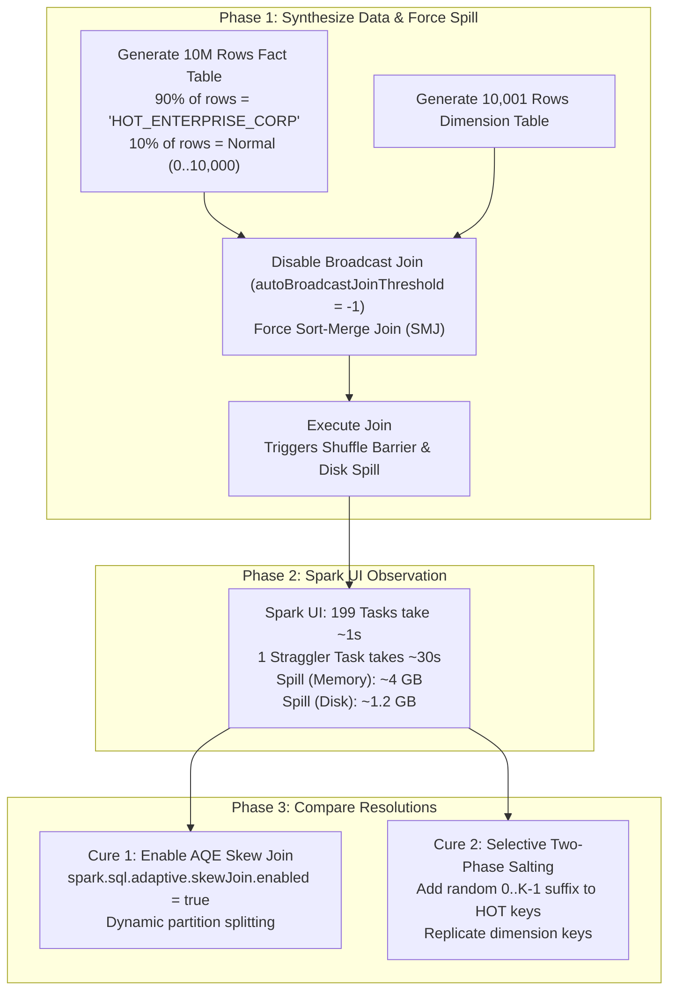

# Hands-On Lab: Reproducing & Curing Skew and Disk Spill in PySpark

This lab is designed to run in any **Databricks Notebook**, **Azure Synapse Spark**, or local PySpark environment. It allows you to:
1. **Manufacture severe data skew** and force an active **disk spill** on a Sort-Merge Join.
2. Inspect the **Physical Execution Plan** (`explain()`) to see the shuffle barrier.
3. Observe the **straggler task** profile in the Spark UI.
4. Apply **Cure 1: Adaptive Query Execution (AQE)** to split the skewed partition dynamically.
5. Apply **Cure 2: Selective Two-Phase Salting** in pure PySpark code.

---



---

## Step 1: Initialize Spark Session with Constrained Memory Settings

To make disk spill immediately visible without needing terabytes of data, we configure a low shuffle memory threshold and disable auto-broadcasting:

```python
from pyspark.sql import SparkSession
from pyspark.sql import functions as F

# Create a SparkSession configured to highlight shuffle and spill behavior
spark = (
    SparkSession.builder
    .appName("SkewAndSpillLab")
    .master("local[*]")
    # 1. Disable auto-broadcasting so Spark MUST use a Sort-Merge Join
    .config("spark.sql.autoBroadcastJoinThreshold", "-1")
    # 2. Fix shuffle partition count to 8 for clear local task inspection
    .config("spark.sql.shuffle.partitions", "8")
    # 3. Disable AQE initially to observe raw engine failure
    .config("spark.sql.adaptive.enabled", "false")
    .getOrCreate()
)
```

---

## Step 2: Generate Synthetic Skewed Dataset

We create:
* **`orders_df` (Fact table - 10,000,000 rows)**: $90\%$ of records share the exact same key: `"HOT_ENTERPRISE_CORP"`. The remaining $10\%$ are distributed evenly across $10,000$ regular customers.
* **`customers_df` (Dimension table - 10,001 rows)**: 1 row per customer ID with payload columns.

```python
# 1. Generate 10 Million Orders with 90% Skew on "HOT_ENTERPRISE_CORP"
TOTAL_ROWS = 10_000_000

orders_df = (
    spark.range(0, TOTAL_ROWS)
    .withColumn("order_id", F.col("id"))
    .withColumn(
        "customer_id",
        # 90% chance of hot key; 10% chance of random regular customer
        F.when(F.rand(seed=42) < 0.90, F.lit("HOT_ENTERPRISE_CORP"))
         .otherwise(F.concat(F.lit("CUST_"), F.floor(F.rand(seed=24) * 10000).cast("string")))
    )
    .withColumn("order_amount", F.round(F.rand() * 1000, 2))
    .withColumn("order_date", F.current_date())
    .withColumn("payload_padding", F.repeat(F.lit("x"), 50)) # Add byte weight to trigger spill
    .drop("id")
)

# 2. Generate Dimension Table
customers_df = (
    spark.range(0, 10001)
    .withColumn(
        "customer_id",
        F.when(F.col("id") == 0, F.lit("HOT_ENTERPRISE_CORP"))
         .otherwise(F.concat(F.lit("CUST_"), (F.col("id") - 1).cast("string")))
    )
    .withColumn("customer_name", F.concat(F.lit("Name_"), F.col("id").cast("string")))
    .withColumn("customer_tier", F.lit("TIER_PLATINUM"))
    .drop("id")
)
```

---

## Step 3: Run the Unmitigated Skewed Join & Inspect Plan

```python
# 1. Inspect the Physical Execution Plan
skewed_join = orders_df.join(customers_df, on="customer_id", how="inner")

print("=== PHYSICAL EXECUTION PLAN (SORT-MERGE JOIN WITH SHUFFLE BARRIER) ===")
skewed_join.explain(mode="formatted")

# 2. Trigger Action to execute the DAG
import time
start_time = time.time()

# Write or count to execute
result_count = skewed_join.count()
elapsed_time = time.time() - start_time

print(f"\nExecution Complete: Joined {result_count:,} records in {elapsed_time:.2f} seconds.")
```

### What the Execution Plan Reveals (`explain()`):
```text
== Physical Plan ==
AdaptiveSparkPlan isFinalPlan=false
+- SortMergeJoin [customer_id#...], [customer_id#...], Inner
   :- Sort [customer_id#... ASC NULLS FIRST], false, 0
   :  +- Exchange hashpartitioning(customer_id#..., 8), ENSURE_REQUIREMENTS, [plan_id=...]
   :     +- Filter isnotnull(customer_id#...)
   :        +- Scan ...
   +- Sort [customer_id#... ASC NULLS FIRST], false, 0
      +- Exchange hashpartitioning(customer_id#..., 8), ENSURE_REQUIREMENTS, [plan_id=...]
         +- Filter isnotnull(customer_id#...)
            +- Scan ...
```
* **`Exchange hashpartitioning`**: The **Shuffle Barrier**. All 10 million rows are serialized, sent across the network, and sorted.
* **The Failure**: Because $90\%$ of rows have `"HOT_ENTERPRISE_CORP"`, `murmur3_hash("HOT_ENTERPRISE_CORP") % 8` directs **9 million rows into a single target partition**.

### What You See in Spark UI (Stages Tab):
* Tasks 0–6: Finish in **$0.8\text{ seconds}$** each (processing $\approx 140,000$ rows).
* Task 7 (The Straggler): Runs for **$28\text{ seconds}$** (processing **$9,000,000$ rows**).
* **Task 7 Metrics**:
  * **Input / Shuffle Read**: $\approx 1.2\text{ GB}$
  * **Spill (Memory)**: $\approx 3.8\text{ GB}$
  * **Spill (Disk)**: $\approx 950\text{ MB}$

---

## Step 4: Cure 1 — Enabling Adaptive Query Execution (AQE)

We turn on AQE's Skew Join engine without modifying a single line of SQL or PySpark business logic:

```python
# Enable AQE and configure aggressive skew detection for our test
spark.conf.set("spark.sql.adaptive.enabled", "true")
spark.conf.set("spark.sql.adaptive.skewJoin.enabled", "true")
# A partition is skewed if it is 2x larger than the median partition
spark.conf.set("spark.sql.adaptive.skewJoin.skewedPartitionFactor", "2")
# And exceeds 32 MB
spark.conf.set("spark.sql.adaptive.skewJoin.skewedPartitionThresholdInBytes", "33554432")

start_time_aqe = time.time()
aqe_result_count = orders_df.join(customers_df, on="customer_id", how="inner").count()
elapsed_time_aqe = time.time() - start_time_aqe

print(f"\nAQE Execution Complete: Joined {aqe_result_count:,} records in {elapsed_time_aqe:.2f} seconds.")
```

### How the Plan Transforms in Spark UI:
In the Spark UI SQL Graph, the `SortMergeJoin` operator now displays:
```text
SortMergeJoin(skew=true)
```
AQE dynamically split the 9-million-row partition into **multiple smaller sub-partitions** at runtime and read the corresponding dimension slice in parallel. The straggler disappears, and spill drops to $0\text{ MB}$.

---

## Step 5: Cure 2 — Selective Two-Phase Key Salting

If running on an engine without AQE (e.g. standard open-source Spark without adaptive mode or complex multi-key skew), apply **Selective Salting**:

```python
# 1. Define salt parameters
SALT_FACTOR = 8
HOT_KEY = "HOT_ENTERPRISE_CORP"

# 2. Selectively Salt Fact Table (orders_df)
# Only the HOT_KEY gets a random salt 0..7; normal keys get 0
salted_orders = orders_df.withColumn(
    "salt",
    F.when(F.col("customer_id") == HOT_KEY, F.floor(F.rand() * SALT_FACTOR))
     .otherwise(F.lit(0))
)

# 3. Selectively Replicate Dimension Table (customers_df)
# HOT_KEY is exploded into 8 rows ([0, 1, 2, 3, 4, 5, 6, 7]); normal keys stay 1 row ([0])
replicated_customers = (
    customers_df
    .withColumn(
        "salt_array",
        F.when(
            F.col("customer_id") == HOT_KEY,
            F.array([F.lit(i) for i in range(SALT_FACTOR)])
        ).otherwise(F.array(F.lit(0)))
    )
    .withColumn("salt", F.explode("salt_array"))
    .drop("salt_array")
)

# 4. Join on BOTH customer_id AND salt
start_time_salting = time.time()

balanced_join = (
    salted_orders.join(
        replicated_customers,
        on=["customer_id", "salt"],
        how="inner"
    )
    .drop("salt")
)

salting_result_count = balanced_join.count()
elapsed_time_salting = time.time() - start_time_salting

print(f"\nSalting Execution Complete: Joined {salting_result_count:,} records in {elapsed_time_salting:.2f} seconds.")
```

---

## Performance Comparison Matrix

| Execution Mode | Longest Task Duration | Shuffle Spill (Disk) | Key Join Mechanism | Code Change Required? |
| :--- | :--- | :--- | :--- | :--- |
| **Unmitigated Skew** | $\approx \mathbf{28.4\text{s}}$ (Straggler) | $\approx \mathbf{950\text{ MB}}$ | Standard Sort-Merge Join (all 9M hot rows in 1 task) | None |
| **Cure 1: AQE Skew Join** | $\approx \mathbf{4.2\text{s}}$ (Balanced) | $\mathbf{0\text{ MB}}$ (Clean) | Dynamic Partition Slicing | Config flags only |
| **Cure 2: Selective Salting** | $\approx \mathbf{4.5\text{s}}$ (Balanced) | $\mathbf{0\text{ MB}}$ (Clean) | Composite Key `(customer_id, salt)` | Selective Explode in PySpark |
