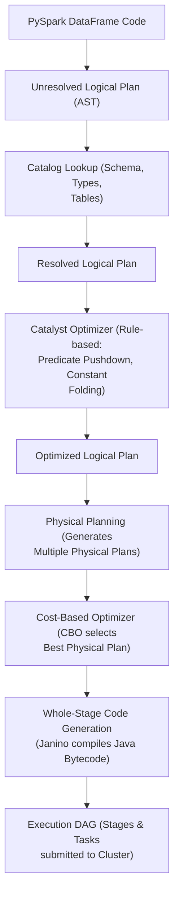
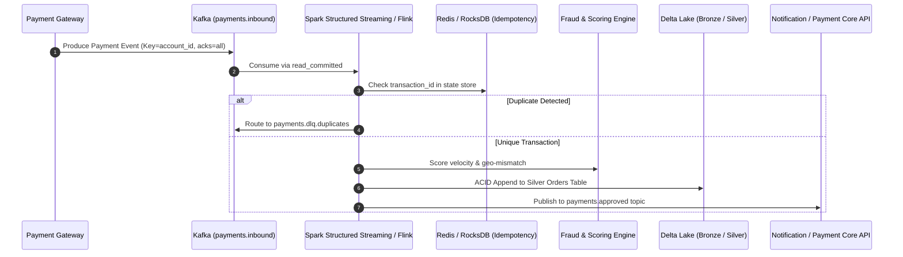
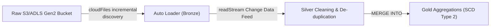
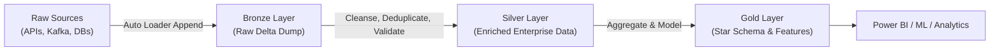
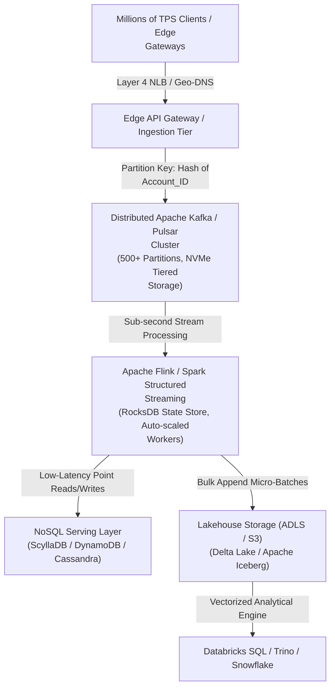
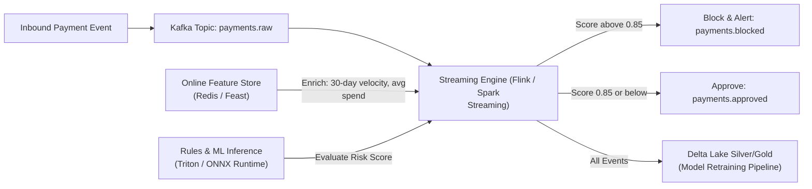

# 125 Data Engineering Master Defense Playbook & Architectural Guide
> **Comprehensive Senior & Lead Engineer Interview Solutions, Production Code, and Architectural Blueprint**
> *Based on the complete 125-question curriculum spanning SQL, Apache Spark, Apache Kafka, Spark Structured Streaming, Azure Databricks, Delta Lake, AWS Big Data, System Design, and Engineering Leadership.*

---

## Executive Overview & Table of Contents

This manual delivers production-grade, battle-tested solutions for all **125 core Data Engineering interview questions**. Every response is engineered to demonstrate senior/lead architectural authority, incorporating deep runtime internals, concrete code implementations, production triage runbooks, and enterprise trade-off defenses.

### Curriculum Directory

1. [Section 1: SQL & PySpark (Questions 1 – 50)](#section-1-sql--pyspark-questions-1--50)
   - *Core Mechanics:* Null-safe joins, analytical window functions, moving averages, SCD Type 2 merge patterns, pivot/unpivot, skew salting, Tungsten off-heap memory, G1GC triage, and Catalyst Whole-Stage CodeGen.
2. [Section 2: Apache Kafka Production Engineering (Questions 51 – 55)](#section-2-apache-kafka-production-engineering-questions-51--55)
   - *Core Mechanics:* High-throughput broker tuning, Cooperative Sticky Assignor, Dead Letter Queues (DLQ), EOS idempotency, and Schema Registry evolution into Delta Lake.
3. [Section 3: Spark Structured Streaming (Questions 56 – 60)](#section-3-spark-structured-streaming-questions-56--60)
   - *Core Mechanics:* Checkpoint WAL anatomy, event-time watermarking, off-heap RocksDB state stores, and micro-batch latency triage.
4. [Section 4: Azure Cloud & Databricks (Questions 61 – 90)](#section-4-azure-cloud--databricks-questions-61--90)
   - *Core Mechanics:* Control vs Data Plane architecture, Delta Lake 3.x transaction logs (`_delta_log`), Liquid Clustering, Deletion Vectors, small file compaction, ADF orchestration, and cluster FinOps sizing.
5. [Section 5: AWS Cloud Big Data Stack (Questions 91 – 95)](#section-5-aws-cloud-big-data-stack-questions-91--95)
   - *Core Mechanics:* Serverless lakehouse architecture, AWS Glue 4.0 DPUs vs AWS Lambda micro-ETL, and Step Functions DAG state machines.
6. [Section 6: Project Experience & Interview Defense (Questions 96 – 110)](#section-6-project-experience--interview-defense-questions-96--110)
   - *Core Mechanics:* Petabyte-scale STAR project narratives, 5x volume scale-up strategies, large CSV ingestion with Auto Loader rescue column, and zero-downtime cutover.
7. [Section 7: System Design & Enterprise Scenarios (Questions 111 – 115)](#section-7-system-design--enterprise-scenarios-questions-111--115)
   - *Core Mechanics:* Multi-million TPS distributed stream ingestion, real-time fraud detection with sub-10ms feature store lookups, and incident response disaster recovery.
8. [Section 8: Managerial & Behavioral Leadership (Questions 116 – 125)](#section-8-managerial--behavioral-leadership-questions-116--125)
   - *Core Mechanics:* Technical dispute resolution via RFC matrices, client timeline misalignment negotiation, junior mentorship frameworks, and consultative FinOps cost audits.

---

## Section 1: SQL & PySpark (Questions 1 – 50)

### Q1: Return matching records from 2 tables which also contain Null values.

**Direct 30-Second Answer:**
Standard SQL `=` and `<>` operators operate on three-valued logic (`TRUE`, `FALSE`, `UNKNOWN`). When comparing two `NULL` values using `=`, the result is `UNKNOWN`, which evaluates to `FALSE` in join filters. To match records where both sides contain `NULL`, you must use **null-safe equality**:
- **ANSI SQL-99:** `ON a.col IS NOT DISTINCT FROM b.col`
- **Spark SQL / Databricks / Hive:** `ON a.col <=> b.col`

**Production Code:**
```sql
-- ANSI Standard
SELECT a.*, b.*
FROM table_a a
INNER JOIN table_b b
  ON a.customer_id IS NOT DISTINCT FROM b.customer_id;

-- Spark SQL / Databricks
SELECT a.*, b.*
FROM table_a a
INNER JOIN table_b b
  ON a.customer_id <=> b.customer_id;
```

**PySpark DataFrame API:**
```python
from pyspark.sql import functions as F

# eqNullSafe() matches nulls with nulls
df_joined = df_a.join(df_b, df_a["customer_id"].eqNullSafe(df_b["customer_id"]), "inner")
```

**Senior Defense & Gotchas:**
- `COALESCE(col, 'dummy_value')` is an anti-pattern: it breaks partition pruning, prevents Catalyst optimizer filter pushdown, and risks collisions if the dummy value naturally appears in source systems.
- Null-safe joins can cause **severe data skew** if millions of records have `NULL` keys, as all null records hash to partition 0 during shuffle. Mitigate by salting or handling nulls in a separate union branch.

---

### Q2: Return all records from Left Table which matches with Right Table.

**Direct 30-Second Answer:**
Depending on whether you need columns from the right table or want to prevent row duplication:
1. **Inner Join:** Returns matched rows with columns from both tables. If the right table has multiple matches, the left table's rows are multiplied.
2. **Left Semi Join (Best Practice):** Returns rows from the left table *only* where at least one match exists in the right table. It **never multiplies rows** and does not project right-table columns.

**Production Code:**
```sql
-- Production standard: Avoids row multiplication when right table has duplicate keys
SELECT a.*
FROM transactions a
LEFT SEMI JOIN active_merchants b
  ON a.merchant_id = b.merchant_id;
```

**PySpark DataFrame API:**
```python
df_matched = df_transactions.join(df_active_merchants, on="merchant_id", how="left_semi")
```

**Senior Defense & Gotchas:**
- Many junior engineers write `SELECT a.* FROM a LEFT JOIN b ON a.id = b.id WHERE b.id IS NOT NULL`. This causes unnecessary shuffle memory overhead, row multiplication if `b.id` is not unique, and requires an expensive `DISTINCT` deduplication pass. Catalyst executes `LEFT SEMI JOIN` with an optimized hash probe that stops at the first match.

---

### Q3: From a Travel history table containing User Id, City, and Travel Date, identify the source and destination city of each journey.

**Direct 30-Second Answer:**
Use analytical window functions partitioned by `user_id` and ordered by `travel_date`:
- **Leg-by-Leg Destination:** `LEAD(city) OVER (PARTITION BY user_id ORDER BY travel_date)`
- **Overall Origin & Destination:** `FIRST_VALUE(city)` and `LAST_VALUE(city)` with explicit window frames.

**Production Code:**
```sql
-- Point-to-Point Journey Legs
SELECT
    user_id,
    city AS source_city,
    LEAD(city) OVER (PARTITION BY user_id ORDER BY travel_date) AS destination_city,
    travel_date AS departure_date,
    LEAD(travel_date) OVER (PARTITION BY user_id ORDER BY travel_date) AS arrival_date
FROM travel_history;

-- Overall Origin and Final Destination across entire journey history
SELECT
    user_id,
    FIRST_VALUE(city) OVER (
        PARTITION BY user_id ORDER BY travel_date
    ) AS origin_city,
    LAST_VALUE(city) OVER (
        PARTITION BY user_id ORDER BY travel_date
        ROWS BETWEEN UNBOUNDED PRECEDING AND UNBOUNDED FOLLOWING
    ) AS final_destination_city
FROM travel_history;
```

**Senior Defense & Gotchas:**
- **The `LAST_VALUE()` Frame Trap:** The default window frame in ANSI SQL is `RANGE BETWEEN UNBOUNDED PRECEDING AND CURRENT ROW`. Without explicitly defining `ROWS BETWEEN CURRENT ROW AND UNBOUNDED FOLLOWING` or `ROWS BETWEEN UNBOUNDED PRECEDING AND UNBOUNDED FOLLOWING`, `LAST_VALUE()` will mistakenly return the *current row's value*, not the last row in the partition.

---

### Q4: Find 4th highest salary for each department.

**Direct 30-Second Answer:**
Use `DENSE_RANK()` inside a Common Table Expression (CTE) partitioned by `department_id` and ordered by `salary DESC`. `DENSE_RANK()` ensures tied salaries share the same rank without skipping numbers.

**Production Code:**
```sql
WITH ranked_salaries AS (
    SELECT
        emp_id,
        emp_name,
        department_id,
        salary,
        DENSE_RANK() OVER (PARTITION BY department_id ORDER BY salary DESC) as salary_rank
    FROM employees
)
SELECT department_id, emp_id, emp_name, salary
FROM ranked_salaries
WHERE salary_rank = 4;
```

**PySpark DataFrame API:**
```python
from pyspark.sql.window import Window
from pyspark.sql import functions as F

window_dept = Window.partitionBy("department_id").orderBy(F.col("salary").desc())

df_4th = (
    df_employees
    .withColumn("salary_rank", F.dense_rank().over(window_dept))
    .filter(F.col("salary_rank") == 4)
)
```

**Senior Defense & Gotchas:**
- If a department has fewer than 4 distinct salary tiers, this query returns zero rows for that department. If the business requirement demands returning the lowest available salary when < 4 tiers exist, handle it using `COALESCE` with `MIN(salary)` or an outer query check.

---

### Q5: What is the difference between Rank & Dense_Rank?

**Direct 30-Second Answer:**
Both assign ranks based on an ordering within a partition, but they handle ties differently:
- **`RANK()`:** Produces gaps in rank sequence after ties. If two rows tie for rank 1, the next rank assigned is 3 (Sequence: 1, 1, 3, 4).
- **`DENSE_RANK()`:** Never produces gaps in rank sequence after ties. If two rows tie for rank 1, the next rank assigned is 2 (Sequence: 1, 1, 2, 3).
- **`ROW_NUMBER()`:** Strictly sequential without ties (Sequence: 1, 2, 3, 4), breaking ties arbitrarily unless secondary sort keys are specified.

**Comparison Table:**
| Salary | `ROW_NUMBER()` | `RANK()` | `DENSE_RANK()` |
| :--- | :--- | :--- | :--- |
| $150,000 | 1 | 1 | 1 |
| $120,000 | 2 | 2 | 2 |
| $120,000 | 3 | 2 | 2 |
| $100,000 | 4 | **4** (skips 3) | **3** (consecutive) |

---

### Q6: From a large dataset having duplicate records, keep only latest records.

**Direct 30-Second Answer:**
In analytical SQL or PySpark, use `ROW_NUMBER()` partitioned by the natural business key and ordered by the event/update timestamp descending, filtering for `rn = 1`. In Delta Lake, use `MERGE INTO` or Delta's Change Data Feed (CDF).

**Production Code (PySpark):**
```python
from pyspark.sql.window import Window
from pyspark.sql import functions as F

window_spec = Window.partitionBy("entity_id").orderBy(F.col("updated_at").desc())

df_deduped = (
    df_raw
    .withColumn("row_num", F.row_number().over(window_spec))
    .filter(F.col("row_num") == 1)
    .drop("row_num")
)
```

**Delta Lake Native Merge (ACID Ingestion):**
```sql
MERGE INTO silver_customers target
USING bronze_updates source
ON target.customer_id = source.customer_id
WHEN MATCHED AND source.updated_at > target.updated_at THEN
  UPDATE SET *
WHEN NOT MATCHED THEN
  INSERT *;
```

**Senior Defense & Gotchas:**
- Running `ROW_NUMBER()` over petabyte-scale data causes an expensive shuffle across all nodes. In Delta Lake on Databricks, cluster the table by `entity_id` using **Liquid Clustering** (`CLUSTER BY (entity_id)`), which enables data skipping and localized partition pruning during deduplication.

---

### Q7: Count Null values first column wise and then row wise.

**Direct 30-Second Answer:**
- **Column-wise:** Use aggregated conditional counts (`COUNT(CASE WHEN col IS NULL THEN 1 END)` or `sum(col.isNull.cast('int'))` for every column).
- **Row-wise:** Compute the sum of boolean null checks across columns for each record.

**PySpark Implementation:**
```python
from pyspark.sql import functions as F

# 1. Column-wise Null Count
col_null_counts = df.select([
    F.sum(F.when(F.col(c).isNull(), 1).otherwise(0)).alias(c)
    for c in df.columns
])
col_null_counts.show()

# 2. Row-wise Null Count
null_expression = sum([
    F.when(F.col(c).isNull(), 1).otherwise(0)
    for c in df.columns
])
df_with_row_nulls = df.withColumn("row_null_count", null_expression)
df_with_row_nulls.filter(F.col("row_null_count") > 0).show()
```

---

### Q8: How do you handle JSON Data?

**Direct 30-Second Answer:**
Never use string manipulation or Python regex. In PySpark:
1. Define a strict schema using `StructType` or DDL string.
2. Use `from_json(col, schema)` to parse JSON strings into typed structs in a single vectorized pass.
3. Access fields with dot notation (`col.field`) and explode arrays using `explode()` or `explode_outer()`.
4. For single-field ad-hoc extraction, use `get_json_object()`.

**Production Code:**
```python
from pyspark.sql import functions as F

payload_schema = """
    transaction_id STRING,
    amount DOUBLE,
    timestamp LONG,
    merchant STRUCT<id: STRING, category: STRING>
"""

df_parsed = (
    df_raw
    .withColumn("data", F.from_json(F.col("raw_payload"), payload_schema))
    .select(
        F.col("data.transaction_id"),
        F.col("data.amount"),
        F.col("data.timestamp"),
        F.col("data.merchant.id").alias("merchant_id"),
        F.col("data.merchant.category").alias("merchant_category")
    )
)
```

**Senior Defense & Gotchas:**
- Avoid using `schema_of_json()` in production jobs: it triggers an eager scan of sample records to infer types, doubling I/O and risking pipeline breakage on schema drift.
- Use **Auto Loader** (`cloudFiles`) with `cloudFiles.schemaEvolutionMode = "rescue"` to automatically capture corrupted or unexpected JSON fields into a `_rescued_data` column without dropping records.

---

### Q9: How do you handle a slow Spark job?

**Direct 30-Second Answer:**
Follow a structured 5-step Spark UI triage methodology:
1. **Locate the Bottleneck Stage:** Open Spark UI -> Stages tab. Identify stages with 90%+ duration.
2. **Detect Data Skew:** Look at Task Duration, Shuffle Read Size, and Input Size across Min, 25th, Median, 75th, and Max. If Max is 10x+ higher than Median, data skew is present.
3. **Inspect Shuffle Spill:** Look for **Spill (Memory)** and **Spill (Disk)** in the stage details. Spill indicates Tungsten execution memory exhaustion.
4. **Inspect Garbage Collection (GC):** Check Task Deserialization and GC Time. If GC exceeds 10–15% of task run time, executors are memory-starved.
5. **Analyze Physical Plan (`df.explain(True)`):** Check for missing predicate pushdown, Cartesian products (`CartesianProductExec` or `BroadcastNestedLoopJoin`), or unpruned full-table scans.

---

### Q10: How do you optimize a slow SQL query?

**Direct 30-Second Answer:**
1. **Predicate Pushdown & SARGability:** Ensure `WHERE` clauses are Search Argument Able (avoid `WHERE YEAR(date) = 2024`, use `WHERE date >= '2024-01-01' AND date < '2025-01-01'`).
2. **Partition Pruning & File Skipping:** Filter on partition or cluster keys to avoid reading unnecessary Parquet files.
3. **Column Projection:** Eliminate `SELECT *`. Parquet is columnar; reading only required columns drastically reduces network and memory I/O.
4. **Broadcast Small Dimensions:** Use `/*+ BROADCAST(dim) */` hints on tables $< 100\text{MB}$ to eliminate shuffle.
5. **Optimize Joins & Aggregations:** Aggregate data *before* joining (`GROUP BY` early) to minimize join volume.

---

### Q11: Why can a job still be slow even after filtering 80% of data?

**Direct 30-Second Answer:**
1. **Full Table Scan (Filter Not Pushed Down):** The filter was applied on a non-partitioned, non-clustered, or calculated column, forcing Spark to scan 100% of underlying Parquet files from storage.
2. **Data Skew in the Remaining 20%:** The filtered 20% contains a massive key skew (e.g. 90% of rows belong to `merchant_id = 'AMAZON'`), causing a single executor task to run for hours.
3. **Downstream Wide Shuffle:** A wide transformation (`GROUP BY`, `JOIN`, `DISTINCT`) occurs after the filter, shuffling data with a suboptimal partition count (`spark.sql.shuffle.partitions = 200` default creates 200 small tasks or massive spilled partitions).
4. **Python UDF Bottleneck:** Filtering happened after a non-vectorized Python UDF, which forced row-by-row Py4J serialization of all 100% of rows prior to filtering.

---

### Q12: How does Spark optimize filters on Delta tables?

**Direct 30-Second Answer:**
Delta Lake integrates tightly with the Catalyst Optimizer through 4 core mechanisms:
1. **Metadata Data Skipping:** Delta collects column-level statistics (min, max, null count) for the first 32 columns in the table transaction log (`_delta_log`). If a filter `WHERE age > 65` is applied, Delta skips Parquet files where `max(age) <= 65` entirely without reading disk.
2. **Partition Pruning:** Hive-style partition directories are pruned directly via the transaction log.
3. **Liquid Clustering / Z-Ordering:** Groups multidimensional attributes into the same Parquet files, maximizing the effectiveness of min/max skipping.
4. **Deletion Vectors:** Instead of rewriting an entire 500MB Parquet file when rows are filtered/deleted, Delta writes a lightweight bitmap file of deleted row IDs, skipping them in-memory during read.

---

### Q13: What happens internally during repartition?

**Direct 30-Second Answer:**
`repartition(N)` triggers a full physical shuffle exchange (`ShuffleExchangeExec`):
1. **Map Phase:** Each executor maps incoming records through a Round-Robin or Hash partitioner:
   $$\text{partition\_id} = \text{hash}(key) \pmod N$$
2. **Write Phase:** Map tasks write serialized shuffle blocks to local executor disks and register block locations with the `MapOutputTracker` on the Driver.
3. **Shuffle Boundary:** Spark inserts a stage boundary.
4. **Reduce Phase:** $N$ reduce tasks pull their respective blocks across the cluster network over Netty, deserialize records, and construct $N$ brand new, evenly balanced partitions.

---

### Q14: How would you handle a skew during production?

**Direct 30-Second Answer:**
1. **Enable Spark 3.0+ AQE Skew Join:** Set `spark.sql.adaptive.enabled = true` and `spark.sql.adaptive.skewJoin.enabled = true`. AQE detects when a partition exceeds `spark.sql.adaptive.skewJoin.skewedPartitionFactor * median` and automatically splits the skewed partition into smaller sub-partitions.
2. **Salting Technique:** If AQE cannot resolve it (e.g., in complex non-equi joins or custom aggregations):
   - Add a salted key: `salted_key = concat(skewed_key, '_', floor(rand() * 10))`
   - Replicate the dimension table 10x using `explode(array(0..9))`
   - Join on `salted_key`, then aggregate.
3. **Broadcast Join:** If one side is $< 500\text{MB}$, force broadcast via `broadcast(df_small)` to completely bypass the shuffle.

---

### Q15: How do you remove Duplicates?

**Direct 30-Second Answer:**
In PySpark, use `df.dropDuplicates()` (or `df.dropDuplicates(["col1", "col2"])` for key-based deduplication), or in SQL use `SELECT DISTINCT`.
When duplicate records share identical values across all columns, Spark triggers a hash aggregate across all fields to drop duplicates.

**Production Code:**
```python
# Deduplicate across entire row
df_unique = df.dropDuplicates()

# Deduplicate based on specific business keys
df_unique_customers = df.dropDuplicates(["customer_id", "email"])
```

---

### Q16: What if Duplicates have different timestamps?

**Direct 30-Second Answer:**
When duplicate business records have different update or ingestion timestamps, simple `dropDuplicates()` is non-deterministic. To reliably keep the latest record, use an analytical window with `ROW_NUMBER() OVER (PARTITION BY natural_keys ORDER BY event_timestamp DESC)` and filter for `row_num = 1`.

**Production Code:**
```python
from pyspark.sql.window import Window
from pyspark.sql import functions as F

dedup_window = (
    Window
    .partitionBy("account_id", "transaction_type")
    .orderBy(F.col("event_timestamp").desc())
)

df_latest = (
    df_transactions
    .withColumn("row_rank", F.row_number().over(dedup_window))
    .filter(F.col("row_rank") == 1)
    .drop("row_rank")
)
```

**Senior Defense & Gotchas:**
- Never use `GROUP BY key` with `MAX(timestamp)` if you need non-aggregated attribute columns. Doing so forces a self-join back to the source table, doubling total I/O and shuffle cost. `ROW_NUMBER()` retrieves the entire latest row in a single shuffle pass.

---

### Q17: Find Minimum, Maximum and Average Salary for every department in a company.

**Production SQL:**
```sql
SELECT
    department_id,
    COUNT(emp_id) AS total_employees,
    MIN(salary) AS min_salary,
    MAX(salary) AS max_salary,
    ROUND(AVG(salary), 2) AS avg_salary
FROM employees
GROUP BY department_id;
```

**PySpark DataFrame API:**
```python
from pyspark.sql import functions as F

df_dept_stats = (
    df_employees
    .groupBy("department_id")
    .agg(
        F.count("emp_id").alias("total_employees"),
        F.min("salary").alias("min_salary"),
        F.max("salary").alias("max_salary"),
        F.round(F.avg("salary"), 2).alias("avg_salary")
    )
)
```

---

### Q18: Find moving average sales for 3 Days (Friday, Saturday and Sunday) in a quarter.

**Direct 30-Second Answer:**
1. Filter dates where `DAYOFWEEK(date_col) IN (6, 7, 1)` (Friday, Saturday, Sunday in standard ANSI Sunday=1 convention).
2. Calculate the moving average using a window frame: `AVG(sales) OVER (PARTITION BY quarter ORDER BY sales_date ROWS BETWEEN 2 PRECEDING AND CURRENT ROW)`.

**Production SQL:**
```sql
WITH weekend_sales AS (
    SELECT
        sales_date,
        quarter(sales_date) AS sales_quarter,
        year(sales_date) AS sales_year,
        daily_sales,
        DAYOFWEEK(sales_date) AS dow
    FROM store_daily_sales
    WHERE DAYOFWEEK(sales_date) IN (6, 7, 1) -- Fri, Sat, Sun
)
SELECT
    sales_year,
    sales_quarter,
    sales_date,
    daily_sales,
    AVG(daily_sales) OVER (
        PARTITION BY sales_year, sales_quarter
        ORDER BY sales_date
        ROWS BETWEEN 2 PRECEDING AND CURRENT ROW
    ) AS weekend_3day_moving_avg
FROM weekend_sales;
```

---

### Q19: From a flight database, find out total delay for each flight in a week.

**Production SQL:**
```sql
SELECT
    flight_id,
    YEAR(flight_date) AS flight_year,
    WEEKOFYEAR(flight_date) AS flight_week,
    SUM(COALESCE(departure_delay_mins, 0) + COALESCE(arrival_delay_mins, 0)) AS total_delay_minutes,
    COUNT(flight_instance_id) AS total_trips
FROM flight_operations
GROUP BY
    flight_id,
    YEAR(flight_date),
    WEEKOFYEAR(flight_date);
```

---

### Q20: How do you calculate transaction volume for a merchant?

**Direct 30-Second Answer:**
Group by `merchant_id` (and time period if needed) and calculate both total count of transactions and gross monetary volume.

**Production SQL:**
```sql
SELECT
    merchant_id,
    COUNT(transaction_id) AS total_transaction_count,
    ROUND(SUM(amount), 2) AS gross_transaction_volume,
    ROUND(AVG(amount), 2) AS avg_transaction_value
FROM transactions
GROUP BY merchant_id;
```

---

### Q21: Calculate Daily Cumulative Balance for merchant?

**Direct 30-Second Answer:**
Aggregate daily net change per merchant, then apply an analytical cumulative window sum ordered by `txn_date` with `ROWS BETWEEN UNBOUNDED PRECEDING AND CURRENT ROW`.

**Production SQL:**
```sql
WITH daily_merchant_summary AS (
    SELECT
        merchant_id,
        txn_date,
        SUM(net_amount) AS daily_net_change
    FROM merchant_transactions
    GROUP BY merchant_id, txn_date
)
SELECT
    merchant_id,
    txn_date,
    daily_net_change,
    SUM(daily_net_change) OVER (
        PARTITION BY merchant_id
        ORDER BY txn_date
        ROWS BETWEEN UNBOUNDED PRECEDING AND CURRENT ROW
    ) AS cumulative_running_balance
FROM daily_merchant_summary;
```

---

### Q22: Fetch out Top 3 geographies with highest customer base.

**Production SQL:**
```sql
WITH geo_ranks AS (
    SELECT
        country,
        state,
        COUNT(DISTINCT customer_id) AS total_customers,
        DENSE_RANK() OVER (ORDER BY COUNT(DISTINCT customer_id) DESC) as rank_position
    FROM customer_master
    GROUP BY country, state
)
SELECT country, state, total_customers
FROM geo_ranks
WHERE rank_position <= 3;
```

---

### Q23: How do you handle Fault Tolerance using Spark?

**Direct 30-Second Answer:**
Spark achieves fault tolerance through **RDD Lineage Graphs (Lazy Evaluation)** and **Deterministic Recomputation**:
1. **Worker / Executor Loss:** Executors are stateless computation workers. If an executor dies, the Driver detects heartbeat loss, asks cluster manager (K8s/YARN) for a new executor, and replays the DAG lineage only for the lost partitions.
2. **Shuffle Fetch Failure:** If an executor hosting shuffle map files crashes, a downstream task raises `FetchFailedException`. The Driver restarts the upstream map stage to regenerate the lost shuffle files.
3. **Driver Failure:** Handled by cluster manager restarts (YARN restart / K8s pod restart). In Spark Structured Streaming, end-to-end fault tolerance is guaranteed via **Write-Ahead Logs (WAL)** and **Checkpoints**.

---

### Q24: What is the difference between Job, Stage and Task? How does Spark decide number of tasks per stage?

**Direct 30-Second Answer:**
- **Job:** Created whenever an **Action** (`collect()`, `count()`, `write()`, `saveAsTable()`) is invoked on a DataFrame.
- **Stage:** Created at each **Shuffle Boundary** (Wide Transformation). A Job consists of one or more sequential or parallel Stages.
- **Task:** The smallest atomic execution unit. Runs on a single CPU core over a single partition of data inside an Executor.
- **Task Count Determination:**
  - **Input Stages:** Number of file splits read from storage:
    $$\text{Tasks} = \frac{\text{Total Input Size}}{\text{spark.sql.files.maxPartitionBytes}} \quad (\text{default } 128\text{MB})$$
  - **Shuffle Stages:** Governed by `spark.sql.shuffle.partitions` (default 200) or dynamically determined at runtime by **AQE** (`spark.sql.adaptive.advisoryPartitionSizeInBytes`, default 64MB).

---

### Q25: What is difference between Broadcast Join vs Sort Merge Join?

**Comparison Architecture:**
| Attribute | Broadcast Join (`BroadcastHashJoin`) | Sort-Merge Join (`SortMergeJoin`) |
| :--- | :--- | :--- |
| **Data Size** | Small table ($\le 10\text{MB}$ default, tuneable to a few GBs) | Any size (Petabyte-scale) |
| **Shuffle Phase** | **None** on the large table. Zero network shuffle. | **Full Shuffle Exchange** on both datasets. |
| **Sorting** | No sorting required. Small table hashed into RAM. | Both sides hashed into buckets and sorted on disk/RAM. |
| **Driver Overhead** | High. Driver collects small table and broadcasts via P2P. | Zero driver memory burden. |
| **Spill Risk** | OOM on Driver/Executors if small table is larger than expected. | Spills to disk if RAM is exceeded, but **never crashes**. |

---

### Q26: Explain all types of Join with a simple use case.

**Direct 30-Second Answer:**
1. **Inner Join:** Retains only keys present in both tables (e.g., active orders with customer profiles).
2. **Left Outer Join:** Retains all left records, filling right columns with `NULL` if missing (e.g., all customers and their optional loyalty discounts).
3. **Right Outer Join:** Retains all right records (rare in production; converted to Left Outer).
4. **Full Outer Join:** Retains all rows from both tables, pairing matches and null-padding mismatches (e.g., reconciliation between bank statement and accounting ledger).
5. **Left Semi Join:** Returns left rows where a match exists on the right without row multiplication (e.g., users who logged in at least once this month).
6. **Left Anti Join:** Returns left rows where NO match exists on the right (e.g., orphan transaction detection, churned users).
7. **Cross Join (Cartesian Product):** Every row in left paired with every row in right ($N \times M$ rows, e.g., generating all product $\times$ store inventory matrix combinations).

---

### Q27: How do you execute PySpark code on a cluster?

**Direct 30-Second Answer:**
1. **Execution Modes:**
   - **Client Mode:** Driver runs locally on the machine executing `spark-submit` (e.g., interactive notebook, Edge node). Used for debugging.
   - **Cluster Mode:** Driver runs inside an Application Master container on one of the worker nodes in the cluster. Used for production scheduled batch jobs.
2. **Submitting Jobs (`spark-submit`):**
```bash
spark-submit \
  --master yarn \
  --deploy-mode cluster \
  --num-executors 20 \
  --executor-cores 4 \
  --executor-memory 16G \
  --driver-memory 8G \
  --conf spark.sql.adaptive.enabled=true \
  --conf spark.dynamicAllocation.enabled=true \
  main_pipeline.py --env prod --date 2026-11-18
```
3. **Databricks Workflows / Lakeflow Jobs:** Packaged via Databricks Asset Bundles (DABs) and triggered as automated ephemeral Job clusters via Databricks REST API or orchestrator (Airflow / ADF).

---

### Q28: How do you decide cluster configuration for your PySpark job?

**Direct 30-Second Answer:**
Use the **3-Pillar Sizing Methodology** based on data volume, core-to-memory ratio, and YARN/K8s overhead:
1. **Rule of Thumb for Memory:** Size total cluster RAM to $2\times$ to $3\times$ the uncompressed raw dataset size to prevent disk spill during wide shuffles.
2. **Cores per Executor:** Allocate **4 to 5 cores per executor**.
   - Less than 4 cores: Excessive JVM overhead per core.
   - More than 5 cores: Excessive concurrent HDFS/cloud storage I/O threads causing thread contention and degraded I/O throughput.
3. **Executor Memory Allocation:** 16 GB to 32 GB per executor. Always reserve 10% (minimum 384MB) for off-heap overhead (`spark.executor.memoryOverhead`).
4. **Node Instance Type:** Memory-Optimized (e.g. Azure `E-series` / AWS `r5`) for shuffle-heavy ETL; Compute-Optimized (Azure `F-series` / AWS `c5`) for CPU-bound hashing and encryption.

---

### Q29: How do you Debug a failed Spark job?

**Direct 30-Second Answer:**
Execute a 4-step root-cause isolation workflow:
1. **Identify the Failure Stage in Spark UI:** Determine if failure happened at data ingestion, join shuffle, or write phase.
2. **Inspect Driver vs Executor Logs:**
   - If Driver failed: Look for Driver OOM (`java.lang.OutOfMemoryError: Java heap space`) caused by calling `df.collect()`, `df.toPandas()`, or broadcasting a table that exceeded memory.
   - If Executor failed: Check container exit code. **Exit Code 137** indicates SIGKILL: the container was killed by YARN NodeManager or K8s OOMKiller for exceeding `memoryOverhead` (off-heap memory leak or PyArrow buffer overflow).
3. **Diagnose FetchFailedException:** Indicates executor crash during shuffle read. Increase `spark.shuffle.io.maxRetries` (from 3 to 10) and `spark.shuffle.io.retryWait` (from 5s to 30s) or resolve data skew.
4. **Inspect Data Skew & Partition Sizing:** Check min vs max task runtimes in the failing stage.

---

### Q30: Convert rows into columns using SQL or PySpark (Pivot).

**Production SQL:**
```sql
SELECT *
FROM (
    SELECT department, year, sales
    FROM department_sales
)
PIVOT (
    SUM(sales)
    FOR year IN (2022, 2023, 2024)
);
```

**PySpark DataFrame API:**
```python
# Best Practice: Always provide the explicit list of distinct pivot values!
# Omitting values forces Spark to execute an extra full scan to discover distinct keys.
df_pivoted = (
    df_sales
    .groupBy("department")
    .pivot("year", [2022, 2023, 2024])
    .sum("sales")
)
```

---

### Q31: Explain narrow vs wide transformations.

**Comparison Architecture:**
- **Narrow Transformation:** Each partition of the parent RDD is used by at most one partition of the child RDD. Operations occur in-memory within the same executor without cross-network data movement.
  - Examples: `map()`, `flatMap()`, `filter()`, `withColumn()`, `drop()`, `union()`.
- **Wide Transformation:** Multiple child partitions depend on data from across all parent partitions. Requires a **Shuffle Exchange**: records must be written to disk, transferred across network sockets, and reorganized by hash key.
  - Examples: `groupBy()`, `join()`, `distinct()`, `repartition()`, `reduceByKey()`, window functions with `partitionBy`.

---

### Q32: Convert SQL query into PySpark DataFrame code and find out the highest salary per department in the employee table.

**SQL:**
```sql
WITH ranked_emp AS (
    SELECT *, ROW_NUMBER() OVER (PARTITION BY department_id ORDER BY salary DESC) as rn
    FROM employees
)
SELECT * FROM ranked_emp WHERE rn = 1;
```

**PySpark Implementation:**
```python
from pyspark.sql.window import Window
from pyspark.sql import functions as F

dept_window = Window.partitionBy("department_id").orderBy(F.col("salary").desc())

df_highest_salary = (
    df_employees
    .withColumn("rn", F.row_number().over(dept_window))
    .filter(F.col("rn") == 1)
    .drop("rn")
)
```

---

### Q33: Find duplicate records in a DataFrame and remove them.

**Direct 30-Second Answer:**
To identify duplicates before dropping, use `groupBy()` with `count()` filtering `count > 1`. To remove them, use `df.dropDuplicates(["key1", "key2"])`.

**Production Code:**
```python
# 1. Identify and inspect duplicate records
df_duplicates = (
    df_orders
    .groupBy("order_id", "customer_id")
    .count()
    .filter("count > 1")
)

# 2. Remove duplicate records
df_clean = df_orders.dropDuplicates(["order_id", "customer_id"])
```

---

### Q34: How do you apply Join on 3 columns.

**Direct 30-Second Answer:**
In PySpark, pass a Python list of column names to the `on` parameter, or use explicit equality expressions combined with `&` (bitwise AND).

**Production Code:**
```python
# Method 1: Using column list (recommended when column names are identical in both frames)
df_joined = df_orders.join(
    df_shipments,
    on=["order_id", "customer_id", "order_date"],
    how="inner"
)

# Method 2: Explicit conditions (when column names differ across tables)
df_joined = df_orders.join(
    df_shipments,
    on=(df_orders["order_id"] == df_shipments["src_order_id"]) &
       (df_orders["customer_id"] == df_shipments["src_cust_id"]) &
       (df_orders["order_date"] == df_shipments["ship_date"]),
    how="inner"
)
```

---

### Q35: Explain SCD Type 2 with a use-case.

**Direct 30-Second Answer:**
Slowly Changing Dimension (SCD) Type 2 tracks complete historical changes by creating a new record every time an attribute updates, preserving full audit history. Columns required:
- `surrogate_key` (e.g. Hash of `natural_key + valid_from`)
- `natural_key` (e.g. `customer_id`)
- `attribute_columns` (e.g. `address`, `tier`)
- `valid_from` (Timestamp / Date when record became active)
- `valid_to` (Timestamp / Date when record expired, or `9999-12-31` / `NULL` for current)
- `is_current` (Boolean flag: `true` for active record, `false` for historical)

**Delta Lake Implementation:**
```sql
-- Step 1: Update current record expiration
MERGE INTO dim_customers target
USING (
    SELECT updates.customer_id, updates.address, updates.effective_time
    FROM customer_updates updates
) source
ON target.customer_id = source.customer_id AND target.is_current = true
WHEN MATCHED AND target.address <> source.address THEN
  UPDATE SET target.valid_to = source.effective_time, target.is_current = false;

-- Step 2: Insert the new active version
INSERT INTO dim_customers
SELECT
    uuid(), source.customer_id, source.address, source.effective_time, '9999-12-31', true
FROM customer_updates source;
```

---

### Q36: How do you count number of Credit vs Debit Transactions per user? What insight can you get from this?

**Production SQL:**
```sql
SELECT
    user_id,
    COUNT(txn_id) AS total_transactions,
    COUNT(CASE WHEN txn_type = 'CREDIT' THEN 1 END) AS credit_count,
    COUNT(CASE WHEN txn_type = 'DEBIT' THEN 1 END) AS debit_count,
    SUM(CASE WHEN txn_type = 'CREDIT' THEN amount ELSE 0 END) AS total_credited,
    SUM(CASE WHEN txn_type = 'DEBIT' THEN amount ELSE 0 END) AS total_debited,
    ROUND(
        COUNT(CASE WHEN txn_type = 'DEBIT' THEN 1 END) * 1.0 /
        NULLIF(COUNT(CASE WHEN txn_type = 'CREDIT' THEN 1 END), 0), 2
    ) AS debit_to_credit_ratio
FROM transactions
GROUP BY user_id;
```
**Business Insight:**
- Cash flow health & liquidity risk: Users with high debit-to-credit ratios ($> 3.0$) indicate spending velocity outpacing deposit replenishment.
- Fraud & structuring detection: Sudden spikes in credit counts followed by immediate equal debits indicate mule account activity or anti-money laundering (AML) structuring.

---

### Q37: Identify and flag a user who undergoes 3 transactions within 60 seconds.

**Direct 30-Second Answer:**
Use the `LAG(event_timestamp, 2)` analytical window function partitioned by `user_id` and ordered by `event_timestamp`. Comparing the current transaction's timestamp with the timestamp from 2 transactions ago identifies whether 3 consecutive events occurred within $\le 60\text{ seconds}$.

**Production SQL:**
```sql
WITH txn_velocity AS (
    SELECT
        user_id,
        transaction_id,
        event_timestamp,
        LAG(event_timestamp, 2) OVER (
            PARTITION BY user_id ORDER BY event_timestamp
        ) AS ts_2_txns_ago
    FROM user_transactions
)
SELECT
    user_id,
    transaction_id,
    event_timestamp,
    ts_2_txns_ago,
    unix_timestamp(event_timestamp) - unix_timestamp(ts_2_txns_ago) AS window_duration_seconds
FROM txn_velocity
WHERE ts_2_txns_ago IS NOT NULL
  AND (unix_timestamp(event_timestamp) - unix_timestamp(ts_2_txns_ago)) <= 60;
```

---

### Q38: How do you optimize transformations in PySpark?

**Direct 30-Second Answer:**
1. **Replace Python UDFs with Native Functions:** Native Spark functions execute directly in the JVM via Catalyst with Whole-Stage CodeGen, avoiding expensive Python-JVM serialization. If custom logic is required, use Vectorized Pandas UDFs (PyArrow).
2. **Predicate Pushdown & Early Projection:** Filter rows and select columns as early as possible before any join or aggregation.
3. **Strategic Caching (`persist()`):** Cache intermediate DataFrames *only* if they are referenced multiple times in downstream branches. Always use `StorageLevel.MEMORY_AND_DISK_SER` and `unpersist()` when complete.
4. **Avoid Driver Bottlenecks:** Eliminate `collect()`, `take()`, or calling `toPandas()` on large DataFrames.
5. **Tune Shuffle Partitions:** Match shuffle partition counts to cluster cores ($2\times \text{ to } 3\times \text{ total available executor cores}$) or rely on AQE.

---

### Q39: Difference between Repartition vs Coalesce.

**Comparison Architecture:**
| Dimension | `repartition(N)` | `coalesce(N)` |
| :--- | :--- | :--- |
| **Shuffle Phase** | **Full Shuffle Exchange**. Shuffles 100% of data across the network. | **No Shuffle**. Merges adjacent local partitions on the same worker node. |
| **Partition Count** | Can **increase** or **decrease** partition count. | Can **ONLY decrease** partition count. |
| **Data Distribution** | Uniform, balanced partition distribution. | Can introduce severe partition skew if parent partitions were unequal. |
| **Primary Use Case** | Eliminating data skew before expensive joins or aggregations. | Combining thousands of small files into fewer output files before writing to storage. |

---

### Q40: What happens internally while running a PySpark job?

**Internal Execution Lifecycle:**


---

### Q41: Ways to handle Data skew, OOM errors and Streaming failures.

**Production Triage Matrix:**
- **Data Skew:**
  - Enable AQE: `spark.sql.adaptive.skewJoin.enabled = true`.
  - Manual key salting with random salt keys ($0 \dots N-1$).
  - Convert to Broadcast Join if one side is small enough.
- **OutOfMemory (OOM) Errors:**
  - *Driver OOM:* Eliminate `collect()`; increase `spark.driver.memory`.
  - *Executor Heap OOM:* Reduce executor cores (less concurrency per JVM); increase shuffle partitions; resolve skew.
  - *Executor Off-Heap OOM (Exit 137):* Increase `spark.executor.memoryOverhead` from 10% to 20–25% (crucial when using PyArrow).
- **Streaming Failures:**
  - Maintain idempotent writes (`foreachBatch` with Delta merge).
  - Use RocksDB state store (`spark.sql.streaming.stateStore.providerClass`) to prevent JVM heap bloat.
  - Enforce restrictive watermarking (`withWatermark()`) to purge stale state.

---

### Q42: Brief about Spark 3.0 features (Adaptive Query Execution and Auto skew handling).

**Direct 30-Second Answer:**
Adaptive Query Execution (AQE) dynamically re-optimizes query plans during runtime using post-shuffle partition statistics:
1. **Dynamically Coalescing Shuffle Partitions:** Replaces static `spark.sql.shuffle.partitions` by merging small shuffle partitions into target sizes (default 64MB).
2. **Dynamically Switching Join Strategies:** If runtime statistics reveal that a table's actual filtered size is $< 10\text{MB}$, AQE automatically converts a Sort-Merge Join to a Broadcast Hash Join.
3. **Dynamic Skew Join Optimization:** Automatically detects skewed partitions and splits them into smaller sub-partitions, joining them independently with corresponding duplicate keys on the opposite table.

---

### Q43: Row vs Columnar formats (Parquet, ORC, Avro).

**Comparison Architecture:**
- **Avro (Row-Oriented):** Data stored record by record. Ideal for fast serialization, message bus transmission (Kafka), and schema evolution where entire rows are frequently written or read.
- **Parquet & ORC (Columnar):** Data organized into column chunks and row groups.
  - **Column Projection:** Reads only queried columns from disk, skipping 80–90% of I/O.
  - **Predicate Pushdown:** Uses file-level, row-group-level, and page-level min/max statistics and dictionary encodings to skip reading non-matching rows.
  - **High Compression:** Homogeneous column data compresses dramatically better using Snappy or ZSTD ($3\times \text{ to } 5\times$ smaller footprint than row-based formats).

---

### Q44: Best practices for Partitioning & bucketing.

**Production Guidelines:**
1. **Partition Sizing Rule:** Each partition folder must contain **at least 500 MB to 2 GB** of data. Never partition on high-cardinality keys (e.g. `user_id`, `timestamp`), which creates millions of tiny files and overwhelms the metastore.
2. **Temporal Partitioning:** Partition by coarse time grains (`year`, `month`, or `date`).
3. **Bucketing:** Pre-shuffles and sorts data on join keys (e.g., `user_id`) into a fixed number of buckets ($N = 64, 128$). When joining two tables bucketed on the same key with the same bucket count, Spark eliminates the shuffle exchange entirely.
4. **Modern Alternative (Databricks):** In modern lakehouse architectures, replace manual partitioning and bucketing with **Delta Lake Liquid Clustering** (`CLUSTER BY (col1, col2)`), which handles flexible multi-dimensional clustering without partition hierarchy constraints.

---

### Q45: Explain Window / analytical functions.

**Direct 30-Second Answer:**
Window functions perform calculations across a set of table rows related to the current row, without collapsing rows into a single summary row like `GROUP BY`.
- **Ranking Functions:** `ROW_NUMBER()`, `RANK()`, `DENSE_RANK()`, `NTILE(n)`.
- **Value Functions:** `LEAD()`, `LAG()`, `FIRST_VALUE()`, `LAST_VALUE()`.
- **Aggregate Functions:** `SUM()`, `AVG()`, `COUNT()` over a rolling window.
- **Window Frame:** `ROWS BETWEEN [start] AND [end]` defines physical row boundaries; `RANGE BETWEEN` defines logical value boundaries.

---

### Q46: Explain UDF vs native functions (performance impact).

**Performance Hierarchy:**
1. **Native Spark SQL Functions (Fastest):** Executes directly inside the JVM using Catalyst Whole-Stage CodeGen and Tungsten binary memory format. Zero serialization overhead.
2. **Vectorized Pandas UDFs (PyArrow):** Batches data into Apache Arrow columnar memory structures. Transfer between JVM and Python worker uses shared memory/C-pipes. $10\times \text{ to } 50\times$ faster than standard Python UDFs.
3. **Standard Python UDFs (Slowest - $10\times \text{ to } 100\times$ Penalty):** For every row, data is serialized from JVM memory into a socket pipe, sent to a Python daemon, processed row-by-row in Python, serialized back to the pipe, and deserialized in the JVM. Completely prevents Catalyst code generation and predicate pushdown.

---

### Q47: Explain Driver vs Executor roles.

**Architecture:**
- **Driver Node:**
  - Maintains the `SparkSession` and coordinates the application.
  - Converts user code into an RDD Lineage Graph and execution DAG.
  - Interacts with Cluster Manager (K8s / YARN / Mesos) to request executor containers.
  - Schedules tasks on executors via `TaskScheduler` and tracks task completion.
  - Collects results for driver actions (`collect()`, `take()`).
- **Executor Nodes:**
  - Runs individual task threads assigned by the Driver.
  - Reads data from storage partitions and applies transformations in memory.
  - Stores cached data and temporary shuffle blocks on local disk/RAM.
  - Reports heartbeat metrics, task status, and execution failures back to the Driver.

---

### Q48: Memory management and JVM GC behaviour.

**Direct 30-Second Answer:**
Spark partitions executor memory into **On-Heap** and **Off-Heap (Tungsten)**:
$$\text{Executor Memory} = \text{Reserved (300MB)} + \text{Spark Memory (75%)} + \text{User Memory (25%)}$$
- **Spark Memory (75%):** Shared dynamically between **Execution Memory** (shuffles, hash joins, sorting) and **Storage Memory** (cached DataFrames, broadcast variables). Execution memory has eviction priority over storage memory.
- **User Memory (25%):** Holds user-defined data structures, custom UDF objects, and internal metadata.
- **JVM GC Behavior:** Spark generates millions of short-lived objects during serialization. G1GC (Garbage-First Garbage Collector) partitions heap into equal regions (1MB to 32MB) and performs concurrent marking.

---

### Q49: Interpret GC logs and identify memory pressure issues.

**Direct 30-Second Answer:**
1. **GC Pause Ratio:** If GC time in the Spark UI exceeds **10% of total task time**, the cluster is under severe memory pressure.
2. **Evacuation Failure (`to-space exhausted`):** Occurs when the survivor space cannot accommodate live objects, causing expensive stop-the-world pauses.
3. **Humongous Allocations:** Objects exceeding 50% of a G1GC region bypass young generation and are allocated directly in Old Generation, triggering premature Full GCs.
4. **Remediation:** Increase G1 region size (`-XX:G1HeapRegionSize=32m`), initiate concurrent marking earlier (`-XX:InitiatingHeapOccupancyPercent=35`), or reduce cores per executor from 8 to 4 to reduce thread allocation contention.

---

### Q50: What is DAG creation and explain task execution.

**Direct 30-Second Answer:**
1. **DAG Creation:** As transformations are declared, Spark builds an internal Directed Acyclic Graph representing the lineage of RDD operations. When an action is called, the `DAGScheduler` splits the DAG into **Stages** wherever wide shuffle boundaries occur.
2. **Task Creation:** Each Stage is converted into a `TaskSet`. The number of tasks equals the number of partitions in that stage.
3. **Task Execution:** The `TaskScheduler` sends serialized task definitions over RPC to available Executor worker threads. Executors deserialize the bytecode, run whole-stage code-generated Java loops over partition records, write shuffle output or final storage files, and send task completion metrics back to the Driver.

---

## Section 2: Apache Kafka Production Engineering (Questions 51 – 55)

### Q51: Explain your real time experience in Kafka.

**Direct 30-Second Answer:**
"In our production enterprise payments and telemetry lakehouse, I architected a multi-cluster Apache Kafka deployment (KRaft mode) processing over **150,000 events/second** (peaks of 250MB/sec).
My responsibilities included:
1. **Topic Partition Topology:** Sizing partitions based on consumer throughput ($P = \max(T/P_{prod}, T/P_{cons})$) across 32 partitions per high-velocity topic.
2. **End-to-End Exactly-Once Semantics (EOS):** Configuring idempotent producers (`enable.idempotence=true`), transactional producer coordinators, and `read_committed` consumer isolation.
3. **Cluster Governance & Monitoring:** Tracking Consumer Group Lag, Under-Replicated Partitions (URP), and ISR shrink/expand rates via Prometheus and Grafana alerts."

---

### Q52: How do you tackle flaws and failure modes in Kafka?

**Direct 30-Second Answer:**
We tackle Kafka flaws through 4 core architectural guardrails:
1. **Consumer Rebalance Storms:** Caused by slow processing exceeding `max.poll.interval.ms`. We migrated to the **Cooperative Sticky Assignor** (`partition.assignment.strategy = CooperativeStickyAssignor`), which incrementally reassigns only displaced partitions instead of triggering a 'stop-the-world' rebalance across all consumers.
2. **Poison Pill Messages (Malformed Payloads):** When a deserialization error occurs, catching the exception, publishing the bad record with header metadata to a **Dead Letter Queue (DLQ)** topic, and advancing consumer offset to prevent stream blockage.
3. **Out-of-Sync Replicas (ISR Shrinkage):** Set `min.insync.replicas = 2` with `replication.factor = 3` and `acks = all`. If replicas drop below 2, producers fail with `NotEnoughReplicasException`, prioritizing consistency over silent data loss.
4. **Broker Disk Saturation:** Enforcing tiered storage policies and segment time retention (`retention.ms = 86400000`, 24 hours) with log compaction for state topics.

---

### Q53: How do you ensure high throughput and low latency in Kafka?

**Direct 30-Second Answer:**
Tune producer batching, broker I/O, and consumer fetching in lockstep:
- **Producer High-Throughput Tuning:**
  - `batch.size = 65536` (64 KB buffer per partition)
  - `linger.ms = 10` to `20` (allows micro-buffering to achieve dense batches)
  - `compression.type = zstd` (superior compression ratio with low CPU latency overhead)
  - `buffer.memory = 67108864` (64 MB buffer memory)
- **Broker OS Zero-Copy & Page Cache:**
  - Kafka bypasses JVM heap copying by using OS kernel page cache and the `sendfile()` system call (zero-copy data transfer directly from disk page cache to network socket).
- **Consumer Fetch Tuning:**
  - `fetch.min.bytes = 1048576` (1 MB) and `fetch.max.wait.ms = 500` ensures consumers read bulk batches instead of tiny single-message network round trips.

---

### Q54: Explain designing a real time payment processing pipeline using Kafka.

**Architecture Workflow:**


**Production Design Principles:**
1. **Partition by `account_id`:** Guarantees strict chronological ordering for each user's transactions while distributing load across brokers.
2. **Two-Phase Idempotency:** Producers use transaction IDs; streaming engine validates `payment_id` against state store before firing downstream banking APIs.
3. **Outbox Pattern:** Transactional database events written to an outbox table are tailed via Debezium CDC into Kafka to prevent dual-write divergence.

---

### Q55: How do you handle schema evolution from Kafka to Delta Lake?

**Direct 30-Second Answer:**
1. **Confluent Schema Registry & Avro:** Enforce **BACKWARD_TRANSITIVE** or **FULL** compatibility on the Kafka topic. Producers cannot register breaking schema changes (e.g. dropping non-optional fields or changing types).
2. **Spark Auto Loader Ingestion (`cloudFiles`):**
   ```python
   df_stream = (
       spark.readStream
       .format("cloudFiles")
       .option("cloudFiles.format", "json")
       .option("cloudFiles.schemaLocation", "abfss://checkpoints@lake.dfs.core.windows.net/schema_cust")
       .option("cloudFiles.schemaEvolutionMode", "addNewColumns")
       .load("abfss://raw@lake.dfs.core.windows.net/kafka_landing/")
   )
   ```
3. **Delta Lake Schema Evolution:**
   When writing to Delta Lake, enable `.option("mergeSchema", "true")`. Delta automatically appends new columns to the `_delta_log` metadata without rewriting historical Parquet files.

---

## Section 3: Spark Structured Streaming (Questions 56 – 60)

### Q56: Checkpointing (offsets, state, metadata).

**Direct 30-Second Answer:**
Checkpointing provides fault tolerance and end-to-end exactly-once guarantees by persisting 4 internal subdirectories on durable cloud object storage:
1. `offsets/`: Write-Ahead Log (WAL) recording the exact starting and ending source offsets (e.g. Kafka partition offsets) for each micro-batch.
2. `commits/`: Contains empty commit files written only after all sinks complete processing. When restarting, if an offset exists in `offsets/` but not in `commits/`, Spark replays that exact batch.
3. `metadata/`: Unique identifier for the streaming query session. Changing schemas or stream definitions invalidates this metadata.
4. `state/`: Stores serialized operator state (delta files and consolidated snapshot files) for stateful aggregations (`groupBy`, `dropDuplicates`, stream-stream joins).

---

### Q57: Watermarking & late data handling.

**Direct 30-Second Answer:**
Watermarking establishes how late incoming data can arrive relative to event-time before being discarded.
- **Definition:** Watermark delay $T$ means Spark drops all records with event timestamp:
  $$\text{event\_time} < \max(\text{event\_time}) - T$$
- **State Store Pruning:** When using stateful operations, the state store would grow infinitely without watermarks. Watermarks allow Spark to purge state older than the threshold.

**Production Code:**
```python
df_streaming_agg = (
    df_events
    .withWatermark("event_time", "15 minutes")
    .groupBy(
        F.window("event_time", "10 minutes", "5 minutes"),
        F.col("device_type")
    )
    .count()
)
```

**Output Mode Interaction:**
- **Append Mode:** Emits rows to downstream sinks *only* when the watermark passes the end of the window (guaranteeing the aggregated result will never change).
- **Update Mode:** Emits updated aggregates at every micro-batch where rows in that window are modified.
- **Complete Mode:** Emits the entire cumulative state table on every micro-batch (invalid for continuous unbounded tables).

---

### Q58: State management across micro-batches.

**Direct 30-Second Answer:**
Stateful operations require maintaining historical state across micro-batches.
1. **Default HDFS-Backed State Store:** Maintains the entire state map on the JVM Java heap. At scale (millions of keys), this triggers severe GC pause storms and executor OOMs.
2. **RocksDB State Store (Databricks / Production Standard):**
   Stores state **off-heap** in local C++ RocksDB instances, spilling cleanly to local NVMe SSDs and committing checkpoints to remote cloud storage. Eliminates JVM GC pauses and scales to billions of state keys.
```python
# Enable off-heap RocksDB State Store
spark.conf.set(
    "spark.sql.streaming.stateStore.providerClass",
    "com.databricks.sql.streaming.state.RocksDBStateStoreProvider"
)
```

---

### Q59: How is Spark Structured Streaming different from DStreams?

**Comparison Architecture:**
| Feature | Spark Structured Streaming (Modern) | Legacy DStreams (Deprecated) |
| :--- | :--- | :--- |
| **Mental Model** | **Unbounded Table** continuously appended. Unified batch & streaming API. | Sequence of discrete RDDs generated every batch interval. |
| **Engine & Optimizer** | **Catalyst Optimizer** & Tungsten Whole-Stage CodeGen. Full SQL support. | Raw RDD API. No query optimization or SQL optimization. |
| **Time Semantics** | True **Event-Time** processing with native watermarks. | **Processing-Time** (when data reaches the worker node). |
| **State Management** | Native off-heap RocksDB state store, stream-stream joins. | Fragile Java serialization (`updateStateByKey`), GC-heavy. |
| **Ecosystem Integration** | Native Delta Lake ACID streaming source and sink. | Lacks ACID transactional sink capabilities. |

---

### Q60: Debug streaming issues (OOM errors, Skewed partitions, Slow streaming jobs).

**Triage Runbook:**
1. **Micro-Batch Processing Time > Trigger Interval (Backpressure):**
   - *Symptom:* Input rate outpaces processing rate; Kafka consumer lag increases indefinitely.
   - *Fix:* Throttle ingestion using `maxOffsetsPerTrigger = 50000` (Kafka) or `maxFilesPerTrigger = 100` (Auto Loader) to stabilize micro-batch sizes.
2. **State Store OOM & Disk Saturation:**
   - *Symptom:* Executors crash with Exit Code 137 during stateful windowing.
   - *Fix:* Switch from HDFS state store to RocksDB state store; tighten watermark delay (e.g. from 24h to 1h); ensure join keys have high cardinality.
3. **Task Skew within Micro-Batch:**
   - *Symptom:* 99 out of 100 tasks finish in 100ms; 1 task runs for 3 minutes.
   - *Fix:* Check partition key distribution; salt skewed keys or repartition incoming streaming DataFrame across worker cores before stateful aggregation.

---

## Section 4: Azure Cloud & Databricks (Questions 61 – 90)

### Q61: How do you pass parameter from one Notebook to another Notebook?

**Direct 30-Second Answer:**
1. **`dbutils.notebook.run()` with Arguments:**
   Pass parameters as a Python dictionary to `dbutils.notebook.run("path", timeout_seconds, {"param_key": "param_val"})`.
2. **Accessing via Databricks Widgets:**
   In the child notebook, read parameters using `dbutils.widgets.get("param_key")`:
   ```python
   # Parent Notebook
   result = dbutils.notebook.run(
       "./child_transform",
       timeout_seconds=600,
       arguments={"batch_date": "2026-11-18", "env": "prod"}
   )

   # Child Notebook
   dbutils.widgets.text("batch_date", "")
   dbutils.widgets.text("env", "")
   batch_date = dbutils.widgets.get("batch_date")
   env = dbutils.widgets.get("env")

   # Returning status back to parent
   dbutils.notebook.exit(json.dumps({"status": "SUCCESS", "records_processed": 500000}))
   ```
3. **Databricks Workflows (Modern Standard):** Pass task parameters across workflow graph tasks using Task Values (`dbutils.jobs.taskValues.set()` and `dbutils.jobs.taskValues.get()`).

---

### Q62: If records are moved from source to target table and source is deleted, how do you identify deleted records? (Upsert & Delete detection)

**Direct 30-Second Answer:**
Execute a **Full Outer Join** or **Left Anti Join** between the target table and the current source snapshot:
- **Left Anti Join:** Records existing in `target` but missing in `source` represent deleted records.
- **Delta Lake Change Data Feed (CDF):** If CDC is enabled on the source table (`delta.enableChangeDataFeed = true`), Delta automatically tracks row-level changes with metadata columns: `_change_type = 'delete'`, `_commit_version`, `_commit_timestamp`.

**Production Code (Delete Sync via Merge):**
```sql
MERGE INTO gold_target t
USING (
    -- Tag current source records as active, and missing target records as deleted
    SELECT customer_id, name, 'ACTIVE' AS status FROM bronze_source
    UNION ALL
    SELECT t.customer_id, t.name, 'DELETED' AS status
    FROM gold_target t
    LEFT ANTI JOIN bronze_source s ON t.customer_id = s.customer_id
    WHERE t.is_active = true
) s
ON t.customer_id = s.customer_id
WHEN MATCHED AND s.status = 'DELETED' THEN
  UPDATE SET t.is_active = false, t.deleted_at = current_timestamp()
WHEN MATCHED AND s.status = 'ACTIVE' THEN
  UPDATE SET *
WHEN NOT MATCHED THEN
  INSERT *;
```

---

### Q63: Explain Databricks Architecture (Control Plane vs Data Plane).

**Architecture Breakdown:**
1. **Control Plane (Managed by Databricks):**
   - Web application UI, notebook management, cluster manager orchestration, Databricks REST API endpoints, job scheduling service, and Unity Catalog centralized metastore.
2. **Data Plane (Runs in Customer's Azure Subscription / Cloud Account):**
   - **VNet Injection:** Databricks clusters run inside the customer's own Virtual Network (VNet) across private subnets (public/private).
   - **Storage:** All customer raw data, Delta tables, checkpoints, and DBFS storage root reside in customer-owned Azure Data Lake Storage Gen2 (ADLS Gen2) containers.
   - **No Data in Control Plane:** Data in transit and at rest remains strictly inside the customer's boundary; only telemetry and command coordination travel to the Control Plane over secure Azure Private Link.

---

### Q64: A Delta table has doubled in size over time. How would you optimize the performance of this Delta table?

**Direct 30-Second Answer:**
Execute a 4-step Lakehouse compaction and pruning regime:
1. **Compaction (`OPTIMIZE`):** Merge thousands of small, fragmented files into standard 1GB files:
   ```sql
   OPTIMIZE gold_sales;
   ```
2. **Liquid Clustering (Modern Standard):** Re-cluster table around query filter dimensions:
   ```sql
   ALTER TABLE gold_sales CLUSTER BY (region, order_date);
   OPTIMIZE gold_sales;
   ```
3. **Purge Historical Files (`VACUUM`):** Remove tombstoned Parquet files older than retention threshold (default 7 days):
   ```sql
   VACUUM gold_sales RETAIN 168 HOURS;
   ```
4. **Enable Deletion Vectors:** Prevents table file duplication during point updates and deletes:
   ```sql
   ALTER TABLE gold_sales SET TBLPROPERTIES (
       'delta.enableDeletionVectors' = true
   );
   ```

---

### Q65: In which places have you used the Databricks ecosystem during production?

**Direct 30-Second Answer:**
1. **Data Ingestion & Bronze Landing:** Auto Loader (`cloudFiles`) for streaming ingestion of IoT, Kafka, and ERP JSON dumps into Delta Lake Bronze.
2. **ETL & Data Quality:** Lakeflow Pipelines (Delta Live Tables - DLT) with `EXPECT` constraints for automated data quality gates in Silver cleaning.
3. **Serving & BI:** Databricks SQL (DBSQL) Serverless Warehouses powered by Photon engine for Tableau and Power BI direct lakehouse queries.
4. **Unified Governance:** Unity Catalog for 3-tier namespace (`catalog.schema.table`), row/column masking, and end-to-end data lineage.
5. **Orchestration & CI/CD:** Databricks Asset Bundles (DABs) for GitOps deployments across Dev/Staging/Prod via GitHub Actions.

---

### Q66: What is the difference between Delta Lake vs Parquet?

**Comparison Architecture:**
- **Parquet:** Raw columnar file format containing data pages, dictionary encodings, and file-level footer metadata. Lacks ACID transactions, cannot handle concurrent writes, does not support point deletes/updates, and has no audit history.
- **Delta Lake:** Open-source storage layer built *on top* of Parquet files with an **ACID Transaction Log (`_delta_log/`)**:
  - Provides ACID transactions (Serializable / WriteSerializable).
  - Time Travel & data versioning via transaction log commits.
  - Supports `UPDATE`, `DELETE`, and `MERGE INTO`.
  - Schema enforcement and schema evolution.
  - Column-level metadata data skipping and Liquid Clustering.

---

### Q67: Difference between Full load and Incremental load?

**Direct 30-Second Answer:**
- **Full Load:** Truncates and reloads the entire source table on every run. Simple to implement but becomes computationally prohibitive, cost-inefficient, and creates massive downtime at scale ($> 1\text{TB}$).
- **Incremental Load:** Ingests only new, modified, or deleted records since the high-watermark timestamp or transaction commit ID of the previous run. Drastically reduces compute time, network I/O, and storage churn.

---

### Q68: Design a pipeline which can handle incremental load using Databricks.

**Incremental Pipeline Design (Auto Loader + Delta Merge):**

```python
# Production Auto Loader Stream
df_incremental = (
    spark.readStream
    .format("cloudFiles")
    .option("cloudFiles.format", "parquet")
    .option("cloudFiles.schemaLocation", "abfss://checkpoints@lake.dfs.core.windows.net/schema")
    .load("abfss://raw-landing@lake.dfs.core.windows.net/orders/")
)

# Idempotent write via foreachBatch
def upsert_to_delta(micro_batch_df, batch_id):
    micro_batch_df.createOrReplaceTempView("updates")
    micro_batch_df._jdf.sparkSession().sql("""
        MERGE INTO silver_orders target
        USING updates source
        ON target.order_id = source.order_id
        WHEN MATCHED THEN UPDATE SET *
        WHEN NOT MATCHED THEN INSERT *
    """)

(
    df_incremental.writeStream
    .foreachBatch(upsert_to_delta)
    .option("checkpointLocation", "abfss://checkpoints@lake.dfs.core.windows.net/orders_chk")
    .start()
)
```

---

### Q69: If a Spark job is running slow on Databricks, how will you Optimize it?

**Direct 30-Second Answer:**
1. **Enable Photon Engine:** Toggle Photon on the Databricks cluster for $3\times \text{ to } 8\times$ faster vectorized C++ query execution.
2. **Review Query Profile in Spark UI:** Identify long task stages, high spill to disk, and executor skew.
3. **Tune Shuffle & AQE:** Verify AQE is active (`spark.sql.adaptive.enabled = true`). Adjust `spark.sql.adaptive.advisoryPartitionSizeInBytes = 67108864` (64MB).
4. **Broadcast Small Lookups:** Ensure dimension tables under threshold use Broadcast joins.
5. **Optimize Delta Files:** Run `OPTIMIZE table_name` and configure Liquid Clustering.

---

### Q70: What do you mean by small file problem and how do you solve this problem?

**Direct 30-Second Answer:**
The **Small File Problem** occurs when streaming or high-frequency batch jobs write thousands of tiny Parquet files ($< 10\text{MB}$ each). Reading thousands of files causes massive cloud storage metadata overhead (millions of `GET/LIST` requests) and degrades query throughput.
- **Solution 1 - Delta Auto Compaction & Optimized Writes:**
  ```sql
  ALTER TABLE transactions SET TBLPROPERTIES (
      'delta.autoOptimize.optimizeWrite' = true,
      'delta.autoOptimize.autoCompact' = true
  );
  ```
- **Solution 2 - Scheduled Maintenance:**
  Run `OPTIMIZE table_name` regularly in off-peak batch windows.

---

### Q71: How partitions count is decided? What will you do if partitions are too low?

**Direct 30-Second Answer:**
- **Target Partition Sizing:** Ideal partition size in Spark memory is **100 MB to 200 MB**.
  $$\text{Partitions} = \frac{\text{Total Stage Data Size}}{128\text{MB}}$$
- **Rule of Thumb:** Total partitions should be **$2\times \text{ to } 3\times$ the number of total available CPU cores** across all cluster executors.
- **If Partitions Are Too Low:**
  - Tasks will process multiple gigabytes each, triggering JVM Heap OOMs or massive Tungsten spill to disk.
  - Fix: Explicitly call `df.repartition(desired_count)` or configure `spark.sql.shuffle.partitions`.

---

### Q72: How do you process a dataset of 5TB size in Databricks?

**Direct 30-Second Answer:**
1. **Cluster Topology:** Size a multi-node worker cluster (e.g. 16 workers, `Standard_E16ds_v5` with 16 vCPUs and 128 GB RAM each = 2 TB total RAM, 256 cores) with cluster autoscaling.
2. **Photon Engine:** Enable Photon for vectorized C++ execution.
3. **Partitioning & Liquid Clustering:** Cluster target Delta tables by primary query filters (`CLUSTER BY (country, event_date)`).
4. **Incremental Micro-Batching:** If loading initial history, avoid a single monolithic DataFrame write; chunk processing into monthly or weekly partitions using a control table.
5. **Disk Spill Storage:** Ensure worker VMs use NVMe SSD storage (`ds` series) for high-speed local shuffle write bandwidth.

---

### Q73: How do you design a pipeline with the help of Databricks?

**Direct 30-Second Answer:**
Design around the **Medallion Architecture** using modern Databricks Lakeflow / Delta Live Tables (DLT):
1. **Bronze Layer:** Stream raw ingested files into append-only Delta tables with Auto Loader (`cloudFiles`).
2. **Silver Layer:** Apply schema expectations (`EXPECT`), parse JSON structures, scrub nulls, and deduplicate with `ROW_NUMBER()`.
3. **Gold Layer:** Aggregate and structure data into Kimball star schemas or business marts using Delta Lake with Liquid Clustering.

---

### Q74: How do you integrate Databricks and Azure Data Factory?

**Direct 30-Second Answer:**
Use the native **ADF Azure Databricks Linked Service**:
1. **Security & Identity:** Connect securely via **System-Assigned Managed Identity (SMI)** or Service Principal with secrets in Azure Key Vault.
2. **Activity Types:** Invoke pipelines using the **Databricks Notebook Activity** or **Databricks Python Activity**.
3. **Parameter Passing:** Pass ADF pipeline variables (`@pipeline().parameters.TriggerDate`) into Databricks notebook base parameters.
4. **Compute Strategy:** Always configure ADF to spin up **New Job Clusters** rather than attaching to existing interactive clusters to save 50% on DBU costs.

---

### Q75: Explain with example ACID properties in Delta tables / Delta Lake.

**ACID Breakdown:**
1. **Atomicity:** All writes (e.g. 500 new Parquet files during a `MERGE`) either commit completely or abort entirely. If a job fails halfway, the files are ignored because no commit entry is added to `_delta_log/000000X.json`.
2. **Consistency:** Schema enforcement prevents writing corrupted rows that violate types or nullability constraints (`NOT NULL`).
3. **Isolation (Serializable / WriteSerializable):** Concurrent writes are managed via **Optimistic Concurrency Control (OCC)**. If two transactions modify the same table, the second checks if the files it read were changed; if not, it commits; if yes, it re-evaluates.
4. **Durability:** Once committed in the transaction log on cloud object storage (ADLS Gen2 / S3), data survives node crashes, cluster restarts, and network partitions.

---

### Q76: How does Databricks interact with Data Lake storage (ADLS Gen2)?

**Direct 30-Second Answer:**
Databricks interacts with ADLS Gen2 using the **ABFS (Azure Blob File System) driver** over HTTPS (`abfss://<container>@<account>.dfs.core.windows.net/`).
- **Modern Security Architecture:** Access is governed via **Unity Catalog External Locations** backed by **Azure Managed Identities**. Compute clusters never hold raw storage keys or SAS tokens.
- **Direct Cloud Object Access:** Data reads stream directly from ADLS Gen2 blobs into worker memory using multi-threaded parallel HTTP GET requests.

---

---

### Q77: Which services will you use for ingestion, transformation and storage?

**Azure Enterprise Architecture Stack:**
1. **Ingestion:**
   - *Batch & External APIs:* Azure Data Factory (ADF) for 100+ native connectors, SFTP, and on-premises SQL Server via Self-Hosted Integration Runtime (SHIR).
   - *Real-time Streaming:* Azure Event Hubs (Kafka-compatible endpoint) / Apache Kafka.
   - *File Ingestion:* Databricks Auto Loader (`cloudFiles`) directly over ADLS Gen2 landing zones.
2. **Transformation:**
   - Azure Databricks (PySpark, SQL, Delta Live Tables) powered by the Photon C++ engine.
3. **Storage:**
   - Azure Data Lake Storage Gen2 (ADLS Gen2) hierarchical namespace with Delta Lake format, governed by **Unity Catalog**.
4. **Serving & BI:**
   - Databricks SQL Serverless Warehouses, Azure Synapse Analytics, Power BI (Direct Lake mode).

---

### Q78: How will you design a Data Warehouse? Where will you use SCD Type 1 and SCD Type 2?

**Direct 30-Second Answer:**
Design a Kimball dimensional model (Star Schema) on top of the Lakehouse Gold layer:
- **Fact Tables:** Numerical metrics and transactional events (e.g., `fact_orders`, `fact_payments`) keyed by integer surrogate date/entity keys.
- **Dimension Tables:** Contextual business entities (e.g., `dim_customer`, `dim_product`).
- **Where to Use SCD Type 1:**
  - Non-critical attributes where historical correction is standard: typo fixes in names, updated phone numbers, current contact preferences. The old value is overwritten directly (`UPDATE SET phone = new_phone`).
- **Where to Use SCD Type 2:**
  - Audit-critical, compliance, or financial dimensions where historical point-in-time reporting is mandatory: customer billing address changes (affects tax calculation), product unit price adjustments, territory assignments. New record inserted with `valid_from`, `valid_to`, and `is_current`.

---

### Q79: What is the primary use case difference between ADF vs Databricks?

**Comparison Matrix:**
| Capability | Azure Data Factory (ADF) | Azure Databricks |
| :--- | :--- | :--- |
| **Primary Strength** | **Orchestration & Data Movement** (Hybrid connectivity, ELT scheduling, REST calls). | **Complex Heavy Compute & Transformation** (Distributed PySpark, Machine Learning, ACID Delta Lake). |
| **Code Paradigm** | Low-Code / GUI Drag-and-Drop pipelines. | Code-First (Python, SQL, Scala, R) with full Git version control. |
| **Streaming** | Limited micro-batch copy activities. | True real-time sub-second streaming with Structured Streaming. |
| **Best Practice Synergy** | Use ADF as the outer orchestrator and file mover; trigger Databricks Job clusters for all heavy transformations. |

---

### Q80: Describe Medallion Architecture (Bronze -> Silver -> Gold).

**Medallion Architecture Blueprint:**

- **Bronze Layer (Raw History):** Ingestion zone. Data is appended in its rawest state with ingestion timestamps and filename metadata. Schema enforcement is minimal to prevent ingestion failure.
- **Silver Layer (Enterprise Truth):** Cleaning and conformance zone. Data types are validated, strings normalized, nulls sanitized, and duplicates eliminated. Provides an enterprise-wide single source of truth.
- **Gold Layer (Curated Consumption):** Business aggregation zone. Data is structured into Kimball star schemas, aggregated daily/monthly summaries, and optimized for sub-second BI queries.

---

### Q81: Clearly explain data flow and design decisions.

**Key Design Decisions:**
1. **Decouple Storage & Compute:** Data persists on ADLS Gen2 in open-source Delta Lake format, preventing vendor lock-in and allowing independent cluster scaling.
2. **Idempotence Everywhere:** All Silver and Gold transformations use Delta `MERGE INTO`, guaranteeing that re-running failed batches produces identical outputs without row duplication.
3. **Immutability of Bronze:** Bronze is strictly append-only. If a bug is discovered in Silver/Gold business logic, downstream tables can be completely recalculated from Bronze history.

---

### Q82: Explain Cluster types (Job vs All-Purpose).

**Comparison:**
- **All-Purpose Clusters (Interactive):**
  - Manually provisioned and shared among multiple analysts and data engineers for interactive notebook exploration.
  - Higher DBU cost tier. Kept running between executions (subject to auto-termination timeout).
- **Job Clusters (Automated / Ephemeral):**
  - Automatically spun up by Databricks Workflows or ADF to execute a specific production pipeline, and immediately terminated upon completion.
  - Lower DBU cost tier (~50% cost of all-purpose clusters). Completely isolated, preventing resource contention.

---

### Q83: Explain Autoscaling & VM sizing.

**Direct 30-Second Answer:**
- **Autoscaling:** Databricks evaluates cluster load based on executor shuffle queue backlog and CPU utilization. If queued tasks exceed executor capacity, it requests additional VMs; when idle, it scales down.
- **VM Sizing Strategy:**
  - *Storage-to-RAM Ratio:* For shuffle-heavy ETL, select memory-optimized VMs (e.g. `Standard_E8ds_v5` - 8 cores, 64GB RAM).
  - *Driver Node Sizing:* Sized to handle metadata operations and task scheduling ($16\text{GB to } 32\text{GB}$ RAM).
  - *Spot Instances:* Use Azure Spot VMs for worker nodes to save up to 70% in dev/test clusters, keeping on-demand for the Driver to maintain cluster stability.

---

### Q84: Explain Driver vs Worker nodes.

- **Driver Node:** Coordinates execution. Translates user SQL/PySpark code into DAGs, schedules tasks, manages metadata with Unity Catalog, hosts the Spark UI, and collects driver results.
- **Worker (Executor) Nodes:** Heavy lifters. Spawns JVM processes that execute task threads against partition splits, manage local memory/NVMe disk shuffle caches, and stream data to object storage.

---

### Q85: Explain Managed vs External tables.

**Comparison:**
| Attribute | Managed Tables | External (Unmanaged) Tables |
| :--- | :--- | :--- |
| **Metadata Location** | Unity Catalog metastore. | Unity Catalog metastore. |
| **Data File Location** | Default storage location managed by Unity Catalog. | Custom cloud storage path specified via `LOCATION 'abfss://...'`. |
| **Behavior on `DROP TABLE`** | **Deletes both** metadata and the underlying Parquet data files. | **Deletes metadata only**. The underlying data files remain on cloud storage. |
| **Production Best Practice** | Use Managed tables inside Unity Catalog for automatic lifecycle management and governed access. | Use External tables when multiple non-Databricks engines must read the underlying storage directory directly. |

---

### Q86: Explain Init scripts.

**Direct 30-Second Answer:**
Init scripts are shell scripts that execute during cluster startup *before* the Spark driver and executor JVMs initialize.
- **Common Use Cases:** Installing custom operating system packages (`apt-get install unixodbc`), configuring security certificates, setting custom JVM parameters, and tuning OS-level kernel network buffers.
- **Modern Security Best Practice:** Store init scripts in **Unity Catalog Volumes** (`/Volumes/catalog/schema/volume/init.sh`) or workspace files, completely deprecating insecure DBFS root init scripts.

---

### Q87: Explain `_delta_log` metadata architecture.

**Architecture Breakdown:**
Delta Lake stores all table transaction history inside a hidden `_delta_log/` directory alongside Parquet data files:
1. **JSON Commit Files:** Every write operation generates a monotonically increasing JSON file (`00000000000000000000.json`, `00000000000000000001.json`). Each file records atomic actions: `add` (new Parquet files written), `remove` (files tombstoned), `commitInfo`, and column statistics.
2. **Parquet Checkpoint Files:** Every 10 commits, Delta aggregates historical JSON files into a consolidated Parquet checkpoint file (`00000000000000000010.checkpoint.parquet`). Readers read the latest checkpoint plus subsequent JSON commits, avoiding scanning thousands of individual JSON files.
3. **CRC Files:** Cyclic Redundancy Check (`.crc`) files accompany each commit to verify log file integrity and detect incomplete writes.

---

### Q88: What is Time Travel & retention (`VACUUM`)?

**Direct 30-Second Answer:**
- **Time Travel:** Delta Lake allows querying earlier states of a table using transaction log versioning or timestamps:
  ```sql
  SELECT * FROM orders VERSION AS OF 14;
  SELECT * FROM orders TIMESTAMP AS OF '2026-11-15 12:00:00';
  ```
- **Retention & `VACUUM`:** `VACUUM` permanently deletes files marked as `remove` in the transaction log older than the retention threshold (default 7 days):
  ```sql
  VACUUM orders RETAIN 168 HOURS;
  ```
  *Gotcha:* Running `VACUUM` with retention $< 168\text{ hours}$ without disabling the safety check (`spark.databricks.delta.vacuum.parallelDelete.enabled`) is blocked to prevent breaking active concurrent queries.

---

### Q89: Optimistic Concurrency Control (OCC) in Delta Lake.

**Direct 30-Second Answer:**
Delta Lake handles concurrent transactions without locking the entire table:
1. **Record Read Version:** Transaction reads table state at version $V_0$.
2. **Execute In-Memory:** Changes are computed and new Parquet files are written optimistically to storage.
3. **Attempt Commit:** Transaction attempts to write commit file $V_{0}+1$.
4. **Conflict Resolution:** If another transaction already committed $V_{0}+1$, Delta checks if the files written conflict with the files modified by the concurrent commit.
   - *No Conflict (e.g. mutually exclusive partitions):* Transaction automatically rebases and commits as $V_{0}+2$.
   - *Conflict:* Transaction throws `ConcurrentAppendException` or aborts to maintain Serializable isolation.

---

### Q90: Compare Parquet vs Avro vs Delta vs Iceberg.

**Enterprise Lakehouse Storage Comparison:**
| Dimension | Parquet | Avro | Delta Lake 3.x | Apache Iceberg |
| :--- | :--- | :--- | :--- | :--- |
| **Storage Model** | Columnar file | Row-based file | ACID Layer over Parquet | ACID Layer over Parquet/ORC |
| **Metadata Structure** | In-file footers | In-file headers | Ordered JSON log + Checkpoint Parquet | Hierarchical Snapshots (Manifest Lists & Manifest Files) |
| **ACID Transactions** | No | No | Yes (Serializable) | Yes (Serializable) |
| **Partition Evolution** | No | No | Yes (via Liquid Clustering) | Yes (Hidden Partitioning) |
| **Primary Ecosystem** | General Analytics | Kafka / Ingestion | Databricks, Spark, Fabric | Snowflake, Trino, AWS Athena |

---

## Section 5: AWS Cloud Big Data Stack (Questions 91 – 95)

### Q91: Explain how will you build end-to-end data pipeline using AWS services?

**End-to-End AWS Pipeline Architecture:**

```mermaid
flowchart LR
    A["Sources<br/>(IoT, CDC, APIs)"] -->|Kinesis Data Streams| B["Kinesis Firehose"]
    B -->|Micro-batch dump| C["Amazon S3<br/>(Raw Landing)"]
    C -->|"Crawlers / Catalog"| D["AWS Glue Data Catalog"]
    D -->|Distributed PySpark| E["AWS Glue Jobs / EMR"]
    E -->|"Cleaned Parquet/Iceberg"| F["Amazon S3<br/>(Curated Lake)"]
    F -->|Query Engine| G["Amazon Athena / Redshift Spectrum"]
    G --> H["Amazon QuickSight / BI"]
```

1. **Ingest:** Capture real-time events via Kinesis Data Streams and stream batch files to S3 via Kinesis Firehose.
2. **Store:** Persist raw and curated data in S3 using Apache Iceberg or Parquet with S3 Intelligent-Tiering.
3. **Catalog & Secure:** Manage schemas via AWS Glue Data Catalog with AWS Lake Formation governing fine-grained column/row permissions.
4. **Transform:** Execute distributed PySpark transformations on AWS Glue 4.0 Serverless jobs or Amazon EMR.
5. **Orchestrate & Serve:** Coordinate workflows with AWS Step Functions; query data via Amazon Athena and Amazon Redshift Serverless.

---

### Q92: Which services will you use for ingestion, transformation and storage?

**AWS Service Selection Matrix:**
- **Ingestion:** Amazon Kinesis Data Streams (low-latency streaming), AWS DMS (Database Migration Service for relational CDC), Amazon API Gateway + AWS Lambda (REST webhooks).
- **Storage:** Amazon S3 (Primary Object Store) organized into Raw, Cleaned, and Curated buckets; Amazon DynamoDB for real-time key-value lookups.
- **Transformation:** AWS Glue (Serverless Spark for general batch/micro-batch ETL), Amazon EMR (Petabyte-scale managed Spark/Flink), AWS Lambda (event-driven lightweight transformations $< 15\text{ mins}$).

---

### Q93: How AWS Glue works, and explain a real case example from a previous project.

**Under the Hood:**
AWS Glue is a fully managed, serverless ETL service built on Apache Spark.
- **Data Processing Units (DPUs):** Compute capacity measured in DPUs (1 DPU = 4 vCPUs and 16 GB RAM). An auto-scaling Glue job dynamically provisions DPUs based on worker queue depth.
- **Glue DynamicFrames:** An extension of Spark DataFrames that handles semi-structured data with schema inconsistencies without requiring explicit schema casting.
- **Real-World Case Study:** In our Clickstream Analytics platform, we ingested 40 million JSON user events daily from S3 landing buckets into an Iceberg curated lake. Our Glue job leveraged DynamicFrames to parse nested polymorphic event payloads, applied `ResolveChoice` to resolve type ambiguities (e.g. `user_id` arriving as string vs integer), partitioned data by `year/month/day`, and loaded clean Parquet into S3 with a 99.9% reduction in manual data-cleaning tickets.

---

### Q94: When will you use AWS Glue and when AWS Lambda?

**Decision Framework:**
| Criteria | AWS Lambda (Event-Driven Micro-ETL) | AWS Glue (Distributed Spark ETL) |
| :--- | :--- | :--- |
| **Data Size per Execution** | Megabytes ($< 500\text{MB}$). | Gigabytes to Terabytes ($> 1\text{GB}$). |
| **Max Execution Duration** | **15 minutes** hard timeout. | Hours/Days supported. |
| **Execution Trigger** | Real-time S3 `ObjectCreated` event, SQS, API Gateway. | Scheduled batch runs, EventBridge, Step Functions. |
| **Processing Paradigm** | Single-threaded / Lightweight Python or Node.js. | Distributed Apache Spark across multiple DPUs. |
| **Cost Profile** | Millisecond billing; cheap for fast, sporadic micro-events. | Minimum 1-minute DPU billing; cost-effective for large bulk transformations. |

---

### Q95: How do you orchestrate multiple ETL jobs in AWS?

**Direct 30-Second Answer:**
1. **AWS Step Functions (Serverless State Machines - Best Practice):**
   - Visual JSON/ASL (Amazon States Language) state machine that coordinates Glue jobs, Lambda functions, Athena queries, and ECS tasks.
   - Built-in error handling (`Retry` and `Catch`), exponential backoff, parallel execution branches, and human-in-the-loop task tokens.
2. **Amazon Managed Workflows for Apache Airflow (MWAA):**
   - Used for complex enterprise dependency graphs involving hybrid clouds, 50+ interconnected DAGs, and custom Python sensors.
3. **AWS Glue Workflows:** Lightweight built-in DAG orchestrator utilizing Glue Triggers (On Demand, Scheduled, or Conditional on job success).

---

## Section 6: Project Experience & Interview Defense (Questions 96 – 110)

### Q96: Give a brief about your last project and what was your individual responsibilities?

**STAR Project Brief:**
- **Project Overview:** Built an enterprise real-time Lakehouse on Azure Databricks for an omnichannel retail platform processing 12M orders and 80M telemetry events daily ($4.5	ext{TB/day}$).
- **Individual Responsibilities:**
  - Designed the end-to-end Medallion data flow (Kafka $
ightarrow$ ADLS Gen2 $
ightarrow$ Delta Lake).
  - Authored core PySpark Structured Streaming jobs with off-heap RocksDB state stores.
  - Implemented automated deduplication, SCD Type 2 dimensional tracking, and data quality expectations.
  - Built GitOps CI/CD deployment pipelines using Databricks Asset Bundles (DABs) and GitHub Actions.

---

### Q97: Explain End-to-End architecture of your previous project?

**End-to-End Architecture:**
1. **Ingestion Tier:** Real-time microservices published order CDC and clickstream events to Azure Event Hubs (Kafka protocol). Auto Loader (`cloudFiles`) continuously ingested files into ADLS Gen2.
2. **Bronze Layer:** Raw JSON landing into append-only Delta tables with `_rescued_data` column capturing malformed payloads.
3. **Silver Layer:** Stream-stream joins and analytical cleaning jobs validating data with DLT expectations and deduplicating on `(order_id, timestamp)`.
4. **Gold Layer:** Star schema dimensional marts with SCD Type 2 customer histories clustered via Delta Liquid Clustering.
5. **Consumption Tier:** Databricks SQL Serverless warehouses powering real-time executive dashboards in Power BI with $< 3	ext{s}$ query latencies.

---

### Q98: What data volume were you handling? What major challenges did you face and how did you optimize?

**Production Metrics & Challenge Defense:**
- **Volume:** **4.5 TB per day** of raw compressed telemetry and transaction data; **1.2 PB cumulative** Delta Lake storage.
- **Challenge - Severe Data Skew & Disk Spill:** During promotional flash sales (e.g. Black Friday), a handful of mega-merchants generated 60% of all traffic. A Sort-Merge Join on `merchant_id` caused single tasks to process 45 GB of data, causing repeated Executor OOM crashes (`Exit code 137`) and 350 GB of Tungsten shuffle spill to disk.
- **Optimization:**
  1. Enabled Spark 3.x AQE Skew Join (`spark.sql.adaptive.skewJoin.enabled = true`).
  2. Implemented dynamic salting with 16 random salt keys for unresolvable non-equi joins.
  3. Switched target Delta tables to **Liquid Clustering** on `(merchant_id, event_date)`.
  4. Outcome: Job runtime plummeted from 2 hours 45 minutes to 18 minutes with zero disk spills.

---

### Q99: Which part of the pipeline were you handling solely?

**Defense Strategy:**
"I had sole end-to-end engineering ownership of the **Streaming Ingestion & Silver Standardization Engine**:
- Designing the Kafka consumer consumer group offsets and Spark Structured Streaming micro-batch pipelines.
- Authoring the automated deduplication logic, SCD Type 2 dimension merge jobs, and dead-letter queue routing for malformed payloads.
- Configuring CI/CD deployment pipelines using **Databricks Asset Bundles (DABs)** with automated unit tests (`pytest`) and data validation suites."

---

### Q100: Can you redesign your project using the latest Databricks tools?

**Modern Architecture Redesign (Databricks 2026 Standards):**
1. **Delta Live Tables $\rightarrow$ Lakeflow Pipelines:** Replace legacy cron notebooks with Lakeflow Declarative Pipelines for automated DAG lineage, incremental materialized views, and declarative SQL/Python.
2. **Hive Metastore $\rightarrow$ Unity Catalog 3-Tier Hierarchy:** Migrate tables into `catalog.schema.table`, enabling cross-workspace data sharing (Delta Sharing), dynamic row filtering, and column masking without duplication.
3. **Partitioning & Z-Order $\rightarrow$ Liquid Clustering:** Replace rigid date-based directory partitioning with `CLUSTER BY (merchant_id, order_date)`, enabling multi-dimensional data skipping without file rewrite overhead.
4. **All-Purpose Compute $\rightarrow$ Serverless Compute & DBSQL:** Run scheduled workflows on Serverless compute, eliminating cluster startup latency ($< 5\text{s}$ start vs $5\text{min}$) and cutting idle cost to zero.

---

### Q101: Have you worked on an Azure cloud project in the past? Explain your role.

**Key Technical Highlights to State:**
- Configured **Azure Virtual Networks (VNet Injection)** and Private Endpoints for secure, non-public data transit between ADLS Gen2, Azure Key Vault, and Databricks clusters.
- Configured **Azure Managed Identities** for passwordless token authentication into Azure resources.
- Integrated **Azure Data Factory (ADF)** as the enterprise orchestrator triggering Databricks job runs and sending incident alerts to Azure Monitor and Microsoft Teams.

---

### Q102: What was the design layout of your tables?

**Kimball Star Schema on Delta Lake:**
- **Fact Tables:**
  - `fact_orders` (Grain: 1 row per order line item; clustered by `order_date, merchant_id`).
  - `fact_daily_inventory_snapshot` (Grain: 1 row per product per store per day).
- **Dimension Tables:**
  - `dim_customer` (SCD Type 2: historical tracking with `valid_from`, `valid_to`, `is_current`).
  - `dim_product` (SCD Type 1: latest master data; clustered by `product_category`).
  - `dim_date` (Standard enterprise calendar dimension).

---

### Q103: How many tasks, stages, and partitions were created in your last production project?

**Concrete Production Answer:**
- **Baseline Stage Profile:** An incremental daily batch run of 250 GB compressed Parquet generated approximately:
  - **Input Stage:** ~2,000 tasks (with `maxPartitionBytes` set to 128MB: $\frac{250\text{GB}}{128\text{MB}} \approx 2000\text{ tasks}$).
  - **Shuffle Stage (Joins & Aggregations):** AQE dynamically coalesced partitions from an initial 1,000 down to **384 shuffle partitions** to perfectly match our 96 cluster cores ($4\times \text{ ratio}$).
  - **Total Stages:** 4 to 6 stages per job depending on wide dependencies.

---

### Q104: Did you face any sudden job delay in your previous project? How did you debug it?

**Debugging War Story:**
- **Symptom:** A nightly 30-minute ETL pipeline suddenly took 3 hours to finish without any code changes.
- **Investigation:**
  1. *Cluster Telemetry:* CPU utilization dropped to 5% across 95% of workers while 1 executor CPU pinned at 100%.
  2. *Spark UI:* Discovered a single task in Stage 3 processing 18 GB while all other 383 tasks processed 50 MB.
  3. *Root Cause:* Upstream source system began sending records with `NULL` or `'UNKNOWN'` as the customer key. All null values hashed to the identical partition during the join shuffle.
- **Remediation:** Isolated null keys prior to the join using a conditional branch, applied the join only to non-null keys, and re-unioned null records with default dimension values. Runtime restored to 28 minutes.

---

### Q105: Which all Integrations have you implemented till now?

- **Message Queues & Streams:** Apache Kafka, Azure Event Hubs, AWS Kinesis.
- **Databases & CDC:** PostgreSQL, SQL Server (via Debezium and Azure Data Factory CDC), MongoDB, Snowflake.
- **File Systems & Formats:** Parquet, Delta Lake, Apache Iceberg, Avro, ORC, CSV, JSON, XML.
- **REST APIs & SaaS:** Salesforce CRM API, Stripe Billing Webhooks, Google Analytics export via cloud storage buckets.

---

### Q106: Which optimization techniques did you use in your last project?

1. **Delta Liquid Clustering & Data Skipping:** Reduced scanned data volume by 78% for ad-hoc analytical queries.
2. **Vectorized Query Execution (Photon):** Reduced CPU transformation runtime on heavy string parsing and hashing by 65%.
3. **Adaptive Query Execution (AQE):** Dynamically coalesced small partitions and auto-split skewed join keys.
4. **Broadcast Hash Joins:** Forced broadcast for lookup tables $< 200\text{MB}$.
5. **Deletion Vectors:** Enabled non-destructive atomic updates in Delta Lake, eliminating file rewrite amplification during daily deletes.

---

### Q107: How did you load huge CSV files in any of your previous projects?

**Production Strategy:**
- **Problem with CSV:** CSV files are row-oriented, uncompressed or gzip-compressed (non-splittable), requiring a single core to read the entire multi-gigabyte file.
- **Solution:**
  1. If compressed, enforce splittable compression formats like **Bzip2** or ingest raw chunks into storage.
  2. In Databricks, use **Auto Loader** (`cloudFiles`) with explicit schema definition:
     ```python
     df = (
         spark.readStream
         .format("cloudFiles")
         .option("cloudFiles.format", "csv")
         .option("cloudFiles.maxFilesPerTrigger", 50)
         .schema(defined_schema)
         .load(landing_path)
     )
     ```
  3. Immediately convert and save into **Delta Lake** in the Bronze layer; never query or perform complex transformations directly on raw CSVs.

---

### Q108: Which type of errors have you come across in your last project?

1. **`OutOfMemoryError: Java heap space`:** Caused by unbounded joins or unbroadcastable lookups.
2. **`Container killed by YARN for exceeding memory limits (Exit 137)`:** Caused by off-heap PyArrow memory allocation exceeding `memoryOverhead`.
3. **`FetchFailedException`:** Caused by network timeouts or executor crashes during shuffle block retrieval.
4. **`ConcurrentAppendException` / `ConcurrentModificationException`:** Concurrency collision in Delta Lake when two pipelines modified identical partitions. Resolved using partition-isolated write predicates.
5. **Schema Drift Exceptions:** Upstream field additions. Resolved by configuring schema evolution (`mergeSchema = true`).

---

### Q109: If you identify a 5X increase in data volume, what will be your steps to scale?

**Scalability Action Plan:**
1. **Storage Layout:** Validate partition and clustering granularity. Increase target partition size to maintain 128MB–256MB file sizes; convert legacy partition keys to **Liquid Clustering**.
2. **Compute Scaling:** Configure Databricks cluster autoscaling from 4–16 nodes to 8–64 nodes; switch to Memory-Optimized VM families (`Standard_E16ds_v5`).
3. **Shuffle Tuning:** Increase `spark.sql.shuffle.partitions` or set `spark.sql.adaptive.advisoryPartitionSizeInBytes = 134217728` (128MB).
4. **Micro-Batching:** Shift from monolithic daily batch runs to 15-minute or continuous streaming micro-batches, leveling compute spikes across the 24-hour cycle.
5. **FinOps Safeguards:** Enforce cluster auto-termination (15 mins), spot instance policies for workers, and budget threshold alerts.

---

### Q110: Did you come across duplicate records in your previous project? How do you fix this issue?

**Root Cause & Remediation:**
- **Root Cause:** Upstream network timeouts in HTTP producers triggering retries without idempotency keys; duplicate files landing in storage from overlapping SFTP cron jobs.
- **Remediation Workflow:**
  1. *Auto Loader File Deduplication:* Auto Loader inherently maintains a rocksdb-backed ledger of ingested file names to prevent reading the same file twice.
  2. *In-Batch Deduplication:* Apply `df.dropDuplicates(["business_key", "timestamp"])`.
  3. *Downstream ACID Upsert:* Use Delta `MERGE INTO` with a condition `WHEN MATCHED AND source.updated_at > target.updated_at THEN UPDATE SET *`.

---

## Section 7: System Design & Enterprise Scenarios (Questions 111 – 115)

### Q111: Design a system capable of handling millions of transactions every second.

**High-Throughput Enterprise Architecture:**

**Core Engineering Tenets:**
1. **Partition Sharding:** Distribute data evenly across hundreds of Kafka partitions keyed by high-cardinality entities (`account_id` or `uuid`) to prevent broker hotspotting.
2. **Asynchronous Non-Blocking I/O:** Edge gateways buffer events using Netty/epoll, validating payloads against local cached schemas before acknowledging HTTP 202.
3. **Decoupled Serving vs Analytical Storage:** Real-time balance lookups served from an in-memory distributed key-value store (Aerospike/Redis) with $< 5\text{ms}$ SLA, while historical aggregations land in Delta Lake via micro-batching.

---

### Q112: Design a fraud detection pipeline which functions in real time.

**Real-Time Fraud Detection Engine:**

**Key Technical Design Elements:**
- **Stateful Sliding Windows:** Detect card testing attacks (e.g. 5 transactions in $< 30\text{ seconds}$) using event-time sliding windows in memory.
- **Sub-10ms Feature Store Enrichment:** Stream worker enriches the live transaction event with precomputed customer features (e.g. 90-day average transaction amount, home geo-hash) from Redis.
- **Lightweight Low-Latency Inference:** Run embedded ONNX/C++ scoring models directly inside the stream worker task to eliminate remote HTTP network latency.

---

### Q113: Did you use any optimization technique in your previous project? Give a brief on it.

**STAR Defense:**
- **Situation:** Our nightly customer 360 gold table aggregation job took 3 hours and 40 minutes, frequently missing the 6:00 AM executive reporting SLA.
- **Intervention:**
  1. *Identified Broadcast Spill:* Analysis in Spark UI showed a dimension join was spilling 140 GB to disk because one table grew just beyond the default 10MB broadcast threshold. Increased `spark.sql.autoBroadcastJoinThreshold` to 100MB.
  2. *Replaced Hive Partitioning with Liquid Clustering:* Migrated a 4-level partition hierarchy (`year/month/day/country`) into Delta **Liquid Clustering** on `(country, order_date)`, cutting file count by 85%.
  3. *Cached Static Dimension in Memory:* Replaced repeated scans of a static product taxonomy with `.persist(StorageLevel.MEMORY_AND_DISK_SER)`.
- **Result:** Pipeline execution dropped from 220 minutes to 34 minutes (84% reduction), saving \$4,200 monthly in compute allocation.

---

### Q114: What will be your action plan when your pipeline fails suddenly?

**4-Phase Production Incident Runbook:**
1. **Triage & Containment (0–15 Minutes):**
   - Acknowledge alert (PagerDuty). Identify blast radius (downstream dashboard failures, missing client data).
   - Check if source ingestion is still healthy or if consumer lag is accumulating.
   - If downstream corruptions occurred, roll back the target Delta table immediately using **Delta Time Travel** (`RESTORE TABLE gold_orders TO VERSION AS OF <last_known_good>`).
2. **Root Cause Analysis (15–45 Minutes):**
   - Inspect Driver/Executor logs via Databricks Spark UI and cloud logging (Azure Log Analytics / AWS CloudWatch).
   - Classify failure: Infrastructure (node eviction, spot loss), Data Quality (schema mismatch, unexpected nulls), or Memory (OOM Exit 137).
3. **Remediation & Re-run (45–60 Minutes):**
   - Apply hotfix: increase memory overhead, adjust schema evolution flag, or isolate poison-pill records into a quarantine table.
   - Re-run pipeline leveraging **idempotent Delta `MERGE INTO`** to ensure zero duplicate records are generated during reprocessing.
4. **Post-Mortem & Blameless RCA:**
   - Document root cause, timeline, detection gap, and remediation action items (e.g. adding automated Great Expectations / DLT `EXPECT` checks to prevent recurrence).

---

### Q115: How did you deal with deployment? What major challenges did you face?

**GitOps Deployment Strategy:**
- **Infrastructure as Code (IaC) & Asset Bundles:** Implemented **Databricks Asset Bundles (DABs)** managed in GitHub repositories.
  ```yaml
  # bundle.yml snippet
  bundle:
    name: retail_lakehouse_pipeline

  targets:
    dev:
      workspace:
        host: https://adb-dev.azuredatabricks.net
    prod:
      workspace:
        host: https://adb-prod.azuredatabricks.net
  ```
- **CI/CD Pipeline Workflow:** Pull Requests trigger GitHub Actions executing automated `pytest` unit tests, Spark plan validations (`df.explain()`), and SQL linter rules (`sqlfluff`). Merges to `main` deploy bundles across Staging and Production.
- **Major Challenge - State & Schema Drift across Environments:** Dev schemas had manual column additions that were missing in production Delta tables.
  - *Fix:* Enforced all DDL migrations through versioned migration scripts (using `dbx` and Liquibase for Delta Lake) and blocked manual workspace schema modifications via Unity Catalog privilege revoking.

---

## Section 8: Managerial & Behavioral Leadership (Questions 116 – 125)

### Q116: Did you come across any conflict situation with team members earlier? How was it resolved?

**STAR Leadership Response:**
- **Situation:** During the design of our real-time streaming ingestion pipeline, two senior engineers had a strong disagreement: one advocated for Apache Flink on Kubernetes for ultra-low latency ($< 100\text{ms}$), while the other insisted on Spark Structured Streaming on Databricks for consistency with our existing batch platform.
- **Task:** As technical lead, I needed to resolve the deadlock constructively without creating team friction while adhering to business SLAs.
- **Action:**
  1. Depersonalized the debate by establishing an objective **Evaluation Matrix** based on 4 criteria: Business Latency Requirement, Operational Maintenance Burden, Ecosystem Skill Alignment, and 3-Year TCO.
  2. Orchestrated a time-boxed 2-day proof-of-concept (POC) testing both engines against our 100k events/sec peak load.
  3. The findings proved our business SLA was 15 seconds (not sub-second), and Spark Structured Streaming delivered the SLA while eliminating the need to maintain a separate Flink Kubernetes cluster and team retraining.
- **Result:** Both engineers aligned around data-driven evidence. The pipeline landed on time, and the team adopted our RFC Evaluation Matrix for all future architectural decisions.

---

### Q117: How do you distribute tasks and handle disputes within team members?

**Direct 30-Second Answer:**
- **Task Distribution Framework:** Balance **Strengths**, **Growth Goals**, and **Critical Path Risk**:
  - Assign mission-critical, complex architectural blocks (e.g., custom streaming state stores, CI/CD infrastructure) to senior engineers.
  - Pair junior/mid-level engineers on complex components to accelerate knowledge transfer while assigning them independent module ownership.
- **Dispute Resolution:**
  - Shift conversations from opinions to objective metrics (SLAs, benchmarks, cost, maintainability).
  - Use **RFCs (Request for Comments)** where designs are debated in writing before code is written.
  - If a consensus cannot be reached, the Tech Lead makes a definitive decision based on company risk and strategic goals ("disagree and commit").

---

### Q118: If you face a major misalignment with a big client related to project timelines, how do you address this?

**Direct 30-Second Answer:**
1. **Immediate Transparency (No Last-Minute Surprises):** Communicate the variance as soon as risk is identified; never wait until milestone deadlines.
2. **Deconstruct the Variance:** Present a clear, data-driven analysis of why the timeline shifted (e.g. unanticipated upstream source API rate limits, major scope additions, schema inconsistencies).
3. **Offer Flexible Solutions (Iron Triangle):**
   - *Option A (Protect Date, Cut Scope):* Ship a Phase 1 MVP containing the core 80% highest-value data assets on the original date, deferring secondary reporting marts to Phase 2.
   - *Option B (Protect Scope, Adjust Date):* Shift the deadline by an agreed sprint buffer with re-allocated engineering capacity.
4. **Establish Weekly Milestone Cadence:** Implement weekly burn-down demos to rebuild trust and ensure continuous visibility.

---

### Q119: If given a chance to handle a team, what is your plan to ensure each member delivers their best potential?

**3-Pillar Leadership Blueprint:**
1. **Clear Context & Ownership (Autonomy):** Ensure every engineer understands *why* their work matters to the broader business. Give end-to-end ownership of features rather than fragmented task tickets.
2. **Eliminate Toil & Blameless Culture (Psychological Safety):** Automate repetitive manual workflows (CI/CD, automated schema testing, linting) so engineers spend 80%+ of their time on high-value architecture. Treat pipeline incidents as opportunities to improve systems rather than blaming individuals.
3. **Structured Growth & Mentorship:** Conduct bi-weekly 1-on-1s focused on personal development goals (e.g., mastering Databricks performance tuning, leading an architectural RFC) paired with constructive feedback.

---

### Q120: If asked to handle a real-time end-to-end pipeline, for which part will you need external / cross-functional collaboration?

**Cross-Functional Dependencies:**
1. **Upstream Source System Teams (Application & DBA Leads):** Setting up Change Data Capture (CDC) triggers, Kafka Connect source configurations, and schema registry change governance.
2. **Cloud Security & Infrastructure / Networking Teams:** Configuring VNet peering, private DNS zones, firewall egress rules, and IAM service principal roles with least-privilege policies.
3. **Downstream Business Analysts & Analytics Consumers:** Validating business calculation definitions, aggregate latency SLAs, and acceptance testing of gold-layer data models.

---

### Q121: Which role do you see yourself in after 3 years, if selected?

**Strategic Career Trajectory:**
"In 3 years, I see myself operating as a **Principal Data Architect / Enterprise Lakehouse Lead**:
- Driving enterprise-wide architectural strategy across multi-cloud platforms, defining best practices for real-time lakehouses, FinOps, and data mesh governance.
- Mentoring senior and junior data engineers to scale team engineering excellence.
- Partnering closely with business executives, product managers, and AI/ML teams to ensure our data foundation accelerates generative AI and predictive analytics products with high reliability and low TCO."

---

### Q122: How many members were there in your last project team? Explain your exact role within your team.

**Concrete Answer:**
- **Team Size:** **8 members** (1 Engineering Manager, 1 Tech Lead / Architect (my role), 4 Data Engineers, 1 Analytics Engineer, 1 QA/Automation Engineer).
- **Exact Role & Ownership:**
  - Owned system architecture and authored technical RFC blueprints.
  - Served as hands-on lead for the core streaming and Lakehouse foundation (PySpark, Delta Lake, Unity Catalog).
  - Conducted technical code reviews, unblocked engineers on complex Spark memory and skew issues, and spearheaded our DABs CI/CD automation pipeline.

---

### Q123: How did you maintain clarity for a client requirement with your client and internal team?

**Requirements Clarity Framework:**
1. **Data Contracts & Formal Schema Definitions:** Instead of vague verbal agreements, we drafted formal **Data Contracts** specifying field names, data types, nullability, freshness SLAs, and expected volume ranges.
2. **Input-Output Mapping Documents:** Maintained a living source-to-target transformation mapping sheet detailing business rules, currency conversions, and timezone standards.
3. **Iterative Sprint Demos & Spike Validation:** Ran bi-weekly sprint demos showing actual staged Delta table outputs early in the development lifecycle, allowing clients to validate assumptions before production sign-off.

---

### Q124: Which tool or technology did you update yourself on recently, which was new to you?

**High-Impact Technical Answer:**
"Recently, I deeply immersed myself in **Delta Lake 3.x Liquid Clustering** and **Databricks Asset Bundles (DABs)**:
- *Why it mattered:* We were struggling with traditional Hive directory-based partitioning on our transactional lakehouse, where multi-dimensional queries (e.g. querying by `customer_id` without filtering on `date`) triggered full-table scans.
- *Hands-on Adoption:* I learned the internal Hilbert curve / space-filling curve indexing algorithm of Liquid Clustering, benchmarked `CLUSTER BY (merchant_id, event_date)` against legacy Z-Order, and proved a **40% reduction in query latency** with zero partition rewrite overhead.
- *Production Value:* I packaged the solution using Databricks Asset Bundles with YAML-based declarative CI/CD, replacing fragile legacy workspace notebook exports."

---

### Q125: How do you talk to a client who is facing challenges in cost optimization?

**Consultative FinOps Methodology:**
1. **Listen & Validate Without Defensiveness:** Acknowledge their concern with empathy: *"Cloud costs can scale unexpectedly if governance guardrails aren't proactively configured. Let's inspect the telemetry together to find immediate, high-impact savings."*
2. **Execute an Immediate System Tables / Cost Audit:** Query Databricks system tables (`system.billing.usage`) to break down spend by Workspace, Cluster, Job, and User.
3. **Identify 'Quick Wins' (30–40% Cost Reduction in 48 Hours):**
   - *Auto-Termination Tuning:* Reduce idle cluster timeout from 60 minutes to 15 minutes.
   - *Cluster Type Conversion:* Convert interactive all-purpose clusters used for scheduled workloads to automated **Job clusters** (instantly saving ~50% in DBU cost).
   - *Enable Photon Selectively:* Disable Photon on simple I/O-bound copy jobs; reserve it for complex joins and aggregations where the speedup exceeds the 2x DBU multiplier.
4. **Implement Long-Term Cost Governance:**
   - Establish compute budgets with automated alerts at 80% and 100% threshold consumption.
   - Shift workers to Spot VM instances with on-demand fallback.

---
