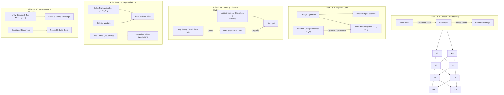
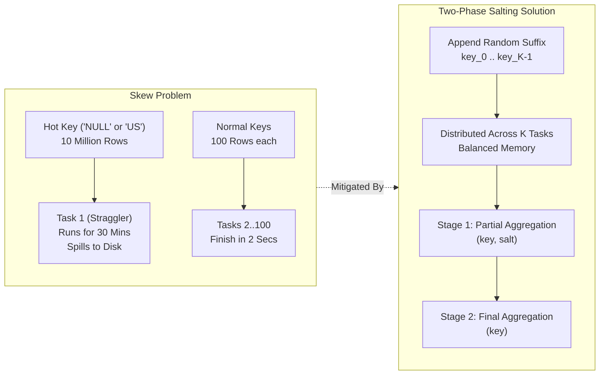
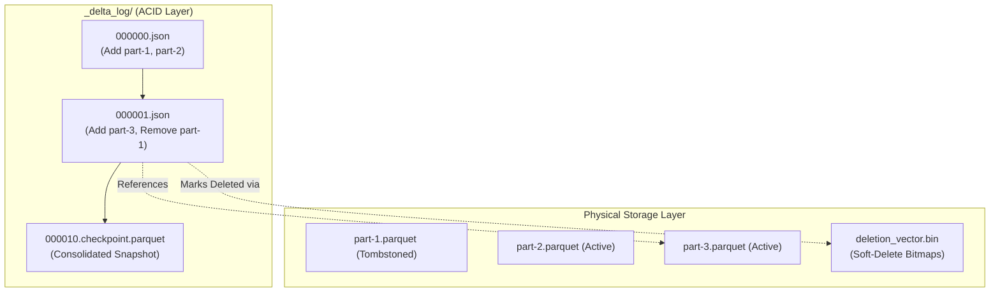
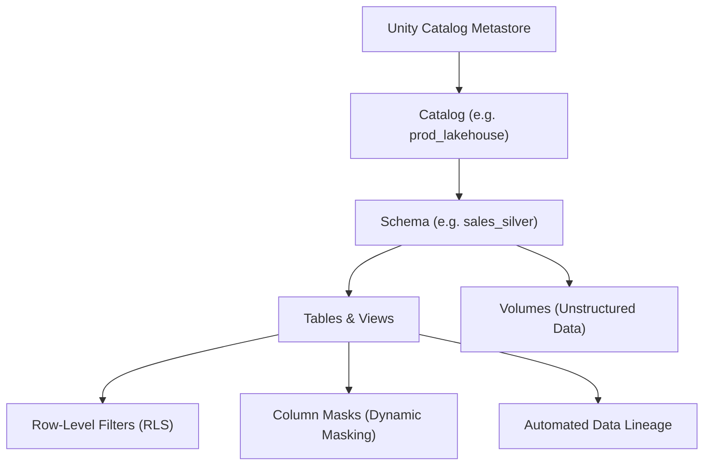

# Databricks, Apache Spark & Lakehouse Architectural Encyclopedia (200 Concepts)

This encyclopedia is organized into **10 logical architectural pillars**, progressing from cluster fundamentals to query optimization, data skew mitigation, storage engine internals, and modern Databricks Lakehouse governance.

---

---

## Pillar 1: Distributed Core & Cluster Architecture (1–20)

1. **Driver Node**: The central master JVM process responsible for instantiating the SparkSession, creating the DAG, coordinating task scheduling, and tracking distributed metadata.
2. **Executor**: A distributed worker process running on cluster nodes that executes assigned tasks, stores cached partitions, and writes shuffle outputs to local disk.
3. **Cluster Manager**: The infrastructure orchestrator (YARN, Kubernetes, or Databricks Standalone) that manages worker resources and provisions executor containers.
4. **Cores / Slots**: Virtual processing units on an executor. Each core executes exactly one task at any given time.
5. **JVM Heap**: Memory allocated to the executor's Java Virtual Machine, split between user objects, execution space, and storage cache.
6. **Off-Heap Memory**: Direct system memory allocated outside the JVM garbage collector, eliminating GC pauses for Tungsten operations.
7. **Directed Acyclic Graph (DAG)**: The computational blueprint representing the dependency flow of transformations without cycles.
8. **Stage**: A physical segment of a DAG bounded by wide transformations (shuffles). Tasks within a stage run in parallel without network exchange.
9. **Task**: The smallest atomic unit of distributed work sent to an executor core, operating on a single partition of data.
10. **Narrow Transformation**: An operation (e.g., `select`, `filter`, `withColumn`) where each partition depends on at most one parent partition, requiring zero network movement.
11. **Wide Transformation**: An operation (e.g., `groupBy`, `distinct`, `join`) where output partitions depend on multiple input partitions, forcing a cluster-wide shuffle.
12. **Lazy Evaluation**: The paradigm where transformations build a logical execution plan without executing until an action (e.g., `count`, `save`) triggers the DAG.
13. **Pipelining**: The execution technique where multiple narrow transformations are collapsed and executed consecutively in a single CPU instruction loop.
14. **Job**: The entire end-to-end execution flow triggered by a single user action (e.g., `.collect()` or `.write.save()`).
15. **RDD Lineage**: The recorded graph of parent-child dependencies enabling Spark to reconstruct lost partitions without restarting the entire computation.
16. **TaskScheduler**: The internal engine component that takes stages from the DAGScheduler and assigns individual tasks to available executor slots based on data locality.
17. **BlockManager**: An internal memory-and-disk manager running on driver and executors that handles storing, retrieving, and replicating blocks of cached data and shuffle files.
18. **Single-Node Cluster**: A Databricks cluster mode where driver and worker run on the same virtual machine, intended for single-threaded Python or small data exploration.
19. **Standard Autoscaling Cluster**: A Databricks cluster that dynamically scales executor nodes up or down based on workload demand while keeping driver static.
20. **Driver Bottlenecks**: Performance slowdowns caused by driver CPU or RAM saturation, typically triggered by large `.collect()`, massive broadcast joins, or high partition counts.

---

## Pillar 2: Partitioning, Shuffling & Data Distribution (21–40)

21. **Partition**: A logical, physical slice of a distributed dataset processed by a single task on an executor thread.
22. **Shuffle (Shuffle Exchange)**: The redistribution of data across cluster nodes over the network to align identical keys into common partitions.
23. **Hash Partitioning**: Distributing data using `murmur3_hash(key) % num_partitions` to ensure rows with the same key reside in the same target partition.
24. **Range Partitioning**: Sampling dataset distribution to allocate contiguous sorted value ranges across partitions (used by `orderBy` and `sort`).
25. **Round-Robin Partitioning**: Distributing records cyclically across partitions regardless of column values, balancing task load evenly.
26. **Coalesce**: Reducing partition count by merging adjacent partitions on the same node without triggering a full network shuffle.
27. **Repartition**: Explicitly reshuffling data across the cluster to change the partition count or redistribute data based on new partition keys.
28. **Sort Shuffle**: Spark's default shuffle implementation that writes an index file and a single sorted data file per map task to local disk.
29. **Shuffle Spill**: Writing shuffle data to worker disk when the in-memory shuffle buffer is exhausted before writing the final sorted shuffle file.
30. **External Shuffle Service (ESS)**: A standalone process on worker nodes that serves shuffle files to downstream tasks even if the executor that generated them is shut down.
31. **Push-Based Shuffle (Magnet)**: Pushing intermediate shuffle blocks directly to remote merger executors to convert random disk reads into sequential reads.
32. **Map-Side Combine**: Performing preliminary aggregation on local mapper partitions before sending records across the network (e.g., `reduceByKey`).
33. **`spark.sql.shuffle.partitions`**: Configuration controlling the default number of partitions created after a wide transformation (default is `200`).
34. **Data Locality (`PROCESS_LOCAL`)**: Running a task inside the exact same JVM where the cached data block already resides.
35. **Data Locality (`NODE_LOCAL`)**: Running a task on the same physical host machine where data resides (e.g., in OS page cache or HDFS), requiring intra-node data transfer.
36. **Data Locality (`RACK_LOCAL`)**: Running a task on a different node within the same network rack.
37. **Dynamic Partition Pruning (DPP)**: Using the filter from a small broadcast dimension table at runtime to prune non-matching partitions from a large partitioned fact table.
38. **Dynamic Partition Coalescing (AQE)**: An Adaptive Query Execution rule that merges undersized post-shuffle partitions automatically to avoid tiny-task scheduling overhead.
39. **Bucketing**: Pre-sorting and pre-hashing data into fixed storage buckets on disk, eliminating future shuffles during joins on those bucketed keys.
40. **Target Partition Size**: The golden rule of distributed performance: keeping post-shuffle partitions between $100\text{ MB}$ and $200\text{ MB}$ uncompressed.

---

## Pillar 3: Query Engines & Optimization (41–60)

41. **Catalyst Optimizer**: Spark's core optimization framework that parses, resolves, optimizes, and compiles SQL queries and DataFrame operations.
42. **Unresolved Logical Plan**: The initial abstract syntax tree (AST) where table and column names have not yet been validated against the catalog.
43. **Analyzed Logical Plan**: The AST after catalog lookup where column references, data types, and functions are validated.
44. **Optimized Logical Plan**: The plan after Catalyst applies rule-based rewrites such as predicate pushdown, projection pruning, and constant folding.
45. **Physical Plan**: The actionable blueprint specifying exact algorithms (e.g., SortMergeJoin vs. BroadcastHashJoin) for each operation.
46. **Project Tungsten**: Low-level engine optimizations focused on hardware efficiency, including off-heap binary data formats and L1/L2/L3 CPU cache-aware algorithms.
47. **Whole-Stage Code Generation (WSCG)**: Synthesizing entire pipeline stages into clean Java bytecode loops at runtime, eliminating virtual function call overhead.
48. **Cost-Based Optimizer (CBO)**: Utilizing table and column statistics (cardinalities, histograms, distinct counts) to determine optimal join order and join algorithms.
49. **Adaptive Query Execution (AQE)**: Re-optimizing physical query plans dynamically between stages using real-time shuffle statistics.
50. **Predicate Pushdown**: Evaluating filter conditions directly inside the storage layer (e.g., Parquet reader) to avoid loading unneeded rows into memory.
51. **Projection Pruning**: Discarding unreferenced columns at the scan layer to reduce I/O and memory deserialization overhead.
52. **Vectorized Parquet Reader**: Reading column chunks directly into memory arrays in contiguous blocks using SIMD CPU instructions.
53. **Photon Engine**: Databricks' native C++ vectorized execution engine that replaces the JVM execution layer for high-throughput SQL workloads.
54. **Spark UI SQL Tab**: The visual DAG representation displaying physical operators, row counts, execution timings, and memory spills for SQL queries.
55. **Janino Compiler**: The embedded Java compiler used by Spark to compile generated bytecode strings into runnable classes on the fly.
56. **Rule-Based Optimization (RBO)**: Applying fixed pattern-matching heuristic rules to rewrite query trees into mathematically equivalent faster representations.
57. **Subquery Decoupling**: Pulling correlated subqueries out of inner loops and converting them into efficient semi-joins or outer joins.
58. **Join Reordering**: A CBO optimization that arranges multi-table joins to execute the most selective, size-reducing joins first.
59. **Constant Folding**: Evaluating static mathematical or logical expressions during compilation (e.g., `1 + 1` replaced by `2`) before execution.
60. **Abstract Syntax Tree (AST)**: The hierarchical tree structure representing the grammatical and logical syntax of a parsed query.

---

## Pillar 4: Join Strategies & Relational Mechanics (61–80)

61. **Broadcast Hash Join (BHJ)**: Replicating the smaller table to all executors to build an in-memory hash table, eliminating any shuffle on the large table.
62. **`spark.sql.autoBroadcastJoinThreshold`**: Threshold (default $10\text{ MB}$) under which Catalyst automatically converts a join into a Broadcast Hash Join.
63. **Broadcast Variable**: An immutable shared object copied to each executor once via a peer-to-peer protocol, avoiding re-sending with every task.
64. **Sort-Merge Join (SMJ)**: Shuffling both tables on the join keys, sorting each partition by key, and merging matching streams sequentially.
65. **Shuffle Hash Join (SHJ)**: Shuffling both datasets on the join keys and building a hash map from the smaller partition in memory without pre-sorting.
66. **Broadcast Nested Loop Join (BNLJ)**: Broadcasting one side and performing an $O(N \times M)$ nested loop; standard fallback for non-equi joins.
67. **Cartesian Product (Cross Join)**: Generating all possible pairings between two tables, causing quadratic data expansion.
68. **`spark.sql.crossJoin.enabled`**: Safety configuration flag that must be set to `true` to allow Cartesian products, preventing accidental cluster saturation.
69. **Equi-Join**: A join condition based strictly on equality (`tableA.id = tableB.id`), enabling hash and sort-merge joins.
70. **Non-Equi-Join**: A join condition using inequality or range comparisons (`tableA.val >= tableB.start`), often triggering slow nested loop evaluations.
71. **Left Semi-Join**: Returning rows from the left table where matching keys exist in the right table without duplicating left rows or including right columns.
72. **Left Anti-Join**: Returning only rows from the left table that have zero matching keys in the right table.
73. **Full Outer Join**: Shuffling and merging both tables to return all matched rows, plus unmatched rows from both sides filled with `NULL`s.
74. **Star-Join**: Joining a massive central fact table with multiple small dimension tables, highly optimized via simultaneous broadcast joins.
75. **Bloom Filter Join**: Constructing an in-memory probabilistic bit array on the join key to filter out non-matching fact table rows before shuffling.
76. **Hash Join Build Phase**: Scanning the smaller dataset partition and populating an in-memory hash map indexed by the join key.
77. **Hash Join Probe Phase**: Streaming rows from the larger dataset partition through the built hash table to find matches.
78. **Bucket Join Elimination**: Bypassing both shuffle and sort operations when joining two tables pre-bucketed and pre-sorted on the same key with identical bucket counts.
79. **Range Join Optimization**: Replacing nested-loop range joins with interval tree lookups or bucketed point-in-range evaluation.
80. **Distributed Merge Sort**: Sorting individual partitions locally and merging them hierarchically across the cluster to produce a globally ordered dataset.

---

## Pillar 5: Memory Management, OOM & Performance Triage (81–100)

81. **Unified Memory Management**: Spark's dynamic memory model sharing a unified pool between Execution (shuffles/joins) and Storage (caching).
82. **Execution Memory**: Ephemeral RAM reserved for runtime buffers (hash maps, sorters); execution memory cannot be forcefully evicted by storage memory.
83. **Storage Memory**: RAM reserved for cached DataFrames and broadcast tables; can be evicted to disk if execution memory requires space.
84. **`spark.memory.fraction`**: Fraction of executor JVM heap allocated to the unified memory pool (default is `0.6` or $60\%$).
85. **`spark.memory.storageFraction`**: Sub-fraction of unified memory immune to eviction by execution tasks (default is `0.5` or $50\%$).
86. **`spark.executor.memoryOverhead`**: Non-JVM memory reserved for OS page cache, native off-heap libraries, and PySpark daemons (default $\approx 10\%$).
87. **Executor OOM (Exit Code 137)**: Container termination by YARN/Kubernetes because combined memory (JVM Heap + Memory Overhead) exceeded container allocation.
88. **Driver OOM (Heap Exhaustion)**: Driver crash caused by collecting too much data (`df.collect()`), over-broadcasting large tables, or tracking millions of partition metrics.
89. **Garbage Collection (G1GC) Pauses**: Long JVM stop-the-world pauses occurring when millions of small Java objects saturate the young/old generations.
90. **Spill to Memory**: The raw, uncompressed byte size of data transferred from internal execution structures before serialization to disk.
91. **Spill to Disk**: The compressed byte size of spilled data physically written to worker local storage (`/local_disk`).
92. **ExternalAppendOnlyMap**: The internal memory structure used by Spark aggregations that spills sorted key-value runs to disk upon saturation.
93. **Unroll Memory**: Memory borrowed temporarily by an executor thread to deserialize a data block to verify if it fits in cache before storing.
94. **Persistence Level `MEMORY_ONLY`**: Storing deserialized Java objects in memory only; partitions that do not fit are recomputed when needed.
95. **Persistence Level `MEMORY_AND_DISK`**: Storing deserialized objects in memory, spilling excess partitions to local disk instead of recomputing.
96. **LRU Cache Eviction**: Least Recently Used algorithm that drops oldest cached blocks from storage memory when memory pressure spikes.
97. **Speculative Execution**: Launching redundant copies of slow tasks on alternative healthy nodes and taking the result of whichever finishes first.
98. **Straggler Task**: A single task within a stage that runs exponentially slower than all sibling tasks, usually caused by data skew or hardware degradation.
99. **CPU Starvation**: Cluster state where all worker cores are saturated by long-running or skewed stages, blocking queued downstream jobs.
100. **Node Decommissioning**: Graceful migration of cached blocks and shuffle files off a node before terminating it during cluster autoscaling.

---

## Pillar 6: Data Skew, Key Distribution & Salting Mechanics (101–120)

101. **Data Skew**: The disproportionate concentration of data records into a small subset of partition keys across a distributed dataset.
102. **Key Skew**: A specific scenario where a handful of distinct keys represent the majority of records in a table.
103. **Partition Skew**: The uneven distribution of byte volume across post-shuffle partitions, causing one or few tasks to process gigabytes while others process megabytes.
104. **Hotspotting**: Overwhelming a single worker node or storage partition with disproportionate read/write traffic due to skewed access patterns.
105. **Null Key Skew**: Skew caused by missing, unpopulated, or default values (`NULL`, `-1`, `UNKNOWN`) that all hash to the exact same partition.
106. **Key Salting**: Appending a pseudo-random integer suffix ($0 \dots K-1$) to a hot key to force the hash function to distribute records across $K$ partitions.
107. **Salt Factor ($K$)**: The integer range determining how many sub-partitions a skewed key is divided into.
108. **Two-Phase Salting Aggregation**: A two-step aggregation pattern: first grouping by `(key, salt)` to compute partial aggregates, then grouping by `key` to compute final aggregates.
109. **Over-Salting**: Choosing a salt factor $K$ that is unnecessarily high, creating excess small tasks and multiplying join dimension tables into memory exhaustion.
110. **Under-Salting**: Choosing a salt factor $K$ that is too small, leaving sub-partitions large enough to still trigger disk spilling.
111. **Blind Salting**: Inefficiently appending salt to every row in a table instead of filtering and salting only the verified skewed keys.
112. **Selective Salting**: Using a conditional statement (`when(col("key").isin(...))`) to append salt only to the top $0.1\%$ hot keys while leaving the remaining $99.9\%$ unchanged.
113. **Join Key Replication**: In a salted join, replicating every row of the non-skewed join partner table by $K$ times so it matches all possible random salted suffixes.
114. **AQE Skew Join Optimization**: Automatic runtime detection of skewed partitions in Spark 3.x+ that splits hot partitions into sub-slices without manual salting code.
115. **`spark.sql.adaptive.skewJoin.skewedPartitionFactor`**: The ratio (default `5`) by which a partition's size must exceed median partition size to be marked skewed.
116. **`spark.sql.adaptive.skewJoin.skewedPartitionThresholdInBytes`**: The absolute minimum size (default $256\text{ MB}$) a partition must exceed to trigger AQE skew splitting.
117. **Straggler Detection in Spark UI**: Identifying skew by comparing the 75th percentile and maximum task execution time and shuffle read bytes in the Stage Detail view.
118. **Two-Phase Grouping Sets**: Distributing multi-dimensional rollups and cube operations by pre-aggregating high-cardinality keys before expanding grouping sets.
119. **Skew on Window Functions**: Skew occurring when a `WINDOW ... PARTITION BY key` concentrates millions of rows into a single ordered task.
120. **Explode Expansion Trap**: Using `explode()` on deeply nested JSON arrays that multiplies a single input row into thousands of rows within memory.

---

## Pillar 7: Delta Lake 3.x, Storage Formats & ACID Lakehouse (121–145)

121. **Lakehouse Architecture**: An architecture combining the ACID transactions, data governance, and reliability of data warehouses with the low-cost scalability of cloud object lakes.
122. **Delta Lake**: An open-source storage framework built on Parquet that brings ACID transactions, versioning, and metadata management to data lakes.
123. **Delta Transaction Log (`_delta_log`)**: An ordered, append-only commit history of JSON and checkpoint Parquet files serving as the single source of truth for table state.
124. **Atomic Commit**: A transaction protocol ensuring an entire data write operation either succeeds completely or fails with zero changes written to the table.
125. **Optimistic Concurrency Control (OCC)**: Concurrency management assuming write transactions will not conflict, validating at commit time and retrying if conflicts occur.
126. **Write Conflict Resolution**: Automatic reconciliation in Delta Lake when concurrent writers touch disjoint partitions or mutually exclusive operations.
127. **Time Travel**: The ability to query historical snapshots of a Delta table using commit versions (`VERSION AS OF`) or timestamps (`TIMESTAMP AS OF`).
128. **Snapshot Isolation (MVCC)**: Ensuring readers always see a consistent, point-in-time snapshot of data isolated from concurrent write transactions.
129. **Parquet Format**: An open-source columnar storage format organizing data into row groups and column chunks with embedded metadata and statistics.
130. **Row Group**: A logical horizontal partition of data within a Parquet file (typically $128\text{ MB} - 512\text{ MB}$) containing column chunks.
131. **Column Chunk**: The contiguous byte data for a single column within a specific row group, enabling selective column reading.
132. **Dictionary Encoding**: Replacing repeated string or high-cardinality values with small integer keys, significantly shrinking file size.
133. **Run-Length Encoding (RLE)**: Compressing contiguous identical values into a value-and-count pair, highly effective on pre-sorted data.
134. **Min-Max Statistics Pruning**: Using min/max column values stored in Parquet file footers and Delta logs to skip irrelevant files during query scans.
135. **Small File Problem**: The accumulation of thousands of sub-megabyte files causing severe object storage metadata overhead and slow query listing.
136. **`OPTIMIZE` (Bin-Packing)**: A Delta Lake command that compacts fragmented small files into larger, uniform target files (typically $1\text{ GB}$).
137. **Z-Ordering (Hilbert Curve)**: Multi-dimensional data clustering that co-locates related data along a space-filling curve to maximize data skipping across multiple columns.
138. **Liquid Clustering (`CLUSTER BY`)**: The modern replacement for Hive partitioning and Z-ordering in Delta 3.x that adapts clustering dynamically without rewriting existing data.
139. **Deletion Vectors (DVs)**: Soft-deletion markers written as compact bitmaps alongside Parquet files, allowing `UPDATE`, `DELETE`, and `MERGE` operations without rewriting data files.
140. **Copy-on-Write (CoW)**: Rewriting an entire data file whenever any single record inside it is modified or deleted.
141. **Merge-on-Read (MoR)**: Appending delta log files containing row changes and reconciling them dynamically with base files at query read time.
142. **Change Data Feed (CDF)**: Delta Lake's native capability to stream row-level change events (`insert`, `update_preimage`, `update_postimage`, `delete`) to downstream consumers.
143. **Schema Evolution**: Automatically adding newly observed columns to an existing Delta table schema without breaking existing data pipelines (`mergeSchema = true`).
144. **Schema Enforcement**: Rejecting write operations that contain columns or data types that do not match the declared schema of the target Delta table.
145. **`VACUUM`**: Purging data files that are no longer referenced by the latest table snapshot and are older than the retention threshold (default 7 days).

---

## Pillar 8: Databricks Platform, Lakeflow & Orchestration (146–170)

146. **Databricks Control Plane**: The Databricks-managed infrastructure hosting the web UI, cluster manager coordinator, workspace notebooks, and metadata services.
147. **Databricks Data Plane**: The customer's cloud VPC/VNet where compute clusters run and where data files reside on object storage (ADLS, S3, GCS).
148. **Classic Compute**: Clusters deployed into virtual machines inside the customer's cloud account where cluster startup requires full VM provisioning time.
149. **Serverless Compute**: Elastic, instant compute managed by Databricks in a secure network boundary that spins up in seconds and auto-terminates immediately when idle.
150. **Databricks Runtime (DBR)**: The optimized enterprise software image containing Apache Spark, Photon, optimized cloud connectors, and machine learning runtimes.
151. **Delta Live Tables (DLT)**: A declarative ETL framework for building reliable, maintainable data pipelines with automated orchestration, scaling, and quality checks.
152. **DLT Expectations**: Data quality constraints defined directly in DLT pipelines with configurable actions: `expect` (warn), `expect or drop`, or `expect or fail`.
153. **Medallion Architecture**: The standardized lakehouse data design pattern consisting of Bronze (raw ingestion), Silver (cleaned/curated), and Gold (aggregated business-level) tables.
154. **Auto Loader (`cloudFiles`)**: An incremental cloud ingestion source that reliably processes new files arriving in object storage using file notification services without directory scanning.
155. **Schema Inference & Evolution in Auto Loader**: Automatically inferring incoming JSON/CSV data structures and adapting schema dynamically without human intervention.
156. **Rescued Data Column (`_rescued_data`)**: An automatic JSON column in Auto Loader capturing unexpected, un-parseable, or schema-violating fields so zero data is lost.
157. **Databricks SQL (DBSQL) Warehouses**: Purpose-built, highly-optimized SQL compute engines designed for low-latency BI queries and interactive dashboarding.
158. **Serverless DBSQL**: SQL warehouses that boot in under 5 seconds with automatic query queuing, autoscaling, and zero management overhead.
159. **Databricks Asset Bundles (DABs)**: An Infrastructure-as-Code (IaC) CI/CD framework for packaging, testing, and deploying Databricks projects as declarative YAML bundles.
160. **`dbutils.notebook.run()`**: A utility function to execute another workspace notebook as a child task, returning exit values to the parent caller.
161. **Databricks Workflows (Jobs)**: A fully managed orchestration service for scheduling DAG-based multi-task data pipelines, notebooks, and DLT runs.
162. **Multi-Task Jobs**: An orchestration pattern where multiple tasks (SQL, Python, JAR, DLT) are executed with explicit task-level dependency DAGs.
163. **Cluster Policies**: Administrative rules governing cluster creation (enforcing instance types, max auto-termination limits, and required tags) for cost governance.
164. **Init Scripts**: Shell scripts executed on cluster worker nodes during boot to install OS packages, configure network proxies, or set environment variables.
165. **Instance Pools**: A pre-warmed set of idle cloud virtual machines that reduce cluster spin-up time from minutes to seconds.
166. **Databricks Repos / Git Folders**: Integration allowing workspace users to clone Git repositories, develop on branches, and commit code directly within Databricks.
167. **Lakehouse Monitoring**: Built-in monitoring tools that track data quality drift, schema changes, and statistical profiles across Delta tables over time.
168. **Databricks Apps**: Serverless hosting environment within Databricks for running custom Streamlit, Dash, or Flask data applications with native Unity Catalog security.
169. **System Tables**: Databricks-provided analytical tables (`system.billing.usage`, `system.access.audit`) for querying cluster costs, user queries, and audit logs.
170. **Clean Rooms**: A secure collaboration environment enabling multiple organizations to join and analyze sensitive data without sharing raw underlying records.

---

## Pillar 9: Unity Catalog, Governance & Security (171–185)

171. **Unity Catalog (UC)**: The unified data and AI governance solution providing centralized access control, auditing, data lineage, and discovery across all Databricks workspaces.
172. **3-Tier Namespace**: The standardized object addressing convention: `catalog.schema.table` (e.g., `prod_lakehouse.finance_silver.daily_ledger`).
173. **Metastore**: The top-level metadata container in Unity Catalog that registers data assets and permission boundaries across one or more workspaces in a region.
174. **Storage Credential**: A managed cloud identity (Azure Managed Identity, AWS IAM Role) registered in UC to access underlying cloud object stores without embedded keys.
175. **External Location**: A securable object linking a storage credential to a specific cloud storage URI (`abfss://...` or `s3://...`).
176. **Managed Table**: A Delta table where Unity Catalog fully manages both the metadata and the underlying physical data lifecycle (dropping the table deletes physical data).
177. **External Table**: A table where Unity Catalog manages metadata, but the underlying data resides at a custom cloud path (dropping the table leaves data files intact).
178. **Unity Catalog Volumes**: Securable objects in UC representing logical directories of non-tabular data (images, audio, PDF, CSV, Parquet files).
179. **Dynamic Data Masking**: Applying SQL functions to mask sensitive columns (e.g., PII, credit cards) for unauthorized users while showing cleartext to admins.
180. **Row-Level Security (Row Filters)**: Securing data by applying SQL predicate functions that filter which rows a user can see based on their group membership.
181. **Automated Runtime Lineage**: Built-in tracking capturing table-level and column-level data lineage across notebooks, jobs, and SQL queries down to the exact transformation.
182. **Delta Sharing**: An open, cross-platform protocol for securely sharing live data and AI assets across different organizations and data platforms without copying data.
183. **Lakehouse Federation**: Querying external relational databases (PostgreSQL, Snowflake, BigQuery, SQL Server) directly through Unity Catalog without ETL data movement.
184. **Unity Catalog REST API**: Open standard APIs enabling external data catalogs and enterprise tools to read and register Unity Catalog assets.
185. **Privilege Inheritance**: Security architecture where permissions granted at the catalog level cascade down automatically to child schemas and tables.

---

## Pillar 10: Structured Streaming, State Management & FinOps (186–200)

186. **Structured Streaming**: A scalable, fault-tolerant stream processing engine built on the Spark SQL engine, expressing streaming computations as continuous table queries.
187. **Micro-Batch Processing**: The default execution engine in Structured Streaming that processes data streams as a continuous sequence of small, discrete RDD batches.
188. **Continuous Processing Mode**: A low-latency ($< 1\text{ ms}$) streaming engine that continuously processes incoming records with epoch-based checkpointing.
189. **Event-Time**: The time when an event physically occurred at the source device, embedded within the data payload itself.
190. **Processing-Time**: The wall-clock time when the distributed processing engine receives and processes the event.
191. **Watermarking**: A moving threshold calculated as $\max(\text{event\_time}) - \text{delay}$ defining how long the engine will wait for delayed, late-arriving data.
192. **Late-Arriving Data**: Records arriving with an event-time older than the current watermark, automatically dropped by stateful aggregation operators.
193. **Stateful Streaming**: Maintaining historical computational state across micro-batches (e.g., stream-stream joins, deduplication, running aggregations).
194. **RocksDB State Store**: An embedded, off-heap key-value store used to hold massive state datasets without creating JVM garbage collection pressure.
195. **HDFSBackedStateStore**: The default state store holding streaming state directly in JVM heap memory, suitable only for small-state workloads.
196. **Streaming Checkpointing**: Persisting stream read offsets, state variables, and transaction logs to cloud storage to enable complete restartability after failure.
197. **Write-Ahead Log (WAL)**: An append-only log recording committed stream offsets before processing to guarantee recoverability.
198. **Idempotent Sink**: A target storage system (such as Delta Lake) that can re-write identical streaming micro-batches after failure without introducing duplicates.
199. **Databricks Units (DBU)**: The normalized unit of compute processing capacity billed per second used by Databricks across cluster tiers.
200. **Spot / Preemptible Instances**: Utilizing discounted cloud VMs for executor nodes to cut compute costs by up to $70\%$, paired with on-demand driver nodes for stability.
